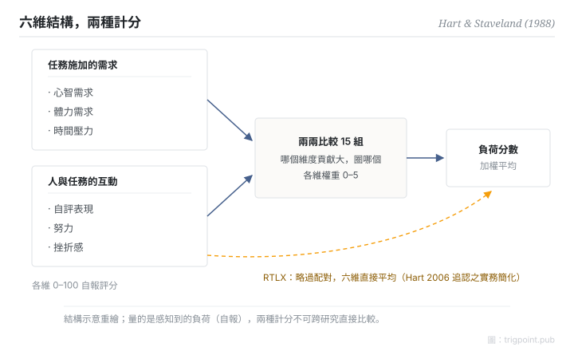

Canonical: https://trigpoint.pub/zh-Hant/collections/hai/mental-workload-nasa-tlx  
Captured: 2026-10-05T03:32:19.535922+08:00

> 公開理論閱讀鏡像。驗證層及 Lab 案例請到原站閱讀。

負荷看不見只能自評，但一個總分又看不出負荷從哪裡來。

# 心智負荷

mental workload (NASA-TLX) · Hart & Staveland (1988)

書目已核 ✓  
Lab 實測 ✓  
人機自動化 · 負荷量測

## 三句講透

NASA-TLX 把量不到的「心智負荷」拆成六個可評維度：心智需求、體力需求、時間壓力、自評表現、努力、挫折感，再由受測者兩兩比較定出各維權重，加權合成分數。  
它量的是感知到的負荷：屬自報量測，跟客觀讀數是兩回事。  
用它的前提是承認這一點。

<strong>圖 1</strong> · NASA-TLX 結構示意。  
六維分兩組：任務施加的需求（心智、體力、時間壓力）與人和任務的互動（自評表現、努力、挫折感）。  
原設計以十五組兩兩比較定權重後加權平均，後世常用簡化為直接平均（RTLX）。  
六維命名經 NASA 官方手冊一手核對。

## 一、發生什麼事

要量一件看不見的東西，只能問經歷它的人。1988 年，NASA Ames 的 Hart 與 Staveland 把三年的研究成果收成一套量表（NASA 官方手冊記載為四十餘個實驗）[\[1\]](#reference-note-1)。出發點是單一總分太粗：掩蓋負荷來源，人與人之間變異又大。改法是六維各自 0 至 100 評分，再用十五組兩兩比較讓受測者自己定權重：哪個維度對這件任務的負荷貢獻大，圈哪個。加權平均，得一個負荷分數。二十年後，Hart 回顧五百五十篇使用或評論它的研究：最常見的修改是省去配對加權、六維直接平均，即 Raw TLX；在他回顧的比較研究中，兩版的敏感度結果不一致，他的看法是兩者可任選[\[2\]](#reference-note-2)。

<strong>署名要給對：</strong>Hart 與 Staveland（1988）是 NASA-TLX 這套工具的原創者：六維結構和配對加權程序都出自這份章節。「mental workload」構念本身更早，不歸他們名下。RTLX 是後世實務簡化版，Hart（2006）回顧時追認；引用時要講清楚用的是哪個版本。

## 二、為什麼這對你重要

管理自己或團隊的負荷，第一課是 TLX 的結構課：負荷是多維的，總分會騙人。時間壓力爆錶和挫折感爆錶是兩種完全不同的問題，混成一個「很累」分數就無從對症。第二課是誠實課：任何自報負荷都是主觀量測，跟客觀產出可以脫節，兩邊都要看。報分數不聲明計法（加權還是直接平均），等於方法漏報。

適用邊界：分數是回溯式自報，不是客觀負荷讀數，也推不出情境覺知；加權版與平均版不可跨研究直接比較；1988 章節本體未核。

## 參考文獻

<strong>如何閱讀來源註記</strong> 「書目經…核對」指作者、年份、題名與出版項已確認；不代表該來源的主張已被核對。「對照全文核實」指主張已與來源文本本身比對。 定義版本：2026-09-20。

- \[1\] Hart, S. G., & Staveland, L. E. (1988). Development of NASA-TLX (Task Load Index): Results of Empirical and Theoretical Research. In P. A. Hancock & N. Meshkati (Eds.), Human Mental Workload (pp. 139–183). Amsterdam: North-Holland. https://doi.org/10.1016/S0166-4115(08)62386-9
- \[2\] Hart, S. G. (2006). NASA-Task Load Index (NASA-TLX); 20 Years Later. Proceedings of the Human Factors and Ergonomics Society Annual Meeting, 50(9), 904–908. https://doi.org/10.1177/154193120605000909

## 知識圖譜

- [<em>應用於 ▸</em>自動化等級（LOA）](levels-of-automation.md)
- [<em>對照 ▸</em>情境覺知](situation-awareness.md)

引用格式：Trigpoint，〈心智負荷〉，trigpoint.pub/zh-Hant/collections/hai/mental-workload-nasa-tlx · © Strategitect Limited. · 內容最後修訂 2026-09-28

## 來源註記

**[1]** Hart, S. G., & Staveland, L. E. (1988). Development of NASA-TLX (Task Load Index): Results of Empirical and Theoretical Research. In Hancock & Meshkati (Eds.), Human Mental Workload (pp. 139–183). North-Holland. 書目經多源交叉核對。已對照官方手冊核實。

**[2]** Hart, S. G. (2006). NASA-Task Load Index (NASA-TLX); 20 Years Later. Proceedings of the Human Factors and Ergonomics Society Annual Meeting, 50(9), 904–908. 書目經多源交叉核對。

---

[English](../../../en/collections/hai/mental-workload-nasa-tlx.md) · [简体中文](../../../zh-Hans/collections/hai/mental-workload-nasa-tlx.md)

[Index](../../README.md) · [Original page](https://trigpoint.pub/zh-Hant/collections/hai/mental-workload-nasa-tlx) · [Citation and versions](../../../READING.md)

[Original SVG](assets/mental-workload-nasa-tlx.svg) · Display copy adds a white background only.
