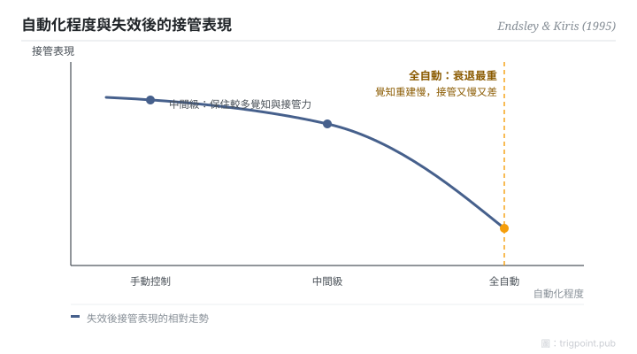

Canonical: https://trigpoint.pub/zh-Hant/collections/hai/out-of-the-loop  
Captured: 2026-10-05T03:32:19.991305+08:00

> 公開理論閱讀鏡像。驗證層及 Lab 案例請到原站閱讀。

導航任務中自動化失效，全自動組的人接管得最差。

# 脫離迴路

out-of-the-loop performance problem · Endsley & Kiris (1995)

摘要已核 ✓  
人機自動化 · 情境覺知

## 三句講透

自動化把人從操作者變成旁觀者，情境覺知和手感同時流失。  
一切正常時，這個損耗看不見，也沒有成本。  
直到系統出錯需要接管：情境理解下降、失效後的決策變慢，這就是脫離迴路績效問題。

<strong>圖 1</strong> · 自動化程度與失效後接管表現的相對走勢。  
Endsley 與 Kiris 的實驗顯示，全自動組的接管衰退最重，中間級別保住較多覺知與接管能力。  
示意走勢重繪；一手數據未核，只標相對走勢，不標數值。

## 一、發生什麼事

自動化運作正常時，旁邊的人只需要看；一旦失效，就要立刻接手。1995 年，Endsley 與 Kiris 用受控實驗把這個問題釘實：同一個導航決策任務，控制層級分五級操弄，然後讓自動化失效，量接管表現[\[1\]](#reference-note-1)。結果：全自動組的接管衰退最重，中間級別反而保住較多覺知和接管能力。更重要的是機制。依 Endsley 1996 年書章對該實驗的轉述，各組的顯示資訊並未改變，警覺與監控的效應也不足以解釋覺知的下降；作者認為最可能的肇因，是人由主動處理變成被動接收這件事本身。把 doer 換成 observer，這個動作自己就降覺知。

<strong>署名要給對：</strong>「人離開迴路後偵測故障變慢」屬這個概念的定義與前史。Endsley 1996 年書章把 Young（1969）、Wickens 與 Kessel（1979）、Ephrath 與 Young（1981）、Kessel 與 Wickens（1982）並列為此前的相關研究，各篇本頁未逐項核對，結果方向依任務複雜度而異。Endsley 與 Kiris（1995）的貢獻是命名形式化，加上以控制層級為變項的受控實驗；該實驗量到的是理解下降與失效後決策耗時增加，偵測變慢不是它的量測項。

## 二、為什麼這對你重要

「有事我隨時接手」是自動化工作流最常見的自我安慰。接手的前提是你對現場還有理解，而理解正是被全自動偷走的東西。所以高自動化的工作線只有兩條誠實的路：刻意保留人參與決策的環節（中間級別），或者接受接管會又慢又差，並為此預留緩衝。兩樣都不做，等於把系統可靠性押在一個已經離場的人身上。

適用邊界：結論不是「自動化越少越好」，而是人是否留在主動決策迴路；本頁對 1995 年正文只到結論級，需要原文措辭或頁碼者請自行取得全文。

## 參考文獻

<strong>如何閱讀來源註記</strong> 「書目經…核對」指作者、年份、題名與出版項已確認；不代表該來源的主張已被核對。「與摘要一致」指主張與論文摘要相符；不含逐句對照全文。 定義版本：2026-09-20。

- \[1\] Endsley, M. R., & Kiris, E. O. (1995). The Out-of-the-Loop Performance Problem and Level of Control in Automation. Human Factors: The Journal of the Human Factors and Ergonomics Society, 37(2), 381–394. https://doi.org/10.1518/001872095779064555
- \[2\] Endsley, M. R. (1996). Automation and Situation Awareness. In R. Parasuraman & M. Mouloua (Eds.), Automation and Human Performance: Theory and Applications (pp. 163–181). Mahwah, NJ: Lawrence Erlbaum Associates. https://doi.org/10.1201/9781315137957

## 知識圖譜

- [<em>前置 ▸</em>情境覺知](situation-awareness.md)
- [<em>前置 ▸</em>自動化等級（LOA）](levels-of-automation.md)
- [<em>被應用 ▸</em>適應性自動化](adaptive-automation.md)

引用格式：Trigpoint，〈脫離迴路〉，trigpoint.pub/zh-Hant/collections/hai/out-of-the-loop · © Strategitect Limited. · 內容最後修訂 2026-09-28

## 來源註記

**[1]** Endsley, M. R., & Kiris, E. O. (1995). The Out-of-the-Loop Performance Problem and Level of Control in Automation. Human Factors, 37(2), 381–394. 書目經多源交叉核對。要旨與摘要一致。核心結論經同作者 1996 年書章一手比對佐證。

---

[English](../../../en/collections/hai/out-of-the-loop.md) · [简体中文](../../../zh-Hans/collections/hai/out-of-the-loop.md)

[Index](../../README.md) · [Original page](https://trigpoint.pub/zh-Hant/collections/hai/out-of-the-loop) · [Citation and versions](../../../READING.md)

[Original SVG](assets/out-of-the-loop.svg) · Display copy adds a white background only.
