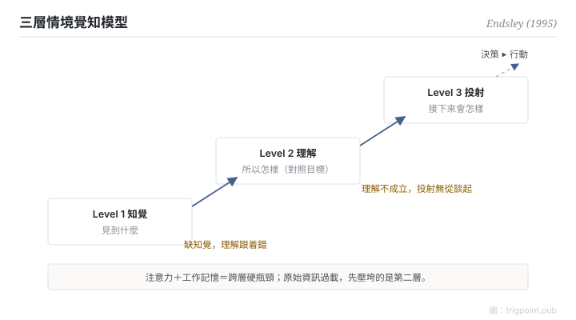

Canonical: https://trigpoint.pub/zh-Hant/collections/hai/situation-awareness  
Captured: 2026-10-05T03:32:20.225692+08:00

> 公開理論閱讀鏡像。驗證層及 Lab 案例請到原站閱讀。

看清狀況和做出決定是兩種能力，前者只是後者的輸入。

# 情境覺知

situation awareness · Endsley (1995)

書目已核 ✓  
Lab 實測 ✓  
人機自動化 · 情境覺知

## 三句講透

情境覺知分三層：知覺（發生了什麼）、理解（所以怎樣）、投射（接下來會怎樣）。  
三層是遞進的覺知層級，並非嚴格的線性階段。  
它是決策的輸入：態勢不清，判斷力再好也是空轉。

<strong>圖 1</strong> · Endsley 三層模型示意重繪。  
知覺、理解、投射是逐層遞進的覺知層級，並非嚴格的線性階段；注意力與工作記憶對新手是最明顯的跨層瓶頸，專家以心智模型與樣式比對緩解。  
情境覺知是決策的輸入，與決策本身分離。

## 一、發生什麼事

知道狀況，不等於知道怎麼做。Endsley 把散落在航空人因研究裏的「知道現在什麼狀況」，形式化成可操作的三層模型；三層的定義一般溯至她 1988 年的研究（據作者後期自述，本頁未讀 1988 原文），1995 年那篇把它擴成完整理論，納入注意、工作記憶、心智模型與目標驅動的處理[\[1\]](#reference-note-1)。第一層知覺：偵測環境中相關元素的狀態。第二層理解：把元素整合成對照目標的意義。第三層投射：基於理解，預測近未來。三層是遞進的層級，越高層覺知越完整，但並非嚴格的線性階段：第一層有缺，理解容易跟着出錯；然而憑目標驅動的處理與心智模型的預設，第一層不完整時仍可能有第二、三層的覺知。整個結構受注意力和工作記憶限制，新手最明顯，專家則以心智模型與樣式比對緩解；所以原始資訊灌得越多，第二層反而越容易被壓垮。

<strong>署名要給對：</strong>「situation awareness」一詞早於 Endsley，軍事航空語境裏用了幾十年。Endsley 的貢獻是三層模型的形式化：把一個口語詞變成可量測、可設計的構念；1995 年那篇是其完整理論。引用時說「Endsley 三層模型」，不要說「Endsley 提出 SA 概念」。

## 二、為什麼這對你重要

管多條並行的 AI 工作線，你的瓶頸很少是「資訊不夠」，幾乎都是「態勢拼不起來」。儀表板給你第一層的原料，但第二層的理解和第三層的預判要靠設計：狀態要對照目標呈現，過期要顯式標記，下一步要可以直接讀出來。把 agent 輸出全部倒給自己看，等於用第一層的量壓死第二層。

適用邊界：覺知是決策的輸入，不能用決策對錯反推覺知高低；三層是遞進的層級，只量第一層命中率不代表有覺知；模型描述停在教科書級一致，未經一手逐句核對。

## 參考文獻

<strong>如何閱讀來源註記</strong> 「書目經…核對」指作者、年份、題名與出版項已確認；不代表該來源的主張已被核對。 定義版本：2026-09-20。

- \[1\] Endsley, M. R. (1995). Toward a Theory of Situation Awareness in Dynamic Systems. Human Factors: The Journal of the Human Factors and Ergonomics Society, 37(1), 32–64. https://doi.org/10.1518/001872095779049543

## 知識圖譜

- [<em>對照 ▸</em>心智負荷（NASA-TLX）](mental-workload-nasa-tlx.md)
- [<em>下游 ▸</em>脫離迴路失能](out-of-the-loop.md)

引用格式：Trigpoint，〈情境覺知〉，trigpoint.pub/zh-Hant/collections/hai/situation-awareness · © Strategitect Limited. · 內容最後修訂 2026-09-28

## 來源註記

**[1]** Endsley, M. R. (1995). Toward a Theory of Situation Awareness in Dynamic Systems. Human Factors, 37(1), 32–64. 書目經多源交叉核對。

---

[English](../../../en/collections/hai/situation-awareness.md) · [简体中文](../../../zh-Hans/collections/hai/situation-awareness.md)

[Index](../../README.md) · [Original page](https://trigpoint.pub/zh-Hant/collections/hai/situation-awareness) · [Citation and versions](../../../READING.md)

[Original SVG](assets/situation-awareness.svg) · Display copy adds a white background only.
