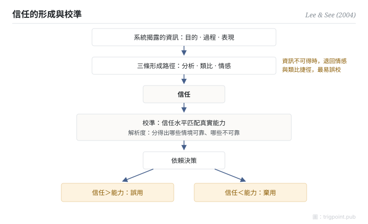

Canonical: https://trigpoint.pub/zh-Hant/collections/hai/trust-in-automation  
Captured: 2026-10-05T03:32:20.281743+08:00

> 公開理論閱讀鏡像。驗證層及 Lab 案例請到原站閱讀。

「信任越高越好」：錯。

# 自動化信任

trust in automation · Lee & See (2004)

書目已核 ✓  
人機自動化 · 信任與依賴

## 三句講透

人靠信任決定用不用自動化，而信任可以錯配：信過頭，系統失能時照樣依賴；信不足，能用的工具被閒置。  
設計目標從來不是把信任推高，是把信任校準到系統的真實能力。

<strong>圖 1</strong> · 信任形成與校準的機制示意。  
系統揭露的資訊經三條心理路徑形成信任；信任對照真實能力做校準與解析，決定依賴行為。  
兩個失配極：信過頭是誤用，信不足是棄用。  
示意重繪自 Lee 與 See（2004）框架。

## 一、發生什麼事

設計人機系統時，很自然會想讓用戶多信任一點。2004 年，Lee 與 See 整合了散落各處的信任研究，給出這個領域的統一框架[\[1\]](#reference-note-1)。衡量信任是否恰當，框架中兩個核心概念是校準（信任水平匹配真實能力）和解析度（信任能分辨系統在哪些情境可靠、哪些不可靠）。信任由三類資訊餵養：系統的目的、過程、表現（這組三維在二人之前已有出處，二手文獻多歸 Lee 與 Moray 1992，祖源本頁未一手核）；經三條心理路徑形成：分析、類比、情感。介面揭露什麼資訊，決定信任往哪裏走。本頁推論：資訊不可得時，人較可能退回情感和類比捷徑，誤校的風險隨之升高。

<strong>署名要給對：</strong>Lee 與 See（2004）的角色是整合者：信任研究在此之前散見各處，三維資訊在其前已有出處（二手文獻多歸 Lee 與 Moray 1992，祖源未一手核），校準加解析度、三維資訊加三條路徑的統一框架，才是二人的統合貢獻。引用時歸屬框架，不必歸屬「信任」一詞。

## 二、為什麼這對你重要

「怎樣令用戶更信任 AI」是一條走錯方向的問題。過度信任製造的事故，和信任不足浪費的產能，同樣真實。可操作的問法是：這個系統在什麼情境下可靠、什麼情境下不可靠，用戶分不分得出？分不出，就在介面上把過程和表現亮出來。信任是校準出來的；谷高出來的，叫盲信。

適用邊界：目標是校準不是拔高，且要分得出系統在哪些情境可靠；信任是動態狀態而非人格特質；本頁框架為二手確認級，未經一手逐句核對。

## 參考文獻

<strong>如何閱讀來源註記</strong> 「書目經…核對」指作者、年份、題名與出版項已確認；不代表該來源的主張已被核對。「依多源一致轉述」指主張建立於多份彼此一致、轉述該來源的資料，而非原文件本身。 定義版本：2026-09-20。

- \[1\] Lee, J. D., & See, K. A. (2004). Trust in Automation: Designing for Appropriate Reliance. Human Factors: The Journal of the Human Factors and Ergonomics Society, 46(1), 50–80. https://doi.org/10.1518/hfes.46.1.50_30392

## 知識圖譜

- [<em>對照 ▸</em>警覺遞減](vigilance-decrement.md)

引用格式：Trigpoint，〈自動化信任〉，trigpoint.pub/zh-Hant/collections/hai/trust-in-automation · © Strategitect Limited. · 內容最後修訂 2026-09-28

## 來源註記

**[1]** Lee, J. D., & See, K. A. (2004). Trust in Automation: Designing for Appropriate Reliance. Human Factors, 46(1), 50–80. 書目經多源交叉核對。框架要旨依多源一致轉述。

---

[English](../../../en/collections/hai/trust-in-automation.md) · [简体中文](../../../zh-Hans/collections/hai/trust-in-automation.md)

[Index](../../README.md) · [Original page](https://trigpoint.pub/zh-Hant/collections/hai/trust-in-automation) · [Citation and versions](../../../READING.md)

[Original SVG](assets/trust-in-automation.svg) · Display copy adds a white background only.
