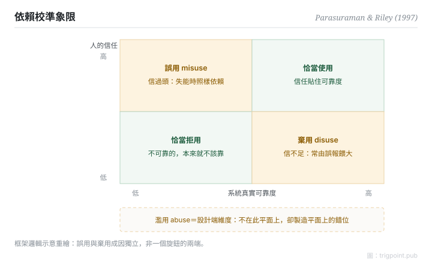

Canonical: https://trigpoint.pub/zh-Hant/collections/hai/use-misuse-disuse-abuse  
Captured: 2026-10-05T03:32:20.462685+08:00

> 公開理論閱讀鏡像。驗證層及 Lab 案例請到原站閱讀。

過度依賴和不肯用，成因各自獨立。

# 使用、誤用、棄用、濫用

use, misuse, disuse, abuse · Parasuraman & Riley (1997)

書目已核 ✓  
Lab 實測 ✓  
人機自動化 · 信任與依賴

## 三句講透

人和自動化的關係分四種：恰當使用之外，另有三種失調：誤用（過度依賴）、棄用（不信而閒置）、濫用（設計端不顧人因硬上）。  
三種失調各有成因，互為因果。  
最常見的管理錯覺，是把誤用和棄用當成同一個旋鈕的兩端。

<strong>圖 1</strong> · 依賴校準象限示意：信任對照真實可靠度，錯配出兩個方向。  
誤用（信過頭）與棄用（信不足）成因獨立，非一個旋鈕的兩端。  
濫用是設計端維度，不在此平面上，卻製造平面上的錯位。  
示意重繪自 Parasuraman 與 Riley（1997）框架。

## 一、發生什麼事

有人過度依賴自動化，有人乾脆不用；兩者常被當成同一個問題的兩個方向。1997 年，Parasuraman 與 Riley 把「自動化失敗」從「人和機器誰更可靠」的爭論，改寫成「依賴是否恰當」的問題，並定出四詞分類[\[1\]](#reference-note-1)。誤用來自信任高於真實可靠度：監控鬆懈、盲從輸出。棄用來自信任低於真實可靠度，最常見的推手是誤報率過高的警報；而誤報率高，往往因為設計時沒算清楚待測事件的基礎率。濫用則把鏡頭轉回設計和管理端：不顧人因後果強推自動化，正是製造前兩者的上游。最反直覺的一點（本頁由分類推論，非原文結論）：壓低誤報去救棄用，可能反手推高誤用。兩個問題成因獨立，不共用一個旋鈕。

<strong>署名要給對：</strong>四詞分類的概念與命名同出一源：Parasuraman 與 Riley（1997），本頁未見需要拆分的前置造詞者。

## 二、為什麼這對你重要

工作流裏的自動警示被人「自動略過」，第一反應通常是怪人。四象限的讀法相反：先查警報的誤報率和基礎率（設計問題），再查依賴有沒有校準到真實可靠度（關係問題），最後才輪到人的紀律。還有一條常被跳過的問題：這個自動化本身該不該上（濫用）？把四個問題分開問，修正才不會互相打架。

適用邊界：四詞是失調分類法，不是成熟度量表；誤用與棄用成因獨立，可同時存在；四詞逐字定義未經一手核對。

## 參考文獻

<strong>如何閱讀來源註記</strong> 「書目經…核對」指作者、年份、題名與出版項已確認；不代表該來源的主張已被核對。「依多源一致轉述」指主張建立於多份彼此一致、轉述該來源的資料，而非原文件本身。 定義版本：2026-09-20。

- \[1\] Parasuraman, R., & Riley, V. (1997). Humans and Automation: Use, Misuse, Disuse, Abuse. Human Factors: The Journal of the Human Factors and Ergonomics Society, 39(2), 230–253. https://doi.org/10.1518/001872097778543886

引用格式：Trigpoint，〈使用、誤用、棄用、濫用〉，trigpoint.pub/zh-Hant/collections/hai/use-misuse-disuse-abuse · © Strategitect Limited. · 內容最後修訂 2026-09-28

## 來源註記

**[1]** Parasuraman, R., & Riley, V. (1997). Humans and Automation: Use, Misuse, Disuse, Abuse. Human Factors, 39(2), 230–253. 書目經官方記錄核對。四詞定義依多源一致轉述。

---

[English](../../../en/collections/hai/use-misuse-disuse-abuse.md) · [简体中文](../../../zh-Hans/collections/hai/use-misuse-disuse-abuse.md)

[Index](../../README.md) · [Original page](https://trigpoint.pub/zh-Hant/collections/hai/use-misuse-disuse-abuse) · [Citation and versions](../../../READING.md)

[Original SVG](assets/use-misuse-disuse-abuse.svg) · Display copy adds a white background only.
