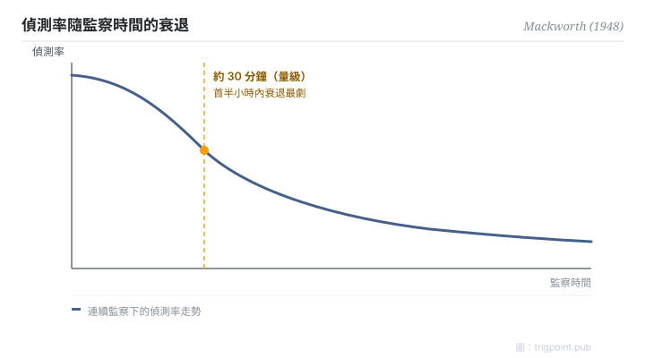

Canonical: https://trigpoint.pub/zh-Hant/collections/hai/vigilance-decrement  
Captured: 2026-10-05T03:32:20.849834+08:00

> 公開理論閱讀鏡像。驗證層及 Lab 案例請到原站閱讀。

受試者盯住一個偶爾跳兩格的鐘面，沒多久就開始漏看。

# 警覺遞減

vigilance decrement · Mackworth (1948)

書目已核 ✓  
Lab 實測 ✓  
人機自動化 · 監控

## 三句講透

人類持續盯住一個少變化的訊號源，偵測率在約三十分鐘內顯著衰退。  
所以，把「叫人盯住自動化」當作唯一安全機制的設計，必然失敗。  
這不是紀律問題，是人因極限：解法在設計層，不在「更小心」。

<strong>圖 1</strong> · 持續監察作業的偵測率衰退走勢。  
Mackworth 的雷達鐘面實驗顯示，偵測率在首三十分鐘內顯著下跌，此後緩慢續降。  
示意走勢重繪；一手數據未核，故只標走勢，不標數值刻度。

## 一、發生什麼事

二戰期間，英國皇家空軍海岸司令部的機載雷達操作員在值班後段漏掉潛艇訊號。Mackworth 用一個「會跳格的鐘面」複製了這件事：受試者盯住指針，捕捉偶發的雙倍跳格。結果穩定得可怕：偵測率在觀察開始後約三十分鐘內（量級，經二手轉述）就顯著下跌[\[1\]](#reference-note-1)。

<strong>署名要給對：</strong>「vigilance」作為神經學概念更早見於 Henry Head（1923）；Mackworth 1948 的貢獻是首個系統性實驗與量化曲線。前人是前人，實驗是實驗。

## 二、為什麼這對你重要

把 AI agent 的輸出交給「人盯住就好」，等於把系統可靠性押在一條三十分鐘就開始漏水的曲線上。你的專注會耗損。所以任何「人類監督」的設計，如果只是叫人看著，它不是安全機制，是安全劇場。

正確的問法不是「誰來盯」，而是「監控面怎樣設計，才能在人必然鬆懈的前提下仍然接得住」：輪換、抽查、把異常主動推到人面前，而不是等人去發現。

適用邊界：「約三十分鐘」是量級不是常數，經二手轉述而來，寫進值班規格前要用自己場景的數據校準；本頁不提供曲線的數值形狀。

## 參考文獻

<strong>如何閱讀來源註記</strong> 「書目經…核對」指作者、年份、題名與出版項已確認；不代表該來源的主張已被核對。 定義版本：2026-09-20。

- \[1\] Mackworth, N. H. (1948). The breakdown of vigilance during prolonged visual search. Quarterly Journal of Experimental Psychology, 1(1), 6–21. https://doi.org/10.1080/17470214808416738
- \[2\] Head, H. (1923). The conception of nervous and mental energy (II): 'Vigilance'; a physiological state of the nervous system. British Journal of Psychology, 14, 126–147. https://doi.org/10.1111/j.2044-8295.1923.tb00122.x
- \[3\] Parasuraman, R., & Manzey, D. H. (2010). Complacency and bias in human use of automation. Human Factors, 52(3), 381–410. https://doi.org/10.1177/0018720810376055

## 知識圖譜

- [<em>對照 ▸</em>自動化信任](trust-in-automation.md)
- [<em>下游 ▸</em>自動化自滿與偏誤](automation-complacency.md)

引用格式：Trigpoint，〈警覺遞減〉，trigpoint.pub/zh-Hant/collections/hai/vigilance-decrement · © Strategitect Limited. · 內容最後修訂 2026-09-28

## 來源註記

**[1]** Mackworth, N. H. (1948). The breakdown of vigilance during prolonged visual search. Quarterly Journal of Experimental Psychology, 1(1), 6–21. 書目經多源交叉核對。

---

[English](../../../en/collections/hai/vigilance-decrement.md) · [简体中文](../../../zh-Hans/collections/hai/vigilance-decrement.md)

[Index](../../README.md) · [Original page](https://trigpoint.pub/zh-Hant/collections/hai/vigilance-decrement) · [Citation and versions](../../../READING.md)

[Original SVG](assets/vigilance-decrement.svg) · Display copy adds a white background only.
