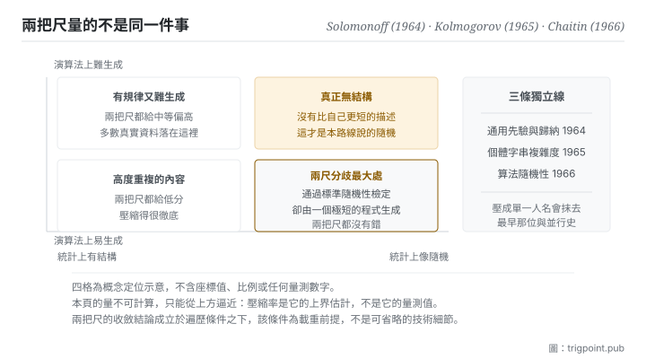

Canonical: https://trigpoint.pub/zh-Hant/collections/information-theory/algorithmic-information-theory  
Captured: 2026-11-02T21:27:53.016869+08:00

> 公開理論閱讀鏡像。驗證層及 Lab 案例請到原站閱讀。

難猜和難描述是兩把尺，同一串數字可以得到相反的讀數。

# 演算法資訊觀

Algorithmic Information Theory · Solomonoff (1964) / Kolmogorov (1965) / Chaitin (1966)

書目已核 ✓  
資訊理論 · 另一條定義路線  
先讀：熵  
先讀：編碼與壓縮

## 三句講透

除了 Shannon 那條路，資訊還有第二個定義：一段東西的資訊量，是能生成它的最短程式長度。  
這條路不需要機率，因此可以對單一對象發問，而 Shannon 的熵不能。  
代價是這個量不可計算，只能從上方逼近。

<strong>圖 1</strong> · 兩把尺的四格對照示意：橫軸是統計上看起來有多隨機，縱軸是演算法上有多難生成。  
右下格是兩把尺分歧最大的地方，一段通過標準隨機性檢定的數字，可能由一個極短的程式產生。

## 一、發生什麼事

平均而言有多難猜，和單獨這一份有多難描述，是兩個不同的問題：前一個需要機率，後一個不需要。Shannon 的熵有一個前提：你得先有一個機率分佈。這對「一批資料平均而言」是自然的，但對「這一份文件」就無話可說了，因為單一對象沒有分佈。1960 年代有三個人各自獨立想到同一個出路：不談機率，談<strong>描述</strong>[\[1\]](#reference-note-1)[\[2\]](#reference-note-2)[\[3\]](#reference-note-3)。一段東西的資訊量，等於在一台通用計算機上能把它生成出來的最短程式有多長。

這個定義有幾個立刻可用的性質。第一，它幾乎不依賴機器的選擇：換一台通用計算機，這個量的變化不超過一個固定的常數。第二，它給了「隨機」一個乾淨的定義：一段東西是隨機的，當且僅當<strong>沒有比它自己更短的描述</strong>，也就是完全無法壓縮。第三，也是代價：這個量<strong>不可計算</strong>，不存在通用的演算法能算出它，這是停機問題的推論。實務上只能從上方逼近，任何壓縮演算法的輸出長度都是它的一個上界。

兩條路線在什麼時候會分歧，是這一頁最值得記的東西。對純隨機的來源，兩者的期望值會收斂；但對<strong>演算法上有結構</strong>的對象，它們會嚴重分歧。經典例子是一個無理數的前一百萬位：它通過標準的隨機性檢定，因此在 Shannon 的尺下不確定性極大、幾乎不可壓縮；但它可以由一個很短的程式生成，因此在這把尺下複雜度極小。<strong>同一段東西，兩把尺給出相反的答案，而兩把尺都沒有錯</strong>，它們量的本來就是不同的東西。

兩者的橋樑見於 1982 年刊出的一篇論文：對遍歷的不變測度，動力系統的熵幾乎處處等於單位時間的算法複雜度[\[4\]](#reference-note-4)。這個結果有一件容易被略過的事：<strong>遍歷性是載重條件，不是可省略的技術細節</strong>；1993 年另有推廣。

至於實務化，1978 年那條線把「選最短總描述」變成可操作的模型選擇準則：把模型本身的描述長度與資料在該模型下的編碼長度加起來，選總和最小的[\[5\]](#reference-note-5)。

<strong>署名要給對：</strong>三條獨立線並列，不可壓成一人：通用先驗與歸納推理的算法基礎歸 Solomonoff（1964），三者中發表最早[\[1\]](#reference-note-1)；個體字串複雜度的形式定義歸 Kolmogorov（1965）[\[2\]](#reference-note-2)；算法隨機性的第三條線歸 Chaitin（1966）[\[3\]](#reference-note-3)。與 Shannon 熵之間的橋接定理歸 Brudno（1982），<strong>其遍歷性條件為載重前提</strong>，1993 年有推廣[\[4\]](#reference-note-4)。實務化為模型選擇準則的最小描述長度原理歸 Rissanen（1978）[\[5\]](#reference-note-5)。常見轉述把整條路線壓成單一人名，會同時抹去一位更早的獨立提出者與一段真實的三線並行史。

## 二、為什麼這對你重要

這一頁把一個常被當作品味的東西，升格成有形式基礎的判準：<strong>簡潔不是美學偏好，是可以定義的。</strong>

日常裡我們說一個解釋「比較簡潔」，通常沒有辦法辯護，因為簡潔看起來是主觀的。這套理論給的說法是：一個解釋的成本，等於描述這個解釋本身的長度，加上在這個解釋之下描述現象所需的長度。兩者要一起算。這立刻解釋了兩種常見的失敗。一種是規則太少：解釋本身很短，但每個個案都要另外交代，總長度反而更大。另一種是規則太多：每個個案都有專屬條款，資料端幾乎不用描述，但規則本身長得驚人。兩者都輸給中間那個總和最小的版本。

這條原則我們自己在用，而且用在一個具體的地方：治理面的規則要不要再加一條。判準不是「這條規則有沒有用」，而是「加上它之後，規則本身的長度與它省下的個案描述，哪一邊多」。多數提案在這個算法下會被否決，因為它們節省的是一兩個個案，付出的是每個人此後都要記住的一條規則。

第二件事是對「隨機」的祛魅。看起來很亂不等於資訊量大，這在判讀資料時很有用：一段雜訊般的輸出，可能來自一個極簡單的機制；反過來，一段看起來井然有序的內容，也可能需要很長的描述才能重建。<strong>表面的規律性與生成的複雜度是兩回事</strong>，而多數人只看得到前者。

第三是一個界線：不要拿壓縮率當作複雜度的量測值。壓縮率是上界的估計，兩者不是同一個東西，這個越界在資料分析裡相當常見。

## 常見誤讀

所屬頁核驗：書目已核 ✓ · 內容最後修訂 2026-10-25

- 常見轉述「Kolmogorov 複雜度可以用壓縮率算出來」：不能。它不可計算，壓縮率只是它的一個上界估計。把壓縮率當成複雜度的量測值是常見的越界。
- 常見轉述「對單一字串談熵」：熵需要一個機率分佈，對單一對象沒有定義。要談單一對象的資訊量，用的正是本頁這一套。兩者不可互換。
- 常見轉述「這套理論說隨機的東西資訊量最大」：說的是無結構的東西最難壓縮。而某些統計上通過隨機檢定的序列，其實有極短的生成程式，因此在這把尺下複雜度極低。兩把尺會分歧。

## 參考文獻

<strong>如何閱讀來源註記</strong> 「書目經…核對」指作者、年份、題名與出版項已確認；不代表該來源的主張已被核對。 定義版本：2026-09-20。

- \[1\] Solomonoff, R. J. (1964). A Formal Theory of Inductive Inference, Part I. Information and Control, 7(1), 1–22; Part II, 7(2), 224–254.
- \[2\] Kolmogorov, A. N. (1965). Three Approaches to the Quantitative Definition of Information. Problems of Information Transmission, 1(1), 1–7.
- \[3\] Chaitin, G. J. (1966). On the Length of Programs for Computing Finite Binary Sequences. Journal of the ACM, 13(4), 547–569.
- \[4\] Brudno, A. A. (1982/1983). Entropy and the Complexity of the Trajectories of a Dynamical System. Trudy Moskovskogo Matematicheskogo Obshchestva, 44, 124–149; Transactions of the Moscow Mathematical Society, (2), 127–151.
- \[5\] Rissanen, J. (1978). Modeling by Shortest Data Description. Automatica, 14(5), 465–471.

引用格式：Trigpoint，〈演算法資訊觀〉，trigpoint.pub/zh-Hant/collections/information-theory/algorithmic-information-theory · © Strategitect Limited. · 內容最後修訂 2026-10-25

## 來源註記

**[1]** Solomonoff, R. J. (1964). A Formal Theory of Inductive Inference, Part I. Information and Control, 7(1), 1–22; Part II, 7(2), 224–254. 書目經官方記錄核對。通用先驗與歸納推理的算法基礎，分兩部分刊出；三條獨立線中發表最早。

**[2]** Kolmogorov, A. N. (1965). Three Approaches to the Quantitative Definition of Information. Problems of Information Transmission, 1(1), 1–7. 書目經雙源核對。個體字串複雜度之形式定義；此處頁碼為英譯本。

**[3]** Chaitin, G. J. (1966). On the Length of Programs for Computing Finite Binary Sequences. Journal of the ACM, 13(4), 547–569. DOI 10.1145/321356.321363. 書目經官方記錄核對。算法隨機性理論之第三條獨立線。

**[4]** Brudno, A. A. (1982/1983). Entropy and the Complexity of the Trajectories of a Dynamical System. Trudy Moskovskogo Matematicheskogo Obshchestva, 44, 124–149; English translation in Transactions of the Moscow Mathematical Society, (2), 127–151. 書目經官方記錄核對。出處經跨模型雙查核實。對遍歷的不變測度，Kolmogorov-Sinai 熵幾乎處處等於軌道單位時間的算法複雜度。遍歷性為載重條件，不是可省略的技術細節；White（1993）推廣了這個結果。英文本為 1983 年之譯本。

**[5]** Rissanen, J. (1978). Modeling by Shortest Data Description. Automatica, 14(5), 465–471. DOI 10.1016/0005-1098(78)90005-5. 書目經官方記錄核對。最小描述長度原理的起點，將本路線實務化為模型選擇準則。

---

[English](../../../en/collections/information-theory/algorithmic-information-theory.md) · [简体中文](../../../zh-Hans/collections/information-theory/algorithmic-information-theory.md)

[Index](../../README.md) · [Original page](https://trigpoint.pub/zh-Hant/collections/information-theory/algorithmic-information-theory) · [Citation and versions](../../../READING.md)

[Original SVG](assets/algorithmic-information-theory.svg) · Display copy adds a white background only.
