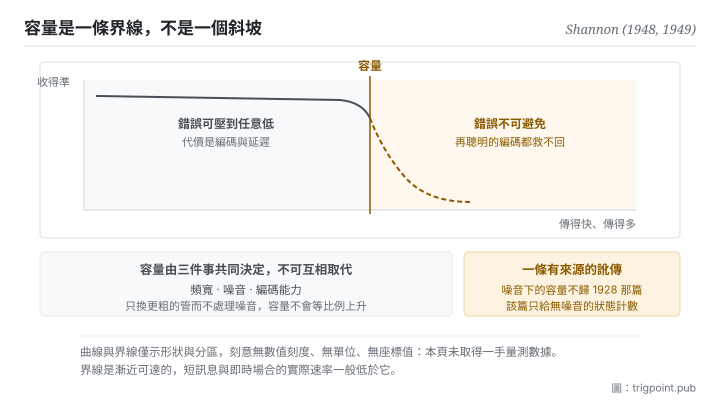

Canonical: https://trigpoint.pub/zh-Hant/collections/information-theory/channel-and-capacity  
Captured: 2026-11-02T21:27:53.334293+08:00

> 公開理論閱讀鏡像。驗證層及 Lab 案例請到原站閱讀。

塞得進去的量，與噪音下能可靠還原的量，是兩個數。

# 通道與容量

Channel and Capacity · Shannon (1948, 1949)

書目已核 ✓  
Lab 實測 ✓  
資訊理論 · 傳輸極限  
先讀：訊號與噪音  
先讀：熵

## 三句講透

通道是任何讓資訊流動的載體，不只是電線與無線電，也包括語言、注意力與記憶。  
容量不是你能塞進去多少，是在噪音存在下對方最多能可靠還原多少。  
兩者的差額不會報錯，它只是安靜地變成誤解。

<strong>圖 1</strong> · 速率與可靠性的取捨示意：橫軸往右是傳得更快更多，縱軸往上是收得更準。  
容量是一條界線，界線以左可以靠編碼把錯誤壓到任意低，越過界線錯誤就不可避免。  
本圖刻意無數值刻度與單位。

## 一、發生什麼事

能送進通道的量，與另一端在噪音下能可靠還原的量，常被當成同一個數；後者有一道硬上限。1948 年那篇證明了一件反直覺的事：在有噪音的通道上，錯誤率並不是只能靠加大功率來慢慢壓低。只要傳輸速率低於某個門檻，就存在一種編碼方式，能把錯誤率壓到任意接近零；一旦越過那個門檻，錯誤就無可避免[\[1\]](#reference-note-1)。那個門檻就是容量。隔年那篇以幾何方式重新證明了這個結果[\[2\]](#reference-note-2)。

這個結果的形狀值得停一下。它不是說「越快越容易錯」這種連續的取捨，而是一條<strong>界線</strong>：界線以左，可靠性是編碼設計的問題；界線以右，可靠性是不可能的問題。工程上要再過數十年，才有編碼方法實際逼近這條界線，但界線本身在 1948 年就定死了。

容量由三件事共同決定：通道能承載的頻寬、噪音的強度、以及你的編碼能力。三者不可互相取代。加粗管子而不處理噪音，容量不會等比例上升；同理，再精巧的編碼也不能突破由頻寬與噪音決定的上限。

歸屬有兩處要說清楚。第一，噪音下的容量不歸 1928 年那篇。那篇只談可區分選擇的數目，未涉及訊號與噪音，把噪音下的容量歸給它是一條可以追溯來源的引註訛傳[\[3\]](#reference-note-3)[\[5\]](#reference-note-5)。第二，同一時期另有多位研究者各自導出相近的式子，1948 年那篇點名提及其中三位。其中 Tuller 的貢獻長期少被提及，但他的推導以可區分振幅級數作粗估[\[4\]](#reference-note-4)；2014 年那篇專文證明，這類式子作為容量成立的是均勻噪音、振幅受限的通道，與 1948 年那篇定理處理的高斯噪音、功率受限通道是不同的設定[\[5\]](#reference-note-5)。

<strong>署名要給對：</strong>以可區分選擇數目的對數衡量資訊，歸 Hartley（1928）[\[3\]](#reference-note-3)。噪音下的容量歸 Shannon，出處是 1948 年那篇的定理 17 與 1949 年那篇的幾何證明[\[1\]](#reference-note-1)[\[2\]](#reference-note-2)。同一時期 Tuller 以粗估獨立導出相近的式子，1949 年刊出，1948 年那篇曾點名提及[\[4\]](#reference-note-4)；2014 年有專文主張以兩人並稱，並考證前述訛傳的來源[\[5\]](#reference-note-5)。三段要分開署名：把噪音下的容量壓成「Hartley 公式」會一次弄錯範圍與作者，這是本站有明文更正的一條。

## 二、為什麼這對你重要

把「通道」這個詞從電線擴大到你自己的工作流，這頁就開始有用。

你和模型之間的那段脈絡是一條通道。它有頻寬（一次能放進去多少）、有噪音（無關的內容、過期的規格、互相矛盾的指示）、有編碼能力（你怎麼組織那些內容）。多數人只調第一項：塞更多、寫更長、把所有可能有關的東西都附上。這在本頁的框架下是一個可以命名的錯誤：<strong>提高的是輸入量，降的是訊噪比，而容量管的是後者。</strong>

同一件事在人身上更明顯。一份交接文件、一次會議、一封信，它們的容量不由你寫了多少決定，由對方能可靠還原多少決定。而這裡有個殘酷的地方：超過容量的傳輸<strong>不會報錯</strong>。對方不會說「我這裡溢出了」，他會給你一個看起來合理的回應，只是它建立在被截斷的輸入上。這種失敗是安靜的，所以你只能靠事前設計去防，不能靠事後偵測。

實務上這頁給的是三個可以直接問的問題。這條通道的噪音是什麼，也就是有哪些內容其實不改變任何判斷。我在調的是輸入量還是訊噪比。以及，如果對方只還原得了一半，我希望是哪一半。第三個問題會直接把你帶到本書架的段三。

## 常見誤讀

所屬頁核驗：書目已核 ✓ · 內容最後修訂 2026-10-27

- 常見轉述「噪音下的容量公式來自 Hartley 1928」：錯。1928 年那篇只談可區分選擇的數目，先假設外來干擾不存在，未以訊號對噪音的比值立式。噪音下的容量出自 1948 年那篇的定理 17，1949 年那篇給出幾何證明。據 2014 年一篇專文考證，可查最早把相關式子歸給 Hartley 的似為 1965 年一本廣泛採用的教科書。
- 常見轉述「容量就是頻寬」：頻寬只是決定容量的其中一個因素，另外兩個是噪音與編碼能力。只換更粗的管而不處理噪音，容量不會等比例上升。

## 修正記錄

- 同一時期另有多位研究者各自導出相近的式子，Tuller 是其中之一，Shannon 1948 年那篇曾點名提及他。他的貢獻長期少被提及；但他的推導以可區分振幅級數作粗估；據 2014 年專文，這類式子作為容量成立的是均勻噪音、振幅受限的通道，與 1948 年那篇定理處理的高斯噪音、功率受限通道是不同的設定。兩件都要說：既不抹去，也不抬高。

## 參考文獻

<strong>如何閱讀來源註記</strong> 「書目經…核對」指作者、年份、題名與出版項已確認；不代表該來源的主張已被核對。「對照全文核實」指主張已與來源文本本身比對。 定義版本：2026-09-20。

- \[1\] Shannon, C. E. (1948). A Mathematical Theory of Communication. Bell System Technical Journal, 27(3), 379–423; 27(4), 623–656.
- \[2\] Shannon, C. E. (1949). Communication in the Presence of Noise. Proceedings of the IRE, 37(1), 10–21.
- \[3\] Hartley, R. V. L. (1928). Transmission of Information. Bell System Technical Journal, 7(3), 535–563.
- \[4\] Tuller, W. G. (1949). Theoretical Limitations on the Rate of Transmission of Information. Proceedings of the IRE, 37(5), 468–478.
- \[5\] Rioul, O., & Magossi, J. C. (2014). On Shannon's Formula and Hartley's Rule: Beyond the Mathematical Coincidence. Entropy, 16(9), 4892–4910.

引用格式：Trigpoint，〈通道與容量〉，trigpoint.pub/zh-Hant/collections/information-theory/channel-and-capacity · © Strategitect Limited. · 內容最後修訂 2026-10-27

## 來源註記

**[1]** Shannon, C. E. (1948). A Mathematical Theory of Communication. Bell System Technical Journal, 27(3), 379–423; 27(4), 623–656. 書目經官方記錄核對。主張已對照全文核實。出處經跨模型雙查核實。定理 17 給出頻寬受限、受白色熱噪音干擾且平均發射功率受限之通道的容量。同篇在該定理之後點名提及 Wiener、Tuller 與 Sullivan 各自發展過相近的式子。

**[2]** Shannon, C. E. (1949). Communication in the Presence of Noise. Proceedings of the IRE, 37(1), 10–21. DOI 10.1109/JRPROC.1949.232969. 書目經官方記錄核對。出處經跨模型雙查核實。以幾何方式重新證明噪音下的容量公式。

**[3]** Hartley, R. V. L. (1928). Transmission of Information. Bell System Technical Journal, 7(3), 535–563. 書目經官方記錄核對。出處經跨模型雙查核實。以可區分選擇數目的對數衡量資訊，未涉及訊號與噪音。把噪音下的容量歸給本篇是一條引註訛傳。

**[4]** Tuller, W. G. (1949). Theoretical Limitations on the Rate of Transmission of Information. Proceedings of the IRE, 37(5), 468–478. DOI 10.1109/JRPROC.1949.232323. 書目經官方記錄核對。出處經跨模型雙查核實。同作者 1948 年 MIT 博士（Sc.D.）論文之期刊版。推導以可區分振幅級數作粗估，得出與噪音下容量相近的式子。據 2014 年專文（第 5 節定理 1），這個式子作為容量成立的情形，是均勻噪音、振幅受限且振幅限制與噪音上界之比為整數的通道，與 1948 年那篇定理 17 處理的高斯噪音、平均功率受限通道是不同的設定。

**[5]** Rioul, O., & Magossi, J. C. (2014). On Shannon's Formula and Hartley's Rule: Beyond the Mathematical Coincidence. Entropy, 16(9), 4892–4910. DOI 10.3390/e16094892. 書目經官方記錄核對。主張已對照全文核實。考證「Hartley 法則」的歸屬：1928 年那篇未以訊號對噪音的比值立式，可查最早把該式歸給 Hartley 的似為 1965 年一本廣泛採用的教科書（Wozencraft 與 Jacobs）。文中並證明該式恰為均勻噪音、振幅受限通道的容量，主張以 Tuller-Shannon 並稱。

---

[English](../../../en/collections/information-theory/channel-and-capacity.md) · [简体中文](../../../zh-Hans/collections/information-theory/channel-and-capacity.md)

[Index](../../README.md) · [Original page](https://trigpoint.pub/zh-Hant/collections/information-theory/channel-and-capacity) · [Citation and versions](../../../READING.md)

[Original SVG](assets/channel-and-capacity.svg) · Display copy adds a white background only.
