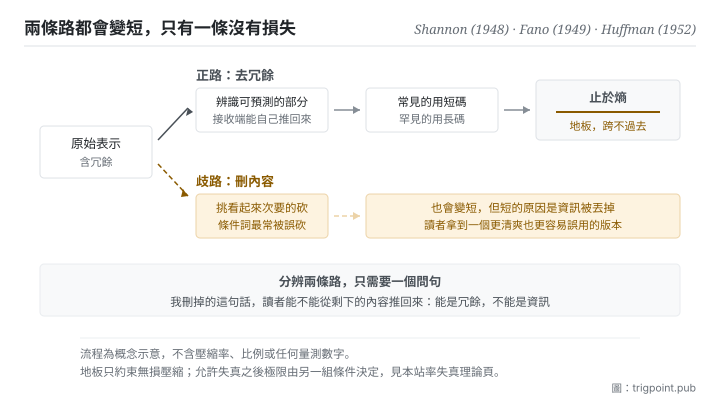

Canonical: https://trigpoint.pub/zh-Hant/collections/information-theory/coding-and-compression  
Captured: 2026-11-02T21:27:53.745305+08:00

> 公開理論閱讀鏡像。驗證層及 Lab 案例請到原站閱讀。

「壓縮就是刪掉一些」：錯。

# 編碼與壓縮

Coding and Compression · Shannon (1948) / Fano (1949) / Huffman (1952)

摘要已核 ✓  
Lab 實測 ✓  
資訊理論 · 表示與壓縮  
先讀：熵  
先讀：資訊量

## 三句講透

壓縮不是刪內容，是換一種更短的方式表示同樣的內容。  
可壓縮的部分叫冗餘，也就是接收端本來就能推得出來的那些；把它們拿掉不損失任何東西。  
而這件事有一道地板：無損壓縮的平均長度不可能低於熵。

<strong>圖 1</strong> · 壓縮的正路與歧路示意：正路是辨識規律、以更短的表示承載同樣的內容，終點是熵這道地板；歧路是直接刪內容，它確實會變短，但變短的原因是資訊被丟掉，不是冗餘被去掉。

## 一、發生什麼事

先分清楚兩個常被混用的詞。編碼是把內容轉成某種符號系統，本身不必然變短；壓縮是編碼的一種優化目標，利用內容裡的規律，把可預測的部分用更短的方式表示。關鍵在<strong>可預測</strong>：一段接收端本來就猜得到的內容，用長篇幅去寫是純粹的浪費，這個浪費就叫冗餘。

由此推出一條分配原則：常出現的東西用短碼，罕見的東西用長碼。這條原則的兩個經典實作分別在 1949 與 1952 年出現。前者是由上而下的啟發式作法，後者證明了由下而上的建構能保證平均碼長最小[\[2\]](#reference-note-2)[\[3\]](#reference-note-3)。兩者的差別不只是效率，是<strong>保證</strong>：一個是「通常不錯」，一個是「可證明最優」。

而無論用什麼方法，都有一道跨不過去的線。1948 年那篇的定理 9 給出無損壓縮的平均碼長下界，那個下界就是熵[\[1\]](#reference-note-1)。這條線有兩個實務含意，都值得記住。其一，壓縮能力的上限由資料本身的機率結構決定，不由你的技術決定；其二，當你逼近那條線，繼續壓下去的每一步都不再是去冗餘，而是在丟資訊。

無損與有損由此分岔。無損要求完整還原，受熵的地板約束；有損允許失真以換取更低的長度，它有另一套完全不同的理論極限，是本書架下一頁的主題。

<strong>署名要給對：</strong>無損壓縮的下界歸 Shannon（1948），出處是該篇第 9 節的定理 9[\[1\]](#reference-note-1)。由上而下的啟發式編碼法通稱以 Shannon 與 Fano 並稱，正式發表處是 Fano 1949 年的技術報告[\[2\]](#reference-note-2)。保證最小平均碼長的建構法歸 Huffman（1952）[\[3\]](#reference-note-3)，其結果的地位與前者不同：一個是啟發式，一個是可證明最優，兩者不可互相代稱。

## 二、為什麼這對你重要

多數人做摘要時做的是刪減，而不是壓縮。兩者的差別可以用一個問題分開：<strong>我刪掉的這句話，讀者能不能從剩下的內容推回來</strong>。能，那是冗餘，刪得對；不能，那是資訊，你只是把文件變短了。

這個判準會立刻改變你怎麼寫交接與說明。真正該砍的往往不是細節，而是那些<strong>讀者的既有知識已經涵蓋的鋪陳</strong>：背景介紹、通則覆述、前提重申。而最不該砍的常常長得像可以砍的，也就是那些帶著條件的句子。「除非」「取決於」「只有在」「必須」這類詞承載的是因果與邊界，它們不能從其他句子推回來，砍掉之後讀者會得到一個看起來更清爽、但實際上更容易誤用的版本。這件事在本書架下一頁會有更精確的說法。

第二個推論是關於「解碼端」。壓縮的前提是雙方共用同一套規律；如果接收端沒有那套規律，你的短碼對他就是密碼。所以同一份內容給不同對象要用不同的壓縮率，這不是體貼，是這套理論的直接後果。給熟手的簡報和給新人的說明不能共用一份，不是因為新人需要更多資訊，是因為他們少了讓你的壓縮成立的那本碼表。

第三個推論最反直覺：<strong>壓不下去有時候是好消息</strong>。它意味著你手上的材料裡冗餘已經不多，剩下的都是不能推導出來的部分。這時候該做的是承認長度，不是繼續削。

## 常見誤讀

所屬頁核驗：摘要已核 ✓ · 內容最後修訂 2026-10-25

- 常見轉述「壓縮就是刪掉不重要的部分」：無損壓縮不刪任何內容，它只換一種更短的表示方式，原件可以完整還原。會刪東西的是有損壓縮，那是另一套理論，本站另有專頁。把兩者混為一談，會讓人以為所有壓縮都要付出失真代價。
- 常見轉述「壓縮率取決於演算法好壞」：演算法決定你離極限多遠，但極限本身由資料的機率結構決定。同一個演算法在不同資料上的壓縮率差距，多半來自資料而非演算法。

## 參考文獻

<strong>如何閱讀來源註記</strong> 「書目經…核對」指作者、年份、題名與出版項已確認；不代表該來源的主張已被核對。「與摘要一致」指主張與論文摘要相符；不含逐句對照全文。「對照全文核實」指主張已與來源文本本身比對。 定義版本：2026-09-20。

- \[1\] Shannon, C. E. (1948). A Mathematical Theory of Communication. Bell System Technical Journal, 27(3), 379–423; 27(4), 623–656.
- \[2\] Fano, R. M. (1949). The Transmission of Information. MIT RLE Technical Report No. 65.
- \[3\] Huffman, D. A. (1952). A Method for the Construction of Minimum-Redundancy Codes. Proceedings of the IRE, 40(9), 1098–1101.

引用格式：Trigpoint，〈編碼與壓縮〉，trigpoint.pub/zh-Hant/collections/information-theory/coding-and-compression · © Strategitect Limited. · 內容最後修訂 2026-10-25

## 來源註記

**[1]** Shannon, C. E. (1948). A Mathematical Theory of Communication. Bell System Technical Journal, 27(3), 379–423; 27(4), 623–656. 書目經官方記錄核對。主張已對照全文核實。出處經跨模型雙查核實。第 9 節（無噪音通道的基本定理）之定理 9：來源的熵決定經無噪音通道傳送所需的最低平均速率，可任意逼近，不可超越；這就是無損壓縮的平均碼長下界。

**[2]** Fano, R. M. (1949). The Transmission of Information (Technical Report No. 65). Research Laboratory of Electronics, Massachusetts Institute of Technology. 書目經出版社記錄核對。主張已對照全文核實。Shannon-Fano 編碼法的發表處：把訊息依機率排序後，反覆切成機率盡量相等的兩組。

**[3]** Huffman, D. A. (1952). A Method for the Construction of Minimum-Redundancy Codes. Proceedings of the IRE, 40(9), 1098–1101. DOI 10.1109/JRPROC.1952.273898. 書目經官方記錄核對。要旨與摘要一致。由下而上的最優前綴碼建構法，保證最小平均碼長。

---

[English](../../../en/collections/information-theory/coding-and-compression.md) · [简体中文](../../../zh-Hans/collections/information-theory/coding-and-compression.md)

[Index](../../README.md) · [Original page](https://trigpoint.pub/zh-Hant/collections/information-theory/coding-and-compression) · [Citation and versions](../../../READING.md)

[Original SVG](assets/coding-and-compression.svg) · Display copy adds a white background only.
