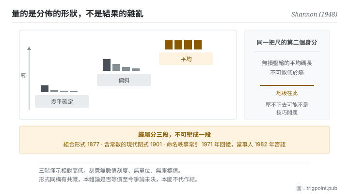

Canonical: https://trigpoint.pub/zh-Hant/collections/information-theory/entropy  
Captured: 2026-11-02T21:27:54.005227+08:00

> 公開理論閱讀鏡像。驗證層及 Lab 案例請到原站閱讀。

「熵就是混亂」：是誤讀。

# 熵

Entropy · Shannon (1948)

書目已核 ✓  
資訊理論 · 核心量度  
先讀：資訊量

## 三句講透

熵不是混亂，是不可預測性的量化。  
它是每個可能結果的資訊量，按各自的機率加權平均起來的那個數。  
分佈越平均越難猜，熵越高；而同一個數還有第二個身分，它是無損壓縮的地板。

<strong>圖 1</strong> · 熵隨分佈形狀變化的階梯示意：分佈越集中越好猜，熵越低；越平均越難猜，熵越高。  
右側標出同一把尺的第二個身分，無損壓縮的平均碼長不可能低於它。  
本圖刻意無數值刻度與單位。

## 一、發生什麼事

前一頁講單一事件的資訊量：越不可能的事發生，帶的資訊越多。但單一事件的量沒法用來描述一個系統，因為系統還沒揭曉。1948 年那篇給出的量，等於做了一個簡單而關鍵的動作：把每個可能結果的資訊量，按它自己的機率加權，平均起來[\[1\]](#reference-note-1)。得到的數就是熵，它回答的是「揭曉之前，我平均要面對多少不確定」。

這個構造有一個立刻可感的性質。分佈越集中，熵越低，因為你幾乎猜得到；分佈越平均，熵越高，因為每個結果都同樣可能。極端情形是確定事件，熵為零。注意這裡量的是<strong>分佈的形狀</strong>，不是結果本身有多雜亂，這就是「熵等於混亂」這個直覺失準的地方：它漏掉了機率結構這一項。

同一篇論文還給了熵第二個身分，而這個身分讓它從一個描述量變成一條硬邊界：<strong>無損壓縮的平均碼長不可能低於熵</strong>[\[1\]](#reference-note-1)。也就是說，你能把一份資料壓多小，不取決於你的演算法多聰明，取決於這份資料的機率結構。這條下界是本書架段三整段的前提。

形式上的同源關係也在同一篇被點明。Shannon 在第 6 節逐字寫下這個 H 就是 Boltzmann H 定理裡的那個 H[\[2\]](#reference-note-2)。這句話開啟了一場延續至今的爭論，本頁在驗證層處理。要先更正一件常被搞錯的事：熱力學裡那條含常數的著名公式，原文並不出自 1877 年那篇，該篇只有組合形式；現代形式與那個常數一般歸於 Planck，在 1900 至 1901 年寫出；據轉述，他自己在 1920 年的諾貝爾演講中也說過，Boltzmann 從未引入該常數[\[3\]](#reference-note-3)[\[4\]](#reference-note-4)。

<strong>署名要給對：</strong>作為資訊量期望值的熵，以及它作為無損壓縮下界這個身分，歸 Shannon（1948）[\[1\]](#reference-note-1)。統計力學中的組合機率量歸 Boltzmann（1877），但<strong>含常數的現代閉式一般歸 Planck（1900 至 1901）</strong>，兩段不可壓成一段[\[3\]](#reference-note-3)[\[4\]](#reference-note-4)。把最大熵確立為推理原則、並把統計力學視為統計推論之一種形式的，是 Jaynes（1957）[\[5\]](#reference-note-5)；主張資訊量度與熱力學熵不能直接劃等號的當代論述，可見 Ben-Naim（2017）[\[6\]](#reference-note-6)。至於 von Neumann 建議命名的那則軼事，最常被引的出處是 1971 年的個人回憶[\[7\]](#reference-note-7)（另有記述指更早已有人講過），且<strong>當事人之一於 1982 年在錄音訪談中否認</strong>[\[8\]](#reference-note-8)，本站不將其列為史實。

## 二、為什麼這對你重要

熵給你的第一件東西，是一個判斷「壓不下去」的診斷工具。

你把一份材料反覆精簡，到某個點之後怎麼改都覺得損失了東西，這時候通常會歸咎於自己表達能力不足。這頁說有另一種可能：你撞到了地板。這份材料的機率結構決定了它的最短平均長度，越過那個點的每一次刪減都不再是去冗餘，而是真的在丟資訊。兩者的差別是可以問出來的：<strong>我刪掉的那一句，讀者能不能從剩下的內容推回來</strong>。能，就是冗餘；不能，就是資訊。

第二件東西更反直覺一點。既然熵取決於分佈，那麼<strong>同一份內容對不同讀者的可壓縮程度不同</strong>。對已經掌握脈絡的人，你的大半鋪陳都是高機率、可預測的內容，可以壓掉；對陌生的人，同樣那些內容承載了真正的不確定性削減，壓掉就斷了。所以「這份文件應該多長」沒有一般答案，只有「對誰」的答案。這也解釋了為什麼給模型的脈絡與給人的說明不能共用一份。

第三件是關於這個詞本身。「對抗熵增」在日常語境裡多半是修辭，指系統放著不管就會變糟。這頁的熵不是那個意思，它是一個關於分佈的量。兩者不是同一回事，但也不是毫無關係，而那個關係到底有多實在，正是本書架最後一頁要處理的問題。在那之前，請把它們當成兩個詞。

## 常見誤讀

所屬頁核驗：書目已核 ✓ · 內容最後修訂 2026-10-25

- 常見轉述「S = k log W 是 Boltzmann 1877 年寫的」：他 1877 年的原文只含組合形式的機率量，並未寫出含常數 k 的閉式。現代形式與該常數一般歸於 Planck，在 1900 至 1901 年寫出。維也納中央公墓那座墓碑於 1933 年揭幕（據二手記述），公式刻在其上，是 Boltzmann 身後多年的事；形式是 Planck 的。
- 常見轉述「von Neumann 建議 Shannon 把這個量叫做熵，理由是沒人真正知道熵是什麼」：這段話最常被引的出處是 1971 年一篇科普文章裡的個人回憶，距那次談話約十年，且 von Neumann 已於 1957 年過世；另有記述指同一位回憶者更早已在 1964 年的一本紀念文集中講過。更關鍵的是 Shannon 本人在 1982 年的口述歷史訪談中否認此事。這則軼事流傳極廣，本站列為未經證實。
- 常見轉述「資訊熵與熱力學熵是同一回事」：數學形式同構有共識，兩者在什麼意義上是同一回事則至今仍有爭論。本頁分層並陳，不挑一邊當定論。

## 參考文獻

<strong>如何閱讀來源註記</strong> 「書目經…核對」指作者、年份、題名與出版項已確認；不代表該來源的主張已被核對。「與摘要一致」指主張與論文摘要相符；不含逐句對照全文。「對照全文核實」指主張已與來源文本本身比對。「依多源一致轉述」指主張建立於多份彼此一致、轉述該來源的資料，而非原文件本身。 定義版本：2026-09-20。

- \[1\] Shannon, C. E. (1948). A Mathematical Theory of Communication. Bell System Technical Journal, 27(3), 379–423; 27(4), 623–656.
- \[2\] Shannon, C. E. (1948). A Mathematical Theory of Communication. Bell System Technical Journal, 27(3), 379–423; 27(4), 623–656.
- \[3\] Boltzmann, L. (1877). Wiener Berichte, 76, 373–435.
- \[4\] Planck, M. (1901). Ueber das Gesetz der Energieverteilung im Normalspectrum. Annalen der Physik, 309(3), 553–563.
- \[5\] Jaynes, E. T. (1957). Information Theory and Statistical Mechanics. Physical Review, 106(4), 620–630; 108(2), 171–190.
- \[6\] Ben-Naim, A. (2017). Entropy, Shannon's Measure of Information and Boltzmann's H-Theorem. Entropy, 19(2), 48.
- \[7\] Tribus, M. & McIrvine, E. C. (1971). Energy and Information. Scientific American, 225(3), 179–188.
- \[8\] Price, R. (1982/1984). Claude E. Shannon oral history. IEEE History Center Interview 423; IEEE Communications Magazine, 22(5), 123–126.
- \[9\] Shannon, C. E. (1956). The Bandwagon. IRE Transactions on Information Theory, IT-2(1), 3.

引用格式：Trigpoint，〈熵〉，trigpoint.pub/zh-Hant/collections/information-theory/entropy · © Strategitect Limited. · 內容最後修訂 2026-10-25

## 來源註記

**[1]** Shannon, C. E. (1948). A Mathematical Theory of Communication. Bell System Technical Journal, 27(3), 379–423; 27(4), 623–656. DOI 10.1002/j.1538-7305.1948.tb01338.x. 書目經官方記錄核對。主張已對照全文核實。定義 H = −Σ p log p（即各結果之 log(1/p) 按機率加權的平均），並在第 9 節（無噪音通道的基本定理，定理 9）定下無損編碼的極限。

**[2]** Shannon 1948 第 6 節原文：「H is then, for example, the H in Boltzmann's famous H theorem」。

**[3]** Boltzmann, L. (1877). Wiener Berichte, 76, 373–435. 書目經雙源核對。本文不含 k 閉式之說依多源一致轉述。以可排列數（組合形式的機率量）建立熵的機率基礎；含常數 k 的閉式不見於本文，一般歸於 Planck。

**[4]** Planck, M. (1901). Ueber das Gesetz der Energieverteilung im Normalspectrum. Annalen der Physik, 309(3), 553–563. DOI 10.1002/andp.19013090310. 書目經官方記錄核對。Planck 1920 年演講之自述依多源一致轉述。一般認為含常數 k 的現代閉式與該常數之引入出自本文。據轉述，Planck 在 1920 年的諾貝爾演講中說：該常數常被稱為 Boltzmann 常數，但據他所知 Boltzmann 本人從未引入它。

**[5]** Jaynes, E. T. (1957). Information Theory and Statistical Mechanics. Physical Review, 106(4), 620–630; Information Theory and Statistical Mechanics. II. Physical Review, 108(2), 171–190. 書目經官方記錄核對。要旨與摘要一致。把統計力學視為統計推論的一種形式：以最大熵原則建立機率分佈，對缺失的資訊不作多餘承諾；統計力學的常用規則因此不必另靠物理假設，作者稱之為「主觀的」統計力學。

**[6]** Ben-Naim, A. (2017). Entropy, Shannon's Measure of Information and Boltzmann's H-Theorem. Entropy, 19(2), 48. DOI 10.3390/e19020048. 書目經官方記錄核對。要旨與摘要一致。主張 Shannon 的資訊量度適用於任何機率分佈，熱力學熵只定義在其中一類特殊分佈上，兩者不能直接劃等號；並據此認為 Boltzmann 的 H 函數是資訊量度，不是熵。

**[7]** Tribus, M. & McIrvine, E. C. (1971). Energy and Information. Scientific American, 225(3), 179–188. DOI 10.1038/scientificamerican0971-179. 書目經官方記錄核對。軼事內容及其年份依多源一致轉述。von Neumann 命名軼事最常被引的出處，性質為約十年後的個人回憶。

**[8]** Price, R. (1982). Claude E. Shannon, an oral history conducted by Robert Price, 28 July 1982. IEEE History Center, Interview #423. Published as: A Conversation with Claude Shannon, IEEE Communications Magazine, 22(5), 123–126 (1984). 書目經雙源核對。主張已對照全文核實。Shannon 在訪談中否認此事：「I'm quite sure that it didn't happen between von Neumann and me」。常見轉述之「1984 年訪談」應為 1982 年受訪、1984 年刊出。

---

[English](../../../en/collections/information-theory/entropy.md) · [简体中文](../../../zh-Hans/collections/information-theory/entropy.md)

[Index](../../README.md) · [Original page](https://trigpoint.pub/zh-Hant/collections/information-theory/entropy) · [Citation and versions](../../../READING.md)

[Original SVG](assets/entropy.svg) · Display copy adds a white background only.
