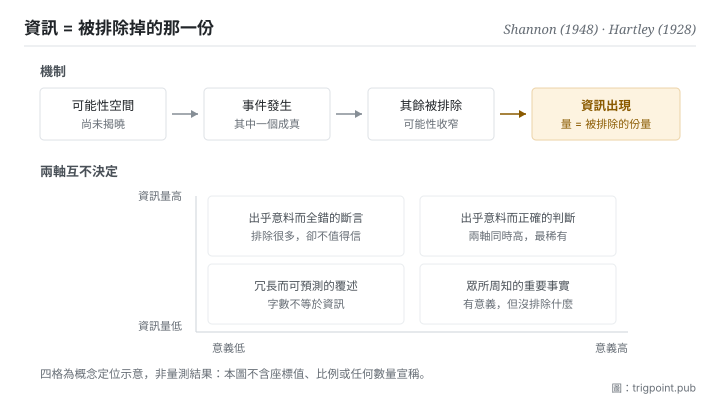

Canonical: https://trigpoint.pub/zh-Hant/collections/information-theory/information-and-uncertainty  
Captured: 2026-11-02T21:27:54.262343+08:00

> 公開理論閱讀鏡像。驗證層及 Lab 案例請到原站閱讀。

「資訊就是內容」：是兩回事。

# 資訊與不確定性

Information and Uncertainty · Shannon (1948) / Hartley (1928)

已對照來源本身 ✓  
資訊理論 · 基本定義

## 三句講透

資訊不是內容，是不確定性的削減量。  
一件事帶多少資訊，取決於它排除掉多少原本可能發生的情況，而不是它講了多長、多深、多重要。  
所以「資訊量」與「有沒有意義」是兩把不同的尺，量出來的東西互不決定。

<strong>圖 1</strong> · 資訊出現的機制示意：先有一個可能性空間，事件發生後排除掉其中一部分，被排除的份量就是資訊。  
下方兩軸說明同一句話可以在資訊量與意義上落在完全不同的位置，兩軸互不決定。

## 一、發生什麼事

1948 年那篇奠基論文開宗明義做了一件現在看來仍然反直覺的事：它把「意義」從問題裡拿掉[\[1\]](#reference-note-1)。原文說得很直接，通訊的語義層面與工程問題無關。這不是迴避，是劃界：要讓資訊變成可計算、可傳輸、可比較的量，就必須先放棄追問它在說什麼。隔年那本書收入 Weaver 的導論，把通訊問題分成技術、語義、效果三層，並承認這套理論表面上只適用於第一層；不過他同時主張，它對另兩層也有幫助與啟發[\[3\]](#reference-note-3)。

拿掉意義之後，剩下什麼可以量？剩下<strong>可能性的排除</strong>。設想一個尚未揭曉的局面，它有一組可能的結果；當其中一個成真，其餘全部被排除，而被排除的份量就是這件事帶來的資訊。這個定義有個立刻可驗的後果：同一句話在不同處境下的資訊量不同。對已經知道明天下雨的人，「明天會下雨」幾乎不帶資訊；對所有預報都說晴天的人，同一句話資訊量極高。變的不是句子，是它排除掉的東西。

再往前一步就分出兩個層級。單一事件排除了多少，是那個事件的資訊量；整個局面平均而言有多難猜，是這個系統的熵。兩者常被混為一談，但它們回答的是不同的問題：一個問「這次揭曉讓我知道了多少」，一個問「揭曉之前我有多不確定」。本站接下來兩頁分別處理。

對數結構的雛形其實更早。1928 年那篇把訊息量與可區分狀態的數量連起來，替後來的形式化鋪了路[\[2\]](#reference-note-2)。要注意它處理的是無噪音情形，把噪音下的容量歸給它是後來才產生的引註訛傳。

<strong>署名要給對：</strong>對數結構的雛形歸 Hartley（1928），但他處理的是無噪音情形的狀態計數，不含噪音下的容量[\[2\]](#reference-note-2)。把資訊定義為不確定性的削減、並明文把語義排除在工程問題之外的，是 Shannon（1948）[\[1\]](#reference-note-1)。技術、語義、效果三層的分法出自 Weaver 為 1949 年那本所寫的導論，不是 Shannon 本人的原文；Weaver 也沒有把理論限在第一層，他主張它對另兩層同樣有幫助[\[3\]](#reference-note-3)。三者要分開署名：壓成「Shannon 提出資訊理論並區分了三個層次」會同時弄錯雛形出處與三層分法的作者。

## 二、為什麼這對你重要

你每天都在用「資訊」這個詞，但用的是它的日常語感：資訊多＝講得多、講得細、講得專業。這套理論說那是另一回事，而這個差別會直接改變你怎麼判斷手上的東西。

一份三千字的會議紀錄，如果它記下的全部是你事前就能預測的內容，那它的資訊量接近零，儘管它的字數不是。一份模型輸出讀起來條理分明、術語齊備，也可能因為它只是把你的提問重新排列而幾乎沒有排除任何可能性。判斷的問題不該是「這段內容夠不夠豐富」，而是「它排除了什麼我原本以為可能的東西」。前一個問題沒有答案，後一個有。

這條界線還有一個更難接受的推論：<strong>資訊量高不代表對</strong>。一句斷言越是出乎意料，它排除的可能性越多，資訊量就越高，而它是否為真完全是另一把尺的事。模型給出一個大膽而具體的判斷，它在這套理論下確實是高資訊量的輸出，這件事本身不構成任何相信它的理由。把兩把尺分開，是使用這套語言的第一個代價，也是它給你的第一個好處。

## 常見誤讀

所屬頁核驗：已對照來源本身 ✓ · 內容最後修訂 2026-10-25

- 常見轉述「資訊量高代表內容有價值」：兩者是獨立的兩軸。一句完全錯誤的話可以有極高資訊量，一句極有意義的話也可以幾乎沒有資訊量。本理論只量前者，對後者不發一言。
- 常見轉述「Hartley 提出了資訊的容量公式」：Hartley 1928 給的是無噪音情形下可區分狀態的計數，不是噪音功率下的容量。後者屬 1948 年那篇。這條訛傳有流傳，本站另有專頁處理。

## 參考文獻

<strong>如何閱讀來源註記</strong> 「書目經…核對」指作者、年份、題名與出版項已確認；不代表該來源的主張已被核對。「對照全文核實」指主張已與來源文本本身比對。 定義版本：2026-09-20。

- \[1\] Shannon, C. E. (1948). A Mathematical Theory of Communication. Bell System Technical Journal, 27(3), 379–423; 27(4), 623–656.
- \[2\] Hartley, R. V. L. (1928). Transmission of Information. Bell System Technical Journal, 7(3), 535–563.
- \[3\] Shannon, C. E. & Weaver, W. (1949). The Mathematical Theory of Communication. University of Illinois Press.

引用格式：Trigpoint，〈資訊與不確定性〉，trigpoint.pub/zh-Hant/collections/information-theory/information-and-uncertainty · © Strategitect Limited. · 內容最後修訂 2026-10-25

## 來源註記

**[1]** Shannon, C. E. (1948). A Mathematical Theory of Communication. Bell System Technical Journal, 27(3), 379–423; 27(4), 623–656. DOI 10.1002/j.1538-7305.1948.tb01338.x. 書目經官方記錄核對。主張已對照全文核實。出處經跨模型雙查核實。引言處明文把語義問題排除在工程問題之外：通訊的語義層面與工程問題無關。

**[2]** Hartley, R. V. L. (1928). Transmission of Information. Bell System Technical Journal, 7(3), 535–563. DOI 10.1002/j.1538-7305.1928.tb01236.x. 書目經官方記錄核對。主張已對照全文核實。以可區分狀態的計數建立資訊的對數結構雛形。該篇明言先假設沒有外來干擾，不含噪音功率下的容量；把後者歸給 Hartley 是引註訛傳（見本站「通道與容量」頁）。

**[3]** Shannon, C. E. & Weaver, W. (1949). The Mathematical Theory of Communication. Urbana: University of Illinois Press. 書目經出版社記錄核對。主張已對照全文核實。出處經跨模型雙查核實。Weaver 導論把通訊問題分為技術、語義、效果三層；他承認這套數學理論表面上只適用於第一層，同時主張它對另兩層也有幫助與啟發。

---

[English](../../../en/collections/information-theory/information-and-uncertainty.md) · [简体中文](../../../zh-Hans/collections/information-theory/information-and-uncertainty.md)

[Index](../../README.md) · [Original page](https://trigpoint.pub/zh-Hant/collections/information-theory/information-and-uncertainty) · [Citation and versions](../../../READING.md)

[Original SVG](assets/information-and-uncertainty.svg) · Display copy adds a white background only.
