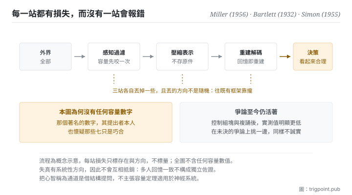

Canonical: https://trigpoint.pub/zh-Hant/collections/information-theory/information-theory-and-cognition  
Captured: 2026-11-02T21:27:54.665893+08:00

> 公開理論閱讀鏡像。驗證層及 Lab 案例請到原站閱讀。

複述陌生文化的故事時，受試者把看不懂的細節改得合理。

# 資訊理論與認知科學

Information Theory and Cognitive Science · Miller (1956) / Bartlett (1932) / Simon (1955)

書目已核 ✓  
資訊理論 · 跨域接口  
先讀：通道與容量  
先讀：編碼與壓縮

## 三句講透

心智是一個在容量限制與噪音下運作的資訊處理系統。  
它不儲存原始資料，它壓縮；回憶不是讀取，是用壓縮後的線索重建。  
所以理解會有損失、記憶會走樣，這是機制的常態。

<strong>圖 1</strong> · 訊息從外界走到決策的流程示意：每一站都有容量限制與噪音，因此每一站都有損失。  
圖上刻意不標任何容量數字，理由見本頁驗證層：那個著名的數字本身正在爭議中。

## 一、發生什麼事

一則陌生文化的故事經受試者複述，不熟悉的細節換成了他們覺得說得通的版本。把前面幾頁的概念搬到人身上，會得到一個相當一致的圖像。注意力、工作記憶、處理速度全部有上限，因此輸入必須被過濾；被留下的部分不是原樣存起來，而是被壓縮成某種結構；日後要用時，是拿那個結構去<strong>重建</strong>，而不是把原件調出來。每一站都有噪音，每一站都有損失。

記憶是重建而非記錄，這一點在 1932 年那本書裡就有實驗支持[\[4\]](#reference-note-4)：受試者複述一則陌生文化的故事時，會把不熟悉、不理解的細節改成自己覺得合理的版本。這正是壓縮加重建的典型後果：<strong>損失發生在編碼端，錯誤出現在解碼端，而中間沒有任何一步會報錯</strong>。

有限理性是同一個圖像在決策上的版本[\[5\]](#reference-note-5)：人不是最優化機器，因為最優化需要的計算與資訊都超出可用的容量，所以實際的決策是在有限容量下尋找「夠好」的解。這個說法常被誤讀成人不理性，但它的原意剛好相反，它說的是在給定約束下的合理行為。

至於容量到底有多大，這一頁必須停下來說清楚，因為那個數字是本頁最有名也最被誤用的部分。1956 年那篇提出的通行數字確實存在且影響深遠，但<strong>它的作者本人在篇末就保留判斷，懷疑那些反覆出現的七只是巧合</strong>[\[1\]](#reference-note-1)；2001 年那篇把它讀為粗略估計與修辭裝置，不是一個真正的容量上限，並指出在控制了組塊與複誦之後，測得的數字明顯更低[\[2\]](#reference-note-2)。這個爭論至今仍然活著。另有一條研究線把組塊重新定義為「最大程度壓縮之後的單位」，讓容量的問題與本書架段三接上[\[3\]](#reference-note-3)。

<strong>署名要給對：</strong>記憶為重建而非記錄，歸 Bartlett（1932）[\[4\]](#reference-note-4)。有限理性的早期表述歸 Simon（1955）[\[5\]](#reference-note-5)。工作記憶容量的通行數字歸 Miller（1956），但<strong>其性質為歷史與修辭錨，非既定極限：作者本人已懷疑那些七只是巧合，「修辭裝置」則是後續研究的解讀</strong>[\[1\]](#reference-note-1)[\[2\]](#reference-note-2)；控制組塊與複誦後的修正研究歸 Cowan（2001）[\[2\]](#reference-note-2)，以壓縮觀點重述組塊的研究歸 Mathy 與 Feldman（2012）[\[3\]](#reference-note-3)。當代以預測誤差最小化統攝知覺與行動的表述另有一線[\[6\]](#reference-note-6)，本站未對其爭議面核對，故不作為本頁任何主張的依據。這一頁的署名紀律比其他頁更嚴：<strong>引用那個數字時，必須同時引用它的爭議</strong>，否則就是把一個作者自己保留的說法當成結論。

## 二、為什麼這對你重要

第一個推論，也是最實用的一個：<strong>你交出去的東西，能不能被用，取決於對方的容量，不是你的完整性</strong>。

寫的人天然會往完整那邊優化，因為完整是可以自我檢查的，而對方的容量看不見。結果是一份沒有錯誤、涵蓋周全、對方讀不完的文件。本書架段二說過，超過容量的傳輸不會報錯；這一頁補上另一半：接收端也不知道自己溢出了，他會給你一個建立在被截斷的輸入上的合理回應。兩邊都不會發現。

第二個推論：<strong>壓縮不是體貼，是必要條件</strong>。既然接收端一定會壓縮，那麼問題只是由誰來壓。你不壓，對方就會壓，而對方壓的時候用的是他的框架、他的先驗，你無法控制他會丟掉哪一部分。你先壓，至少你能決定失真落在哪裡，這正是本書架段三那條規矩的理由。

第三個推論關於記憶的可靠性，而它對協作有直接影響：<strong>當事人記得的版本與當時發生的事不同，這是常態，不是誰不誠實</strong>。既然回憶是重建，那麼任何依賴事後回憶的流程都在使用一個有系統性偏差的來源。可行的對策不是要求大家記清楚，是在當下留下記錄，讓後來的重建有東西可以校準。

第四點是關於這一頁自己：把心智稱為通道，是一個有啟發性的類比。它讓你問對問題，但它不授權你套用任何數值。這一頁刻意不給任何容量數字，理由見下節。

## 常見誤讀

所屬頁核驗：書目已核 ✓ · 內容最後修訂 2026-10-25

- 常見轉述「工作記憶容量是七加減二，這是心理學的定論」：那篇論文本身是經典且確實存在，但作者在篇末就對那些反覆出現的七保留判斷，懷疑只是巧合；後續研究把它讀為粗略估計與修辭裝置，並在控制組塊與複誦之後測得明顯更低的數字。這個爭論到今天仍然活著。把它當定論引用，是把一個被作者自己保留的說法當成結論。
- 常見轉述「記憶會失真是因為不夠專心」：記憶本來就不是記錄，是壓縮之後的重建。失真是這個機制的常態產物，不是注意力不足的症狀。

## 參考文獻

<strong>如何閱讀來源註記</strong> 「書目經…核對」指作者、年份、題名與出版項已確認；不代表該來源的主張已被核對。「與摘要一致」指主張與論文摘要相符；不含逐句對照全文。「對照全文核實」指主張已與來源文本本身比對。「依多源一致轉述」指主張建立於多份彼此一致、轉述該來源的資料，而非原文件本身。 定義版本：2026-09-20。

- \[1\] Miller, G. A. (1956). The Magical Number Seven, Plus or Minus Two: Some Limits on Our Capacity for Processing Information. Psychological Review, 63(2), 81–97.
- \[2\] Cowan, N. (2001). The Magical Number 4 in Short-Term Memory: A Reconsideration of Mental Storage Capacity. Behavioral and Brain Sciences, 24(1), 87–114.
- \[3\] Mathy, F. & Feldman, J. (2012). What's Magic about Magic Numbers? Chunking and Data Compression in Short-Term Memory. Cognition, 122(3), 346–362.
- \[4\] Bartlett, F. C. (1932). Remembering: A Study in Experimental and Social Psychology. Cambridge: Cambridge University Press.
- \[5\] Simon, H. A. (1955). A Behavioral Model of Rational Choice. Quarterly Journal of Economics, 69(1), 99–118.
- \[6\] Friston, K. (2010). The Free-Energy Principle: A Unified Brain Theory? Nature Reviews Neuroscience, 11(2), 127–138. 書目經官方記錄核對。要旨與摘要一致。僅作脈絡提及，本站未核對其爭議面，刻意不作為本頁任何主張之依據。

引用格式：Trigpoint，〈資訊理論與認知科學〉，trigpoint.pub/zh-Hant/collections/information-theory/information-theory-and-cognition · © Strategitect Limited. · 內容最後修訂 2026-10-25

## 來源註記

**[1]** Miller, G. A. (1956). The Magical Number Seven, Plus or Minus Two: Some Limits on Our Capacity for Processing Information. Psychological Review, 63(2), 81–97. DOI 10.1037/h0043158. 書目經官方記錄核對。主張已對照全文核實。通行數字的出處。作者在篇末對那些反覆出現的七保留判斷，自言懷疑只是巧合。

**[2]** Cowan, N. (2001). The Magical Number 4 in Short-Term Memory: A Reconsideration of Mental Storage Capacity. Behavioral and Brain Sciences, 24(1), 87–114. DOI 10.1017/S0140525X01003922. 書目經官方記錄核對。主張已對照全文核實。在阻斷複誦、不讓項目重組為更大組塊的條件下，各類資料指向一個明顯低於通行數字的容量上限。文中把 1956 年那個數字讀為粗略估計與修辭裝置，而非真正的容量上限；這是本文的解讀，不是原作者的話。

**[3]** Mathy, F. & Feldman, J. (2012). What's Magic about Magic Numbers? Chunking and Data Compression in Short-Term Memory. Cognition, 122(3), 346–362. DOI 10.1016/j.cognition.2011.11.003. 書目經官方記錄核對。要旨與摘要一致。以壓縮觀點重述組塊：一個組塊即一個最大程度壓縮後的編碼單位。

**[4]** Bartlett, F. C. (1932). Remembering: A Study in Experimental and Social Psychology. Cambridge: Cambridge University Press. 書目經出版社記錄核對。要旨與摘要一致。記憶為重建而非記錄之經典來源：受試者複述一則陌生文化的鬼故事時，會把不理解的細節改掉。

**[5]** Simon, H. A. (1955). A Behavioral Model of Rational Choice. Quarterly Journal of Economics, 69(1), 99–118. DOI 10.2307/1884852. 書目經官方記錄核對。本文在有限理性概念史上的位置依多源一致轉述。常被視為有限理性概念的早期表述：以生物實際擁有的資訊與計算能力，取代全知的最優化假設。

**[6]** Friston, K. (2010). The Free-Energy Principle: A Unified Brain Theory? Nature Reviews Neuroscience, 11(2), 127–138. DOI 10.1038/nrn2787. 書目經官方記錄核對。要旨與摘要一致。自由能原理：把知覺、行動與學習統攝為對「意外」（預測誤差）的最小化。本站未對其爭議面另做核對，僅作為脈絡列出。

---

[English](../../../en/collections/information-theory/information-theory-and-cognition.md) · [简体中文](../../../zh-Hans/collections/information-theory/information-theory-and-cognition.md)

[Index](../../README.md) · [Original page](https://trigpoint.pub/zh-Hant/collections/information-theory/information-theory-and-cognition) · [Citation and versions](../../../READING.md)

[Original SVG](assets/information-theory-and-cognition.svg) · Display copy adds a white background only.
