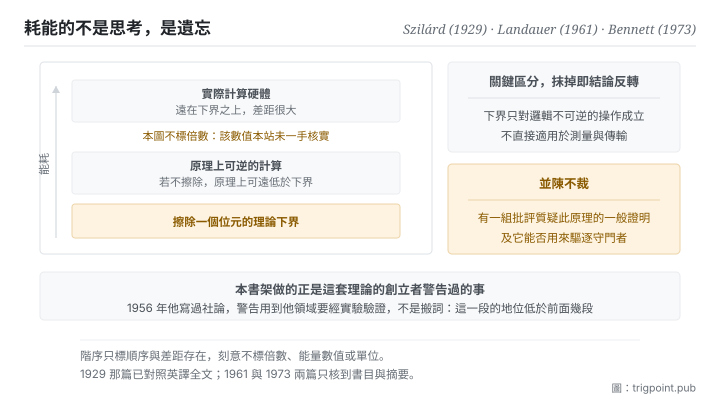

Canonical: https://trigpoint.pub/zh-Hant/collections/information-theory/information-theory-and-thermodynamics  
Captured: 2026-11-02T21:27:54.981754+08:00

> 公開理論閱讀鏡像。驗證層及 Lab 案例請到原站閱讀。

做計算與擦掉資料，熱力學的帳要分開記；下界落在後者。

# 資訊理論與熱力學

Information Theory and Thermodynamics · Szilárd (1929) / Landauer (1961) / Bennett (1973)

摘要已核 ✓  
資訊理論 · 跨域接口  
先讀：熵

## 三句講透

資訊不是純粹的抽象。  
把一個位元擦掉，物理上必須付出熱量，這是熱力學給計算劃下的硬邊界。  
所以「維持秩序需要持續投入能量」在這一頁不是比喻，它有一個下界，而且可以量。

<strong>圖 1</strong> · 計算能耗的階序示意：最底下是理論下界，也就是擦除資訊必須付出的熱量；實際硬體遠在其上。  
圖上刻意不標任何倍數與能量數值，只標階序與差距存在。

## 一、發生什麼事

計算本身和把資料擦掉，耗能的帳不能併在一起算：本頁講的下界只落在擦除上。這條線的起點不是計算機，是一個思想實驗。十九世紀有人設想一個能分辨快慢分子的守門者，藉此在不做功的情況下製造溫差，看起來直接違反熱力學第二定律。1929 年那篇提出了關鍵的一步：<strong>守門者要分辨，就得取得資訊，而取得資訊這件事本身要計入熵的帳</strong>[\[1\]](#reference-note-1)。悖論的出口從此不在物理系統，而在觀察者身上。

1961 年那篇把帳算得更清楚，也更違反直覺：真正必須付出熱的不是計算，是<strong>擦除</strong>[\[2\]](#reference-note-2)。理由是邏輯不可逆的操作會把多個可能的輸入狀態壓成同一個輸出狀態，這個壓縮必須在環境裡以熱的形式補回去。1973 年那條線再推一步，證明計算在邏輯上可以做到每一步都可逆，並據此指出：不擦除的計算，原理上可以把每一步的耗散壓到遠低於那個下界的量級[\[3\]](#reference-note-3)。三步合起來給出一個很乾淨的結論：<strong>耗能的不是思考，是遺忘。</strong>

要注意這條線不是沒有反對意見。有一組哲學與物理的批評認為，前述原理的一般性證明並不成立：例如有批評指出，那些證明把存有不同資料的記憶裝置不當地當成同一個統計系綜；而用它來一般性地驅逐守門者，現有的論證也不足[\[4\]](#reference-note-4)。這場爭論至今活著，本站並陳不裁。

最後，形式同源這件事要放在正確的位置。資訊熵與統計力學的熵在數學形式上同源，這一點沒有爭議；但兩者的單位、詮釋與本體地位是否相同，至今仍有爭論、未有定論，本站在熵那一頁已經分層處理過。

<strong>署名要給對：</strong>把觀察者取得資訊與熵變正式連起來的早期關鍵一步，歸 Szilárd（1929）[\[1\]](#reference-note-1)。擦除必然伴隨熱耗散的下界歸 Landauer（1961）[\[2\]](#reference-note-2)；計算在邏輯上可以每一步都可逆、原理上可遠低於該下界，歸 Bennett（1973）[\[3\]](#reference-note-3)。對前述原理的哲學批評有其獨立傳統，本站並陳不裁[\[4\]](#reference-note-4)。而對整條跨域外推的公開警告，出自這套理論的創立者本人（1956）[\[5\]](#reference-note-5)。三段要分開署名，特別是第二段與第三段：把「計算耗能」與「擦除耗能」混為一談，會讓整條線的結論反轉。

## 二、為什麼這對你重要

本書架前面十一頁講的都是限制與取捨；這一頁講的是為什麼那些限制不是人的問題。

<strong>維持一個有序的系統需要持續投入，而且那個投入有物理下界。</strong>這句話在日常裡通常是勵志文的口吻，但在這一頁它是一個可以量的陳述：清掉舊狀態、覆蓋過期的記錄、把散落的東西收回結構裡，這些動作在最抽象的層次上都是擦除，而擦除有代價。你的知識庫、你的專案、你的工作流不會自己維持在有序狀態，不是因為你不夠自律，是因為維持有序<strong>本來就是一項持續支出</strong>，停止支出，秩序就開始崩解。

第二件事是關於「遺忘比記住貴」這個反直覺的結論。它在人的層面有一個對應：<strong>決定丟掉什麼，比決定留下什麼難得多</strong>。留下不需要判斷，丟掉需要。所以任何一個持續累積的系統，真正的瓶頸從來不在收集，在刪減，而刪減之所以拖延，不是懶，是它的單位成本確實比較高。知道這一點之後，正確的做法是替刪減安排固定的預算，而不是期待它在有空的時候發生。

第三件事是把這條線與整個書架接起來。段一定義了資訊，段二說它傳不過去，段三說怎麼壓縮，段四說怎麼量相關與錯，段五說誰在承受這些限制。這一頁給出最後一個承受者：<strong>物理世界本身</strong>。前面所有的限制都不是約定，它們最終落在能量上。

## 常見誤讀

所屬頁核驗：摘要已核 ✓ · 內容最後修訂 2026-10-25

- 常見轉述「資訊熵與熱力學熵是同一回事」：兩者的數學形式同源，本體論上是否等價至今仍有爭論、未有定論。本站在熵那一頁與本頁都分層並陳，不挑一邊。
- 常見轉述「計算本身要耗能」：據前述原理，耗能來自邏輯不可逆的操作，尤其是擦除；原理上可逆的計算不受同樣下界的約束。這個區分是整條線的關鍵，抹掉它會得到相反的結論。
- 常見轉述「所以資訊有質量／資訊是物理的」：本頁支持的是一個較窄的命題，擦除資訊有能量下界。從這裡跳到更強的形上學結論，需要本頁沒有提供的論證。

## 參考文獻

<strong>如何閱讀來源註記</strong> 「書目經…核對」指作者、年份、題名與出版項已確認；不代表該來源的主張已被核對。「與摘要一致」指主張與論文摘要相符；不含逐句對照全文。「對照全文核實」指主張已與來源文本本身比對。 定義版本：2026-09-20。

- \[1\] Szilárd, L. (1929). Über die Entropieverminderung in einem thermodynamischen System bei Eingriffen intelligenter Wesen. Zeitschrift für Physik, 53(11–12), 840–856. English translation: Behavioral Science, 9(4), 301–310 (1964).
- \[2\] Landauer, R. (1961). Irreversibility and Heat Generation in the Computing Process. IBM Journal of Research and Development, 5(3), 183–191.
- \[3\] Bennett, C. H. (1973). Logical Reversibility of Computation. IBM Journal of Research and Development, 17(6), 525–532.
- \[4\] Norton, J. D. (2005). Eaters of the lotus: Landauer's principle and the return of Maxwell's demon. Studies in History and Philosophy of Modern Physics, 36(2), 375–411. 書目經官方記錄核對。要旨與摘要一致。列為對前述原理之批評的代表文獻。
- \[5\] Shannon, C. E. (1956). The Bandwagon. IRE Transactions on Information Theory, IT-2(1), 3.

引用格式：Trigpoint，〈資訊理論與熱力學〉，trigpoint.pub/zh-Hant/collections/information-theory/information-theory-and-thermodynamics · © Strategitect Limited. · 內容最後修訂 2026-10-25

## 來源註記

**[1]** Szilárd, L. (1929). Über die Entropieverminderung in einem thermodynamischen System bei Eingriffen intelligenter Wesen. Zeitschrift für Physik, 53(11–12), 840–856. DOI 10.1007/BF01341281. English translation: On the decrease of entropy in a thermodynamic system by the intervention of intelligent beings. Behavioral Science, 9(4), 301–310 (1964). 書目經官方記錄核對。主張已對照全文核實。文中論證：若非測量本身必然伴隨熵的產生，測量所憑的那種記憶能力就可能造成熵的永久減少；算出的熵產生恰好足以完全抵銷。英譯版的編者按稱它為最早、或最早之一的此類論文。

**[2]** Landauer, R. (1961). Irreversibility and Heat Generation in the Computing Process. IBM Journal of Research and Development, 5(3), 183–191. DOI 10.1147/rd.53.0183. 書目經官方記錄核對。要旨與摘要一致。沒有單值反函數的邏輯操作（邏輯不可逆，如擦除）必然伴隨最低限度的熱產生。

**[3]** Bennett, C. H. (1973). Logical Reversibility of Computation. IBM Journal of Research and Development, 17(6), 525–532. DOI 10.1147/rd.176.0525. 書目經官方記錄核對。要旨與摘要一致。證明通用計算機可以做到每一步在邏輯上都可逆；作者據此認為，每一步耗散遠低於該下界量級的熱力學可逆計算機是可能的。

**[4]** Norton, J. D. (2005). Eaters of the lotus: Landauer's principle and the return of Maxwell's demon. Studies in History and Philosophy of Modern Physics, 36(2), 375–411. DOI 10.1016/j.shpsb.2004.12.002. 書目經官方記錄核對。要旨與摘要一致。對前述原理的批評之一：作者認為它只對一類特定的擦除過程成立，其一般性證明有賴把存有隨機資料的記憶裝置不當地當成同一個統計系綜；並認為現有理論不足以一般性地驅逐守門者。Earman、Norton 與 Shenker 等人另有相關批評。屬活的哲學爭論，本站並陳不裁。

**[5]** Shannon, C. E. (1956). The Bandwagon. IRE Transactions on Information Theory, IT-2(1), 3. DOI 10.1109/TIT.1956.1056774. 書目經官方記錄核對。主張已對照全文核實。編者社論。文中列出當時正在套用這套理論的領域（生物、心理、語言學、基礎物理、經濟等），並警告：理論的基本結果針對一個很特定的方向；用到其他領域不是把詞語搬過去就算數，而要經過假設與實驗驗證的緩慢過程。

---

[English](../../../en/collections/information-theory/information-theory-and-thermodynamics.md) · [简体中文](../../../zh-Hans/collections/information-theory/information-theory-and-thermodynamics.md)

[Index](../../README.md) · [Original page](https://trigpoint.pub/zh-Hant/collections/information-theory/information-theory-and-thermodynamics) · [Citation and versions](../../../READING.md)

[Original SVG](assets/information-theory-and-thermodynamics.svg) · Display copy adds a white background only.
