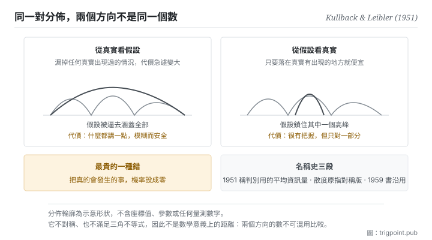

Canonical: https://trigpoint.pub/zh-Hant/collections/information-theory/kl-divergence  
Captured: 2026-11-02T21:27:55.241139+08:00

> 公開理論閱讀鏡像。驗證層及 Lab 案例請到原站閱讀。

模型該涵蓋所有出現過的情況，還是鎖住一個高峰？

# 相對熵

Kullback-Leibler Divergence · Kullback & Leibler (1951)

書目已核 ✓  
資訊理論 · 分佈之間  
先讀：熵  
先讀：互信息

## 三句講透

這個量回答一個很實際的問題：你用錯的模型去編碼真實的資料，每一筆平均要多付多少。  
它永遠不小於零，只有在你的模型完全正確時才等於零。  
但它不是距離：從你看真相與從真相看你，是兩個不同的數。

<strong>圖 1</strong> · 方向選擇造成的兩種行為示意：從真實看假設，會逼假設去涵蓋所有真實出現過的情況，代價是模糊；從假設看真實，會逼假設鎖住其中一個高峰，代價是漏掉其他。  
同一對分佈，兩個方向給出不同的數與不同的最優解。

## 一、發生什麼事

拿模型去逼近真實資料時，有一個常在不自覺中做掉的取捨：涵蓋所有真實出現過的情況，或鎖住其中一個高峰。前面幾頁講過，最省的編碼方式由資料的真實機率結構決定：常出現的用短碼，罕見的用長碼。現在假設你搞錯了那個結構，你以為某些情況很常見，實際上很罕見。你仍然可以編碼，只是碼長分配錯了，於是平均下來每一筆都會比最省的方案多付一點。<strong>這一頁量的就是那個多付的量。</strong>

從這個角度看，它的幾個性質都變得自然。它<strong>永遠非負</strong>，因為你不可能比最省的方案更省；它<strong>只有在你的假設完全正確時等於零</strong>。它衡量的不是兩個分佈長得像不像，是<strong>用其中一個去替代另一個要付的代價</strong>。

而代價這個框架直接解釋了它最著名的性質：<strong>不對稱</strong>。我用你的分佈去編我的資料，和你用我的分佈去編你的資料，這兩件事的成本沒有理由相同。加上它也不滿足三角不等式，所以它在數學上不是距離，儘管它常被這樣稱呼。

不對稱不只是技術細節，它會造成兩種完全不同的行為。一個方向會逼你的模型去<strong>涵蓋</strong>所有真實出現過的情況，因為漏掉任何一個真實出現的情況，代價會急遽變大；結果是模型變得保守而模糊，什麼都涵蓋一點。另一個方向會逼你的模型去<strong>鎖住</strong>其中一個高峰，把其餘部分放棄；結果是模型很有把握，但只對了一部分。這兩種行為在實務上都看得到，而選了哪個方向往往不是有意識的決定。

還有一個容易踩到的邊界：如果真實會發生的某種情況，在你的假設下機率被設成零，那麼代價是無限大。直覺上很合理，你的模型宣稱那件事不可能，而它發生了。實務上這意味著任何「絕不可能」的斷言都極其昂貴。

至於名字，要分兩段記：1951 年那篇稱它為「用於判別的平均資訊量」[\[1\]](#reference-note-1)；當時的「散度」一詞指的是兩個方向相加的對稱化版本，1959 年那本書沿用[\[2\]](#reference-note-2)。

<strong>署名要給對：</strong>這個量歸 Kullback 與 Leibler（1951），原文稱之為「用於判別的平均資訊量」[\[1\]](#reference-note-1)。「散度」一詞原指兩個方向相加的對稱化版本，Kullback（1959）那本書沿用[\[2\]](#reference-note-2)；單向的那個量後來才被普遍以兩人之名稱呼。非負性由 Gibbs 不等式給出，屬教科書層標準結果，本站未對其出處另做核對，故不列入參考文獻[\[3\]](#reference-note-3)。名稱與量分開記帳，是本頁與本書架其他幾頁共有的紀律。

## 二、為什麼這對你重要

這一頁把「我的判斷錯了」從一句話變成一個有結構的量，而結構的部分才是有用的。

第一件事：<strong>錯誤的代價與錯誤的方向有關</strong>。當你和現實不一致，重點不只是差多少，還有你是往哪個方向錯。你的模型過度自信地排除了某些可能，與你的模型太保守地涵蓋了太多可能，是兩種不同的錯，代價結構不同，該用的修正也不同。多數人在檢討判斷失準時只問「差多少」，這一頁說還要問「往哪邊」。

第二件事最實用：<strong>任何「絕不可能」的斷言都是最貴的一種錯</strong>。你的模型只要在某處把機率設成零，而那件事真的發生了，代價就爆掉。這給了一條可以直接套用的紀律：在你的判斷裡保留非零的可能性給你認為不會發生的事，尤其是在資訊不足的時候。這條紀律的成本很低，它防的損失卻沒有上界。

第三件事關於模型的行為。你會在使用模型時看到兩種傾向：一種是什麼都講一點、什麼都不排除，讀起來安全但沒有用；另一種是很有把握地給出一個具體答案，但漏掉了其他同樣可能的情況。這一頁提供的框架是：這兩種傾向對應的是不同的優化方向，不是「好模型」與「壞模型」的差別。知道這一點，你會改問另一個問題：<strong>在我這件事上，哪一種錯誤比較貴</strong>。答案決定你該逼它往哪邊走。

## 常見誤讀

所屬頁核驗：書目已核 ✓ · 內容最後修訂 2026-10-25

- 常見轉述「這是兩個分佈之間的距離」：它不對稱，也不滿足三角不等式，因此不是數學意義上的距離。要用真正的距離，得換別的度量。這條誤稱相當普遍。
- 常見轉述「這個概念叫做 KL 散度，出自 1951 年那篇」：1951 年那篇稱它為「用於判別的平均資訊量」；那時的「散度」一詞，指的是兩個方向相加的對稱化版本。名稱與量的歷史要分開記。
- 常見轉述「數值越大代表兩個分佈差越多」：方向不同數值不同，比較前必須先講清楚是哪一個方向。同一對分佈換個方向，大小關係可能反轉。

## 參考文獻

<strong>如何閱讀來源註記</strong> 「書目經…核對」指作者、年份、題名與出版項已確認；不代表該來源的主張已被核對。「依多源一致轉述」指主張建立於多份彼此一致、轉述該來源的資料，而非原文件本身。 定義版本：2026-09-20。

- \[1\] Kullback, S. & Leibler, R. A. (1951). On Information and Sufficiency. Annals of Mathematical Statistics, 22(1), 79–86.
- \[2\] Kullback, S. (1959). Information Theory and Statistics. New York: Wiley; London: Chapman & Hall.
- \[3\] 編輯註，無外部來源；內容見正文註 \[3\]。

引用格式：Trigpoint，〈相對熵〉，trigpoint.pub/zh-Hant/collections/information-theory/kl-divergence · © Strategitect Limited. · 內容最後修訂 2026-10-25

## 來源註記

**[1]** Kullback, S. & Leibler, R. A. (1951). On Information and Sufficiency. Annals of Mathematical Statistics, 22(1), 79–86. DOI 10.1214/aoms/1177729694. 書目經官方記錄核對。原文的用語依多源一致轉述。原文把單向的那個量稱為「用於判別的平均資訊量」；同文的「散度」指的是兩個方向相加的對稱化版本，不是今天稱為 KL 散度的單向量。

**[2]** Kullback, S. (1959). Information Theory and Statistics. New York: Wiley; London: Chapman & Hall. 書目經多源交叉核對。書中用語與後來的稱呼依多源一致轉述。書中沿用「散度」稱對稱化的版本，兩個方向各自的量稱為「有向散度」；單向的那個量後來才被普遍以兩人之名稱呼。

**[3]** 非負性由 Gibbs 不等式給出，等號成立當且僅當兩分佈相同。屬教科書層標準結果，本站未對其出處另做核對。

---

[English](../../../en/collections/information-theory/kl-divergence.md) · [简体中文](../../../zh-Hans/collections/information-theory/kl-divergence.md)

[Index](../../README.md) · [Original page](https://trigpoint.pub/zh-Hant/collections/information-theory/kl-divergence) · [Citation and versions](../../../READING.md)

[Original SVG](assets/kl-divergence.svg) · Display copy adds a white background only.
