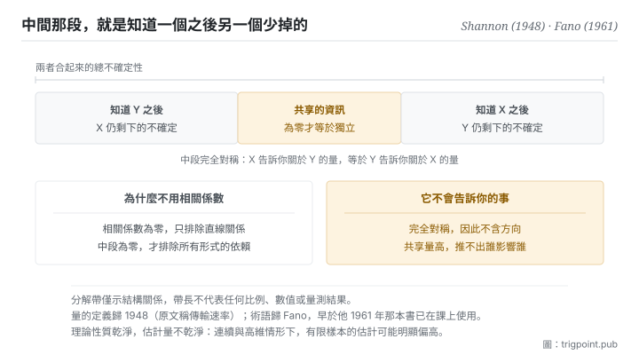

Canonical: https://trigpoint.pub/zh-Hant/collections/information-theory/mutual-information  
Captured: 2026-11-02T21:27:55.543608+08:00

> 公開理論閱讀鏡像。驗證層及 Lab 案例請到原站閱讀。

「相關係數是零就是沒關係」：錯。

# 互信息

Mutual Information · Shannon (1948) / Fano (1961)

書目已核 ✓  
資訊理論 · 分佈之間  
先讀：熵

## 三句講透

互信息量的是：知道其中一個之後，另一個的不確定性少了多少。  
它為零才等於真正的獨立，而且抓得到相關係數看不見的非線性依賴。  
代價是它完全對稱，因此它告訴你「有關」，永遠不告訴你「誰影響誰」。

<strong>圖 1</strong> · 兩個變數的不確定性分解示意：整條帶是兩者合起來的總不確定性，中間那段是知道其中一個之後、另一個少掉的部分，也就是共享的資訊。  
兩側各自是知道對方之後仍然剩下的部分。  
帶長僅示結構關係，不代表任何比例。

## 一、發生什麼事

前面幾頁量的都是單一對象的不確定性。這一頁開始量<strong>兩個之間</strong>。做法很直接：先看其中一個原本有多不確定，再看知道另一個之後它還剩多少不確定，兩者的差就是它們共享的資訊量。

這個構造有幾個乾淨的性質。它<strong>永遠非負</strong>，也就是知道一件事不會讓你對另一件事更不確定，至少平均而言不會。它<strong>完全對稱</strong>：X 告訴你關於 Y 的量，等於 Y 告訴你關於 X 的量。而最有用的一條是：<strong>它為零，當且僅當兩者統計獨立</strong>。

最後這條是它與相關係數的關鍵差別。相關係數只捕捉線性關係，因此相關係數為零並不排除兩者有強烈的依賴，只是那個依賴不是直線形狀的。互信息沒有這個盲點，任何形式的統計依賴都會讓它大於零。代價是計算成本：在連續變數與高維情形下，從有限樣本估計它相當困難，實務上得靠各種代理方法，而那些方法各有自己的偏差。

這個量也是通道容量的核心：容量正是在所有可能的輸入分佈上，讓這個共享資訊量最大的那個值[\[1\]](#reference-note-1)。也就是說，本書架段二那條硬邊界，量的正是這一頁的東西。

還有一條標準推論值得記住，它處理的是資訊在流程中的走向：一條資訊經過任何加工之後，它與原始來源的共享量只會減少或持平，<strong>不會增加</strong>。加工可以讓資訊更好用、更易讀，但不能無中生有。這條推論屬教科書層，本站未對其出處另做核對，因此不掛引註標號，僅作為方向性提示。

至於名字，要分兩段記：這個<strong>量</strong>歸 1948 年那篇，原文稱之為傳輸速率[\[1\]](#reference-note-1)；「互信息」這個<strong>術語</strong>歸 Fano，不歸 Shannon[\[2\]](#reference-note-2)。

<strong>署名要給對：</strong>這個量的定義歸 Shannon（1948），原文稱之為傳輸速率，並在同一篇中被用來建立通道容量[\[1\]](#reference-note-1)。「互信息」這個術語歸 Fano：常被引用的出處是他 1961 年的書，但據學術史記述，他更早已在課上使用這個詞[\[2\]](#reference-note-2)。量與詞要分開記帳：把兩者一併歸給 1948 年那篇是常見寫法，但那會抹去一段真實的術語史。至於它與分佈差異度量的等價關係，見本站相關專頁；把兩者當成同一個概念是另一種常見的壓縮過度。

## 二、為什麼這對你重要

本書架段二說訊號是「能穩定降低不確定性的輸入」，但沒有給量。這一頁給了：<strong>共享資訊量就是那個量</strong>。

實務上你不會真的去計算它，但它提供的提問方式可以直接用：<strong>如果拿掉這一項，我的結論會不會不同</strong>。這個問句是共享資訊量的日常版本，因為它問的正是「知道這件事之後，我對結論的不確定性有沒有變」。用它去審一份給模型的脈絡，多數段落會當場出局，這不是因為它們錯，是因為它們不改變任何東西。

第二個用處是拆穿一個很常見的誤判。有人拿相關係數說兩件事無關，然後停止調查。這一頁說那個結論太強了：相關係數為零只排除直線關係，而現實裡的依賴常常是有轉折的、有閾值的、分段的。<strong>要主張獨立，需要比相關係數更強的證據。</strong>

第三個用處帶著警告。這個量完全對稱，所以它永遠不會告訴你方向。兩件事共享很多資訊，可能是甲影響乙、乙影響甲、或兩者都被第三件事影響。看到高共享量就推論因果，是把一個對稱的量當成有向的量用。要處理方向需要另一族含時序的變體，本書架因其技術密度未收。

## 常見誤讀

所屬頁核驗：書目已核 ✓ · 內容最後修訂 2026-10-25

- 常見轉述「相關係數為零代表兩者無關」：只代表沒有線性關係。本頁這個量為零才等於統計獨立，而它抓得到非線性與非單調的依賴。用相關係數當獨立性檢定，是把一個較弱的條件當成較強的來用。
- 常見轉述「這個術語出自 Shannon 1948」：他定義了那個量，原文稱之為傳輸速率，沒有用「互信息」一詞；這個術語歸 Fano。量與詞要分開記帳。
- 常見轉述「互信息越高代表因果關係越強」：它完全對稱，不含方向，因此不能用來判斷誰造成誰。要處理方向需要另一族含時序的變體，本書架未收。

## 參考文獻

<strong>如何閱讀來源註記</strong> 「書目經…核對」指作者、年份、題名與出版項已確認；不代表該來源的主張已被核對。「對照全文核實」指主張已與來源文本本身比對。「依多源一致轉述」指主張建立於多份彼此一致、轉述該來源的資料，而非原文件本身。 定義版本：2026-09-20。

- \[1\] Shannon, C. E. (1948). A Mathematical Theory of Communication. Bell System Technical Journal, 27(3), 379–423; 27(4), 623–656.
- \[2\] Fano, R. M. (1961). Transmission of Information: A Statistical Theory of Communications. Cambridge, MA: MIT Press.

引用格式：Trigpoint，〈互信息〉，trigpoint.pub/zh-Hant/collections/information-theory/mutual-information · © Strategitect Limited. · 內容最後修訂 2026-10-25

## 來源註記

**[1]** Shannon, C. E. (1948). A Mathematical Theory of Communication. Bell System Technical Journal, 27(3), 379–423; 27(4), 623–656. 書目經官方記錄核對。主張已對照全文核實。原文以「傳輸速率」之名定義這個量（來源的熵減去收到訊號後仍剩的條件熵），並以它對所有輸入來源取最大值來定義通道容量。全文沒有使用「mutual information」一詞。

**[2]** Fano, R. M. (1961). Transmission of Information: A Statistical Theory of Communications. Cambridge, MA: MIT Press. 書目經多源交叉核對。術語早於本書的使用依多源一致轉述。「互信息」一詞歸 Fano。有學術史記述指出，他在 MIT 的課上已使用這個詞（引其 1952 年的課程講義），早於本書；本頁因此只把本書當作常被引用的出處，不當作術語首見。

---

[English](../../../en/collections/information-theory/mutual-information.md) · [简体中文](../../../zh-Hans/collections/information-theory/mutual-information.md)

[Index](../../README.md) · [Original page](https://trigpoint.pub/zh-Hant/collections/information-theory/mutual-information) · [Citation and versions](../../../READING.md)

[Original SVG](assets/mutual-information.svg) · Display copy adds a white background only.
