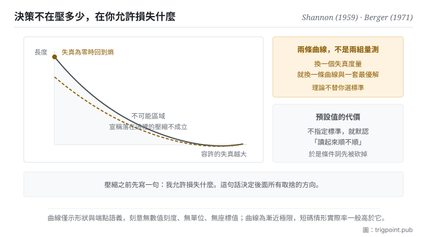

Canonical: https://trigpoint.pub/zh-Hant/collections/information-theory/rate-distortion-theory  
Captured: 2026-11-02T21:27:55.956587+08:00

> 公開理論閱讀鏡像。驗證層及 Lab 案例請到原站閱讀。

影像要壓縮，失真照數值差異算，還是照人眼在意的算？

# 率失真理論

Rate-Distortion Theory · Shannon (1959) / Berger (1971)

書目已核 ✓  
資訊理論 · 表示與壓縮  
先讀：熵  
先讀：編碼與壓縮

## 三句講透

允許失真，就能壓得比熵更低，但低到哪裡有一條不可逾越的曲線。  
真正的設計決策不是壓多少，是<strong>先指定哪一種損失可以接受</strong>。  
選錯了那個標準，你會非常有效率地優化一件錯的事。

<strong>圖 1</strong> · 率與失真的取捨曲線示意：容許的失真越大，所需的長度下界越低；容許失真為零時，下界回到熵。  
曲線下方是不可能區域，任何宣稱落在那裡的壓縮都不成立。  
本圖刻意無數值刻度與單位。

## 一、發生什麼事

允許失真之後，第一個設計決定是哪一種差異算作損失，然後才輪到能壓多短。無損壓縮的地板是熵。但很多時候我們不需要完整還原：一張照片、一段錄音、一份摘要，損失一些細節換取大幅縮短是划算的。問題是划算到哪裡為止。

答案的雛形在 1948 年那篇末段已就連續來源提出[\[4\]](#reference-note-4)，1959 年那篇給了它完整的形狀[\[1\]](#reference-note-1)。它用一個「失真度量」來說明什麼樣的差異算是損失、損失多少；然後在「平均失真不超過 D」這個約束下，求所需長度的最小值。得到的是一條隨 D 遞減的曲線：容許的失真越大，需要的長度越少。曲線有兩個端點值得記：<strong>容許失真為零時，它回到熵</strong>；容許失真大到極限時，它降到零，也就是什麼都不傳。1971 年那本教科書把這個領域系統化，成為此後的典律[\[2\]](#reference-note-2)。

這條曲線最重要的性質不是它的形狀，是它下方的區域<strong>不可能</strong>。任何宣稱能在某個失真水準下壓得比曲線更低的方法，不是計算錯了就是偷偷改了失真的定義。這給了你一個很硬的檢查工具。

而整套理論真正的重量落在一個常被略過的地方：<strong>失真度量是你選的</strong>。理論本身不告訴你什麼算損失，它只在你給定標準之後，告訴你極限在哪。所以同一份資料，換一個失真度量就會得到完全不同的曲線、完全不同的最優壓縮法。影像壓縮領域一個著名的後果是，用數值差異當標準做出來的方法，在人眼看來會產生特定形態的瑕疵，因為人眼在意的東西不是數值差異。

還有一條實務上的修正：曲線是<strong>漸近</strong>可達的，需要很長的碼塊。短訊息、要求即時的場合，實際能達到的率一般高於曲線[\[3\]](#reference-note-3)。

<strong>署名要給對：</strong>有損壓縮的理論極限歸 Shannon：概念在 1948 年那篇末段已就連續來源提出[\[4\]](#reference-note-4)，1959 年的會議紀錄論文給出離散來源的完整表述[\[1\]](#reference-note-1)。領域的系統化與典律地位歸 Berger（1971）那本教科書[\[2\]](#reference-note-2)，兩者角色不同，不可互相代稱。有損壓縮在有限碼長下的修正，可見 Kostina 與 Verdú（2012）[\[3\]](#reference-note-3)。至於把這套框架引入機器學習表徵理論的後續變體，本站因其下游主張存在未決爭議而未收入本書架，僅在此註明其存在。

## 二、為什麼這對你重要

你每天做的摘要、交接、簡報，全部是有損壓縮。差別在於多數人沒有意識到自己正在做一個選擇：<strong>哪一種損失是可以接受的</strong>。

不指定這件事，就等於默認一個標準，而默認值通常是「讀起來順不順」。於是壓縮的過程變成砍掉那些讓句子變長、變彆扭的部分，而那些部分往往正是承載條件與例外的地方：「除非」「取決於」「只有在」「必須」。砍掉它們，文字流暢度上升，而流暢度正是那個被默認的失真度量，所以優化過程覺得自己做得很好。損失的是判斷所需的邊界，而這種損失不會產生錯誤訊息。

換一個度量，整個做法就變了。如果你把失真度量定成「讀者會不會做出不同的決定」，那麼首先要保住的就是所有改變決定的條件，而可以整段丟掉的是背景、動機、與過程敘述。同一份材料，同樣壓到一半長度，兩個版本會完全不一樣，而且各自在自己的標準下最優。

所以這一頁給的操作是一句話：<strong>壓縮之前，先寫下你允許損失什麼</strong>。這句話寫出來通常不到十個字，但它決定了後面所有的取捨方向。我們自己的知識庫把它寫成一條硬規矩：壓縮時承載因果與條件的詞永不可刪，其餘皆可。這條規矩就是一個明文的失真度量。

第三件事是承認極限。當你發現無論怎麼壓都會損失掉你不能接受的東西，那不代表你技巧不夠，代表<strong>你要的失真水準對應的長度就是那麼長</strong>。這時候正確的動作是接受長度，或者改變讀者，而不是繼續壓。

## 常見誤讀

所屬頁核驗：書目已核 ✓ · 內容最後修訂 2026-10-25

- 常見轉述「有損壓縮就是品質比較差的壓縮」：不是品質好壞，是取捨位置。有損壓縮的設計核心不是壓多少，是事先指定哪一種損失可以接受、哪一種不行。沒有指定失真度量的有損壓縮，等於沒有目標。
- 常見轉述「曲線上的值是可以達到的」：那是漸近極限，需要很長的碼塊。短訊息與即時場合的實際率一般高於曲線；有損壓縮在有限碼長下的修正量，2012 年有論文系統刻畫。

## 參考文獻

<strong>如何閱讀來源註記</strong> 「書目經…核對」指作者、年份、題名與出版項已確認；不代表該來源的主張已被核對。「與摘要一致」指主張與論文摘要相符；不含逐句對照全文。「對照全文核實」指主張已與來源文本本身比對。 定義版本：2026-09-20。

- \[1\] Shannon, C. E. (1959). Coding Theorems for a Discrete Source with a Fidelity Criterion. IRE National Convention Record, 7, Part 4, 142–163.
- \[2\] Berger, T. (1971). Rate Distortion Theory: A Mathematical Basis for Data Compression. Englewood Cliffs, NJ: Prentice-Hall.
- \[3\] Kostina, V., & Verdú, S. (2012). Fixed-Length Lossy Compression in the Finite Blocklength Regime. IEEE Transactions on Information Theory, 58(6), 3309–3338.
- \[4\] Shannon, C. E. (1948). A Mathematical Theory of Communication. Bell System Technical Journal, 27(3), 379–423; 27(4), 623–656.

引用格式：Trigpoint，〈率失真理論〉，trigpoint.pub/zh-Hant/collections/information-theory/rate-distortion-theory · © Strategitect Limited. · 內容最後修訂 2026-10-25

## 來源註記

**[1]** Shannon, C. E. (1959). Coding Theorems for a Discrete Source with a Fidelity Criterion. IRE National Convention Record, 7, Part 4, 142–163. 書目經雙源核對。主張已對照全文核實。以失真度量與平均失真上限定義率失真函數 R(d)，並證明離散來源的編碼定理；R(d) 隨 d 單調遞減，失真超過某一上限時降為零。

**[2]** Berger, T. (1971). Rate Distortion Theory: A Mathematical Basis for Data Compression. Englewood Cliffs, NJ: Prentice-Hall. 書目經多源交叉核對。把率失真理論系統化整理的教科書。

**[3]** Kostina, V., & Verdú, S. (2012). Fixed-Length Lossy Compression in the Finite Blocklength Regime. IEEE Transactions on Information Theory, 58(6), 3309–3338. DOI 10.1109/TIT.2012.2186786. 書目經官方記錄核對。要旨與摘要一致。有損壓縮在有限碼長下的分析：給定碼長與失真超標的機率，最低可達率近似為 R(d) 加上一項隨碼長平方根遞減的修正，因此短碼情形的實際率一般高於曲線。

**[4]** Shannon, C. E. (1948). A Mathematical Theory of Communication. Bell System Technical Journal, 27(3), 379–423; 27(4), 623–656. 書目經官方記錄核對。主張已對照全文核實。原刊第 26 至 27 節（後來的重排本作第 27 至 28 節）以距離函數衡量重建的保真度，定義來源相對於保真度的率，並給出對應的編碼定理（定理 21）；處理的是連續來源。

---

[English](../../../en/collections/information-theory/rate-distortion-theory.md) · [简体中文](../../../zh-Hans/collections/information-theory/rate-distortion-theory.md)

[Index](../../README.md) · [Original page](https://trigpoint.pub/zh-Hant/collections/information-theory/rate-distortion-theory) · [Citation and versions](../../../READING.md)

[Original SVG](assets/rate-distortion-theory.svg) · Display copy adds a white background only.
