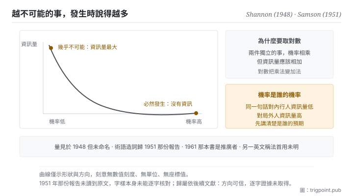

Canonical: https://trigpoint.pub/zh-Hant/collections/information-theory/self-information  
Captured: 2026-11-02T21:27:56.205956+08:00

> 公開理論閱讀鏡像。驗證層及 Lab 案例請到原站閱讀。

同一件事的資訊量，要按知情者還是局外人的機率算？

# 資訊量

Self-Information · Shannon (1948) / Samson (1951)

書目已核 ✓  
資訊理論 · 核心量度  
先讀：資訊與不確定性

## 三句講透

一件事帶多少資訊，取決於它原本有多不可能發生。  
必然發生的事發生了，等於什麼也沒告訴你；幾乎不可能的事發生了，帶的資訊量最大。  
所以資訊量量的是它推翻了多少你原本的預期。

<strong>圖 1</strong> · 資訊量與機率的關係示意：機率越低，該事件發生時帶的資訊量越高；當一件事幾乎必然發生，它發生時幾乎沒有告訴你任何事。  
右側說明為何要取對數，兩個獨立事件的資訊量才加得起來。  
本圖刻意無數值刻度與單位。

## 一、發生什麼事

替一個事件算資訊量之前，要先做一個選擇：用掌握內情者的機率，還是局外人的機率。把資訊定義為不確定性的削減之後，下一步是替單一事件定出一個數。答案其實已經藏在 1948 年那篇裡：熵是每個結果的 log(1/p) 按機率加權的平均，論文也用同一個量界定單一訊息所需的碼長[\[1\]](#reference-note-1)。把它單獨拿出來看，結論簡潔到有點反直覺：一個事件的資訊量，只由它的機率決定，機率越低資訊量越高。必然發生的事，資訊量為零。

為什麼要取對數，而不是直接用機率的倒數？因為要讓資訊量<strong>加得起來</strong>。兩件互不相干的事同時發生，它們合起來帶的資訊，直覺上應該是各自資訊量的和；而兩件獨立事件同時發生的機率是兩個機率相乘。要把乘法變成加法，對數是唯一自然的選擇。這個看似技術性的決定，讓資訊變成一個可以累計、可以比較、可以當單位用的量，整套理論的實用性都建立在這上面。

這裡有個容易滑過去的細節：<strong>機率是誰的機率</strong>。同一件事，對掌握內情的人機率高、資訊量低，對局外人機率低、資訊量高。理論本身不規定機率從哪裡來，它只要求你先講清楚是誰的預期。這就是為什麼「這句話資訊量大不大」沒有絕對答案，只有「對誰」的答案。

至於名字，有兩件事要分開記。這個<strong>量</strong>出自 1948 年那篇的框架，但論文沒有替它命名[\[1\]](#reference-note-1)；「surprisal」這個<strong>詞</strong>的造詞優先權，後續文獻歸於 1951 年一份空軍研究報告，1961 年那本書使它流通但非首創[\[2\]](#reference-note-2)[\[3\]](#reference-note-3)；而英文裡另一個常見稱法不見於 1948 年那篇，本站未查到可靠的首用出處，故不歸給任何一位[\[4\]](#reference-note-4)。

<strong>署名要給對：</strong>這個量出自 Shannon（1948）的框架，但論文沒有單獨為它定義或命名[\[1\]](#reference-note-1)。「surprisal」一詞的造詞優先權，後續文獻歸 Samson（1951）[\[2\]](#reference-note-2)，Tribus（1961）為推廣者而非首創[\[3\]](#reference-note-3)；英文中另一個常見稱法不見於 1948 年那篇，本站未查到可靠的首用出處[\[4\]](#reference-note-4)。量與詞要分開記帳：把兩者一起歸給 Shannon 是常見的簡化，但那會同時抹去一位有優先權的作者與一段真實的術語史。

## 二、為什麼這對你重要

這一頁給你的是一個可以直接套用的閱讀動作：<strong>讀任何一段內容，先問它推翻了你哪一項預期</strong>。

這個動作能立刻分辨兩種讀起來很像的東西。一種是把你已經相信的事，用更完整、更有條理的方式重講一遍；另一種是告訴你某件你以為如此的事其實不然。前者讀起來很舒服，資訊量接近零；後者讀起來不舒服，資訊量高。<strong>舒適感與資訊量在這裡是負相關的</strong>，這對挑選閱讀材料是一條很鋒利的判準。

用在模型輸出上更直接。一份回應如果完全落在你的預期分佈裡，無論它多長多完整，它對你的不確定性沒有削減。真正有用的輸出通常有一個共同特徵：其中至少有一項是你事前會賭它不是這樣的。所以與其問「這個回答好不好」，不如問「它有沒有任何一處讓我意外」。沒有，那這次呼叫的產出接近零，不管它產生了多少字。

反過來也成立，而且這是一個實用的自我檢查：<strong>當你寫的東西讓所有人都點頭，你可能什麼也沒說</strong>。共識性的陳述機率高、資訊量低。這不代表它們沒有價值，鋪陳與對齊有它們的功能，但要清楚那部分不是你在傳遞資訊，是你在對齊機率分佈。兩件事要分開計。

## 常見誤讀

所屬頁核驗：書目已核 ✓ · 內容最後修訂 2026-10-25

- 常見轉述「Shannon 提出了 surprisal 這個概念與名稱」：1948 年那篇用到了那個量，但沒有替它造詞。造詞優先權據後續文獻屬 1951 年一份空軍研究報告，1961 年那本書使它流通。至於中文常見的「自資訊」對應的英文術語，不見於 1948 年那篇，本站未查到可靠的首用出處。
- 常見轉述「資訊量取決於事件是否重要」：不取決於重要性，只取決於它原本有多不可能。這條在直覺上很難接受，但它正是整套理論能量化的前提。

## 參考文獻

<strong>如何閱讀來源註記</strong> 「書目經…核對」指作者、年份、題名與出版項已確認；不代表該來源的主張已被核對。「對照全文核實」指主張已與來源文本本身比對。「依多源一致轉述」指主張建立於多份彼此一致、轉述該來源的資料，而非原文件本身。 定義版本：2026-09-20。

- \[1\] Shannon, C. E. (1948). A Mathematical Theory of Communication. Bell System Technical Journal, 27(3), 379–423; 27(4), 623–656.
- \[2\] Samson, E. W. (1951). Fundamental Natural Concepts of Information Theory. AFCRC Report E5079.
- \[3\] Tribus, M. (1961). Thermostatics and Thermodynamics. Van Nostrand.
- \[4\] 編輯註，無外部來源；全文見正文註 \[4\]。

引用格式：Trigpoint，〈資訊量〉，trigpoint.pub/zh-Hant/collections/information-theory/self-information · © Strategitect Limited. · 內容最後修訂 2026-10-25

## 來源註記

**[1]** Shannon, C. E. (1948). A Mathematical Theory of Communication. Bell System Technical Journal, 27(3), 379–423; 27(4), 623–656. DOI 10.1002/j.1538-7305.1948.tb01338.x. 書目經官方記錄核對。主張已對照全文核實。論文用到這個量：熵是各結果的 log(1/p) 按機率加權的平均，單一訊息所需碼長的界也以 log(1/p) 表示。但論文沒有把它單獨定義為單一事件的資訊量，也沒有替它命名；全文不見 self-information、surprisal、mutual information 這幾個詞。

**[2]** Samson, E. W. (1951). Fundamental Natural Concepts of Information Theory. AFCRC Report E5079. 書目經雙源核對。「surprisal」一詞之造詞歸屬依多源一致轉述。後續文獻把「surprisal」一詞的造詞優先權歸於本報告。本站未讀到報告原文，該詞是否出現在報告內未能逐字核對。

**[3]** Tribus, M. (1961). Thermostatics and Thermodynamics. Van Nostrand. 書目經雙源核對。本書推廣該詞之說依多源一致轉述。使「surprisal」一詞流通，屬推廣而非首創。

**[4]** 「self-information」一詞不見於 1948 年那篇；本站未查到可靠的首用出處，故不歸給任何一位。

---

[English](../../../en/collections/information-theory/self-information.md) · [简体中文](../../../zh-Hans/collections/information-theory/self-information.md)

[Index](../../README.md) · [Original page](https://trigpoint.pub/zh-Hant/collections/information-theory/self-information) · [Citation and versions](../../../READING.md)

[Original SVG](assets/self-information.svg) · Display copy adds a white background only.
