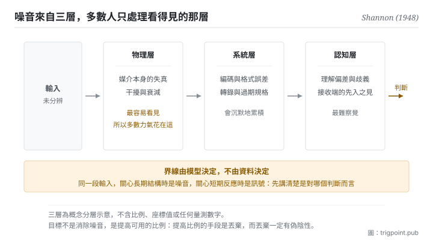

Canonical: https://trigpoint.pub/zh-Hant/collections/information-theory/signal-and-noise  
Captured: 2026-11-02T21:27:56.589432+08:00

> 公開理論閱讀鏡像。驗證層及 Lab 案例請到原站閱讀。

看長期結構，還是短期反應？訊號與噪音會因此換邊。

# 訊號與噪音

Signal and Noise · Shannon (1948)

書目已核 ✓  
Lab 實測 ✓  
資訊理論 · 傳輸極限  
先讀：資訊量  
先讀：熵

## 三句講透

訊號是能穩定降低不確定性的那部分輸入，其餘是噪音。  
兩者的界線不在資料本身，在你用來讀它的模型：換一個模型，同一段輸入可能換一邊。  
所以要下功夫的，是把可用的比例拉高。

<strong>圖 1</strong> · 噪音的三個來源層示意：同一段輸入在抵達判斷之前，會依序經過物理、系統與認知三層干擾。  
下方指出一個常被忽略的性質，訊號與噪音的界線由你當下用的模型決定，換一個模型同一段輸入可能換一邊。

## 一、發生什麼事

一段輸入該當訊號還是噪音，要先選定拿它回答哪個判斷：長期結構，或短期反應。1948 年那篇的一個關鍵動作，是把噪音正式寫進通訊模型裡[\[1\]](#reference-note-1)。噪音從此成為模型的一部分，於是「在干擾存在下仍能可靠傳輸多少」變成一個可以分析、可以求極限的問題。這個轉向的重要性在於：它承認噪音不會消失，然後去問在它存在的前提下能做到什麼。

從這個角度看，訊號的定義變得很窄：<strong>只有能穩定改變你的機率分佈的輸入才是訊號</strong>。能改變，指它削減了不確定性；穩定，指它不是這次改變、下次又反過來的隨機擾動。不滿足這兩條的部分，無論它看起來多像資料，都是噪音。

噪音來自至少三層，而它們往往同時作用。物理層是傳輸媒介本身的失真；系統層是編碼、格式、轉錄過程中引入的誤差；認知層是理解偏差、術語歧義、以及接收端自己的先入之見。多數人只處理第一層，因為它最容易看見。

還有一個性質常被忽略，而它是本頁最實用的一句：<strong>訊號與噪音是相對於模型而言的</strong>。同一段輸入，在你關心長期結構時是噪音，在你關心短期反應時是訊號。這不是模稜兩可，是這對概念的定義本來就帶著參照系。所以任何「這是不是訊號」的討論，如果沒先講清楚是對哪個判斷而言，都不會有結論。

<strong>署名要給對：</strong>把噪音正式納入通訊模型、使干擾下的可靠傳輸成為可分析問題的，是 Shannon（1948）；白噪音下的容量公式也已見於同一篇[\[1\]](#reference-note-1)，1949 年那篇另以幾何方式處理同一問題[\[2\]](#reference-note-2)。到 1948 年，訊噪比已是通訊工程的實用量：該篇開篇第一句就提到當時以頻寬換取訊噪比的 PCM、PPM 等調變方法[\[1\]](#reference-note-1)；更早的使用史與署名，本站未另做核對，故不作具體署名。其他工程史人物的歸屬本頁同樣未核，因此不列入本節。

## 二、為什麼這對你重要

多數人處理資訊過載的方式是加閘門：訂更多來源，做更多摘要，建更多分類。這一頁說那多半是在錯的變數上用力。

要看的量是比例，不是總量。你收到的東西變多，如果其中能改變判斷的比例沒有跟著變，你的處境沒有改善，只是變忙。更糟的是，總量增加通常會讓比例下降，因為新增的來源普遍比既有的更邊緣。<strong>輸入量與訊噪比是兩個可以反向移動的量</strong>，而只有後者影響你判斷得多準。

這在使用模型時特別致命，因為餵進去的脈絡有一個安靜的失敗模式。你把所有可能相關的東西都附上，模型不會告訴你其中八成是噪音，它會照單全收然後產出一個看起來合理的回應。你以為你在提供更完整的背景，實際上你在稀釋。判準很簡單：<strong>這段內容如果拿掉，我的結論會不會不同</strong>。不會，它就是噪音，附上去的成本不是零。

第三件事是關於時間尺度。把短期波動當成趨勢，是把噪音誤判為訊號的標準形態，而且它有一個很難擺脫的特徵：波動總是最新的、最生動的、最容易被解讀成「情況正在變化」。防這件事沒有巧妙的辦法，只能事前定好在哪個尺度上看、要看多久才算數，然後不要在中途改。

## 常見誤讀

所屬頁核驗：書目已核 ✓ · 內容最後修訂 2026-10-25

- 常見轉述「先把噪音去掉，再來分析」：多數情況下噪音不可消除，可調整的是訊號與噪音的比例。把目標設成消除噪音，通常會導致過度過濾，連訊號一起濾掉。
- 常見轉述「訊號與噪音是資料的固有屬性」：不是。同一段輸入在不同的模型與時間尺度下可以分屬兩邊。判斷之前要先講清楚是哪個模型、哪個尺度。

## 參考文獻

<strong>如何閱讀來源註記</strong> 「書目經…核對」指作者、年份、題名與出版項已確認；不代表該來源的主張已被核對。「對照全文核實」指主張已與來源文本本身比對。 定義版本：2026-09-20。

- \[1\] Shannon, C. E. (1948). A Mathematical Theory of Communication. Bell System Technical Journal, 27(3), 379–423; 27(4), 623–656.
- \[2\] Shannon, C. E. (1949). Communication in the Presence of Noise. Proceedings of the IRE, 37(1), 10–21.

引用格式：Trigpoint，〈訊號與噪音〉，trigpoint.pub/zh-Hant/collections/information-theory/signal-and-noise · © Strategitect Limited. · 內容最後修訂 2026-10-25

## 來源註記

**[1]** Shannon, C. E. (1948). A Mathematical Theory of Communication. Bell System Technical Journal, 27(3), 379–423; 27(4), 623–656. DOI 10.1002/j.1538-7305.1948.tb01338.x. 書目經官方記錄核對。主張已對照全文核實。把噪音正式納入通訊模型（第二部分〈有噪音的離散通道〉），使「在干擾下仍可靠傳輸」成為可分析的問題；白噪音下的通道容量公式見第 24 節定理 17。開篇第一句提到當時以頻寬換取訊噪比的 PCM、PPM 等調變方法。

**[2]** Shannon, C. E. (1949). Communication in the Presence of Noise. Proceedings of the IRE, 37(1), 10–21. DOI 10.1109/JRPROC.1949.232969. 書目經官方記錄核對。以幾何方式處理噪音下的傳輸；1948 年那篇已預告本文，並引用它作白噪音幾何性質的論述出處。噪音下的容量本站另有專頁。

---

[English](../../../en/collections/information-theory/signal-and-noise.md) · [简体中文](../../../zh-Hans/collections/information-theory/signal-and-noise.md)

[Index](../../README.md) · [Original page](https://trigpoint.pub/zh-Hant/collections/information-theory/signal-and-noise) · [Citation and versions](../../../READING.md)

[Original SVG](assets/signal-and-noise.svg) · Display copy adds a white background only.
