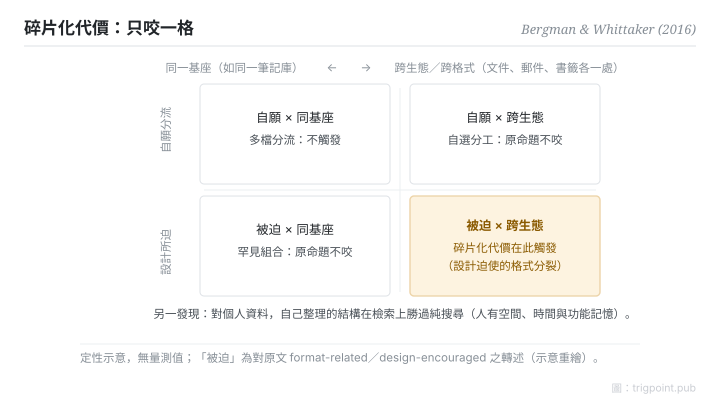

Canonical: https://trigpoint.pub/zh-Hant/collections/pkm/bergman-whittaker-2016-pim  
Captured: 2026-10-05T03:32:21.092946+08:00

> 公開理論閱讀鏡像。驗證層及 Lab 案例請到原站閱讀。

「工具越少越好」：錯在結構。

# 個人資訊管理

Personal Information Management · Bergman & Whittaker (2016)

摘要已核 ✓  
個人知識管理 · 實證科學

## 三句講透

個人資訊管理是一門實證科學，不是生產力雞湯。  
兩個核心發現：搜尋主導公共資訊，但用於個人資訊時效果較差，作者主張的「使用者主觀取向」並不取代資料夾；碎片化有明確邊界，只涵蓋被系統設計所迫的跨工具分裂。  
「工具越少越好」恰好把這條邊界讀漏了。

<strong>圖 1</strong> · 碎片化代價的適用邊界定性示意：兩軸為「分裂是否被系統設計所迫」與「是否跨生態／格式」；代價只在被迫且跨生態的一格觸發。  
同一基座內的自願多檔分流不在此列。  
「被迫」為對原文 format-related／design-encouraged 的轉述。  
示意重繪，非原書圖表。

## 一、發生什麼事

Bergman 與 Whittaker 2016 年在 MIT Press 出版的專著，綜合了個人資訊管理的研究[\[1\]](#reference-note-1)。資料夾常被批評：資訊藏在層層資料夾裡，要記住確切位置，資訊科學家因此主張搜尋更靈活。但作者的看法不同：搜尋、標籤等對公共資訊最有效，用於個人資訊時效果較差，他們主張的使用者主觀取向並不取代資料夾。碎片化命題同樣被修窄：所謂碎片化，一項經典界定（CHI 2006）是同一專案的資料分存於依格式分開的集合（20 人研究顯示是否碎片化取決於介面設計的鼓勵），文件一處、郵件一處、書籤又一處[\[2\]](#reference-note-2)。問題出在系統設計迫使的分裂，不是「多檔案」本身。

<strong>署名要給對：</strong>「被迫（involuntary）」是對原文 format-related／design-encouraged 的合理轉述，非原書逐字用語；資料夾批評句是書介的近似轉述。碎片化問題的一項經典界定見 Bergman、Beyth-Marom 與 Nachmias 2006 年的 CHI 論文[\[2\]](#reference-note-2)；2016 年專著是實證綜合的里程碑，引用時分開這兩層。

## 二、為什麼這對你重要

兩條設計推論。一，個人知識庫的「整理」不是浪費時間：你在為自己的記憶建索引，這正是搜尋替代不了的部分。二，判斷「要不要合併工具」之前先過邊界測試：跨生態、被格式所迫的分裂才落入這種碎片化的界定，同一基座內的多檔分流（例如同一筆記庫內按用途分多個檔案）不在這條定義之內。把設計主張當萬能，會讓你為不存在的代價重組系統；把邊界讀對，「工具多少才算多」就從口味之爭變成可判定的問題。要補一句誠實的邊界：這條定義只涵蓋跨工具那一種，不代表系統內部怎麼分都免費。

## 參考文獻

<strong>如何閱讀來源註記</strong> 「書目經…核對」指作者、年份、題名與出版項已確認；不代表該來源的主張已被核對。「與摘要一致」指主張與論文摘要相符；不含逐句對照全文。 定義版本：2026-09-20。

- \[1\] Bergman, O., & Whittaker, S. (2016). The Science of Managing Our Digital Stuff. Cambridge, MA: MIT Press. https://doi.org/10.7551/mitpress/9780262035170.001.0001
- \[2\] Bergman, O., Beyth-Marom, R., & Nachmias, R. (2006). The project fragmentation problem in personal information management. CHI 2006, 271–274. https://doi.org/10.1145/1124772.1124813

引用格式：Trigpoint，〈個人資訊管理〉，trigpoint.pub/zh-Hant/collections/pkm/bergman-whittaker-2016-pim · © Strategitect Limited. · 內容最後修訂 2026-10-01

## 來源註記

**[1]** Bergman, O., & Whittaker, S. (2016). The Science of Managing Our Digital Stuff. Cambridge, MA: MIT Press. ISBN 9780262035170. 書目經多源交叉核對。要旨與摘要一致。folder 批評句為書介近似轉述非逐頁引文。

**[2]** Bergman, O., Beyth-Marom, R., & Nachmias, R. (2006). The project fragmentation problem in personal information management. CHI 2006, 271–274. DOI 10.1145/1124772.1124813. 書目經多源交叉核對。要旨與摘要一致。碎片化問題的一項經典界定（同一專案資料分存於依格式分開的集合；20 人研究）。

---

[English](../../../en/collections/pkm/bergman-whittaker-2016-pim.md) · [简体中文](../../../zh-Hans/collections/pkm/bergman-whittaker-2016-pim.md)

[Index](../../README.md) · [Original page](https://trigpoint.pub/zh-Hant/collections/pkm/bergman-whittaker-2016-pim) · [Citation and versions](../../../READING.md)

[Original SVG](assets/bergman-whittaker-2016-pim.svg) · Display copy adds a white background only.
