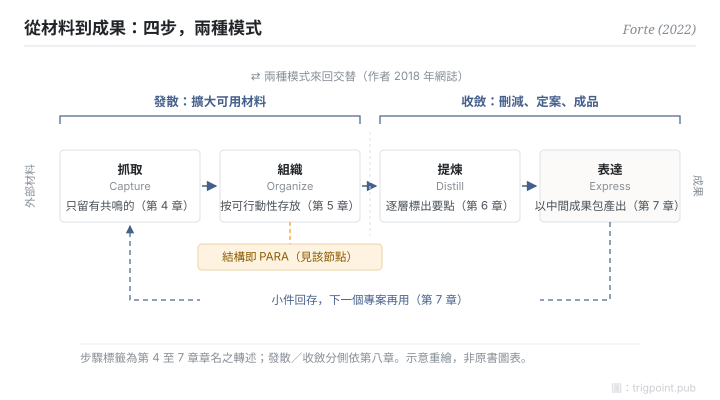

Canonical: https://trigpoint.pub/zh-Hant/collections/pkm/code-tiago-forte-2022  
Captured: 2026-10-05T03:32:21.173668+08:00

> 公開理論閱讀鏡像。驗證層及 Lab 案例請到原站閱讀。

「四步走完一次就交貨」：沒這麼簡單。

# CODE 四步法

CODE Method · Forte (2022)

書目已核 ✓  
個人知識管理 · 工作流程  
先讀：PARA 組織法

## 三句講透

收回來的材料，要經過四步才會變成成果：抓取只留有共鳴的，組織按可行動性存放，提煉逐層標出要點，表達以中間成果包組裝成品。  
書的第八章再把四步分成兩種模式：抓取與組織屬發散，提煉與表達屬收斂。  
收集只是前半程，成品要靠後兩步收窄與定案。

<strong>圖 1</strong> · 四步由左至右把外部材料逐步變成成果：抓取、組織屬發散，提煉、表達屬收斂；表達時做出的小件回存，供下一個專案重用。  
組織一步的結構即 PARA。  
步驟標籤為書第 4 至 7 章章名之轉述；兩種模式來回交替，出自作者 2018 年網誌。  
示意重繪，非原書圖表。

## 一、發生什麼事

以為四步走完一次就交貨，會漏掉書中兩處結構。Tiago Forte 在 2022 年出版的《Building a Second Brain》把方法核心寫成四步，第 4 至 7 章各講一步[\[1\]](#reference-note-1)。抓取（Capture）只保留觸動自己的材料；組織（Organize）按可行動性而非主題存放，所用的結構就是同書的 PARA；提煉（Distill）用漸進式歸納，分層標出重點，讓日後一眼取用；表達（Express）以中間成果包（Intermediate Packets）為單位產出，成品由既有的小件組裝，小件回存後可在下一個專案再用[\[1\]](#reference-note-1)。

第八章〈The Art of Creative Execution〉再把四步分成兩種工作模式：抓取與組織屬發散，負責擴大可用材料；提煉與表達屬收斂，負責刪減、定案、做出成品[\[1\]](#reference-note-1)。作者在 2018 年的網誌中描述兩種模式來回交替，並自述這套模型取自 Design Thinking[\[2\]](#reference-note-2)。

<strong>署名要給對：</strong>CODE 出自 Tiago Forte 2022 年的《Building a Second Brain》，引用「2022」指書。名稱所見最早為 2019 年 1 月的作者推文，課程 2017 年開辦時單元名不同，三個年份分開標。發散與收斂兩詞另有來源：技術用語見 Guilford 1956 年，設計流程形狀見 Design Council 的雙鑽石（另有一說追至 1970 年的 Jones，未核）；本書的貢獻是把 CODE 四步分派到兩側。作者自述模型取自 Design Thinking，這是網誌的說法。

## 二、為什麼這對你重要

筆記系統常見的停滯點在收集之後：材料越存越多，成品遲遲不出。CODE 把「存」與「交」拆成四個各有任務的步驟，每一步都可以單獨檢查：這份材料提煉過了沒有？提煉過的要點，有沒有用進一件成品？第八章的分法再提供一個判斷：還在擴大可選範圍，屬發散；開始刪減和定案，屬收斂。

一條邊界要記住：CODE 講材料怎樣變成成果；組織一步把東西放在哪裡，由 PARA 回答，本頁不重述，請見 PARA 節點。

## 參考文獻

<strong>如何閱讀來源註記</strong> 「書目經…核對」指作者、年份、題名與出版項已確認；不代表該來源的主張已被核對。「對照原站核實」指主張已與該項目的原始網站比對。「依多源一致轉述」指主張建立於多份彼此一致、轉述該來源的資料，而非原文件本身。 定義版本：2026-09-20。

- \[1\] Forte, T. (2022). Building a Second Brain: A Proven Method to Organize Your Digital Life and Unlock Your Creative Potential. New York: Atria Books / Simon & Schuster. https://www.simonandschuster.com/books/Building-a-Second-Brain/Tiago-Forte/9781982167387 書目經多源交叉核對。第八章發散與收斂段落（約 p.178–180）之兩側對應依多源一致轉述。
- \[2\] Forte Labs blog. Divergence and Convergence: The Two Fundamental Stages of the Creative Process (2022-05-16); Just-In-Time PM #8: Divergence and Convergence (2018-05-23). https://fortelabs.com/blog/ 書目經官方記錄核對。網誌兩項自述與 CODE 縮寫之時點已對照原站核實。
- \[3\] Guilford, J. P. (1956). The structure of intellect. Psychological Bulletin, 53(4), 267–293. https://doi.org/10.1037/h0040755 書目經出版社記錄核對。「1956 年為已知最早刊出之技術用語」一說依多源一致轉述。
- \[4\] Design Council (UK). History of the Double Diamond. https://www.designcouncil.org.uk/ 書目經官方記錄核對。2003／2004 年份與兩詞用法已對照原站核實。

引用格式：Trigpoint，〈CODE 四步法〉，trigpoint.pub/zh-Hant/collections/pkm/code-tiago-forte-2022 · © Strategitect Limited. · 內容最後修訂 2026-10-01

## 來源註記

**[1]** Forte, T. (2022). Building a Second Brain. Atria Books / Simon & Schuster. ISBN 9781982167387. 書目經多源交叉核對。第八章發散與收斂段落（約 p.178–180）之兩側對應依多源一致轉述。

**[2]** Forte Labs. 書目經官方記錄核對。網誌兩項自述與 CODE 縮寫之時點已對照原站核實。作者網誌（fortelabs.com）與 @fortelabs 推文。兩種模式「來回交替」及「取自 Design Thinking」之自述，均出自網誌，非書中文字。

---

[English](../../../en/collections/pkm/code-tiago-forte-2022.md) · [简体中文](../../../zh-Hans/collections/pkm/code-tiago-forte-2022.md)

[Index](../../README.md) · [Original page](https://trigpoint.pub/zh-Hant/collections/pkm/code-tiago-forte-2022) · [Citation and versions](../../../READING.md)

[Original SVG](assets/code-tiago-forte-2022.svg) · Display copy adds a white background only.
