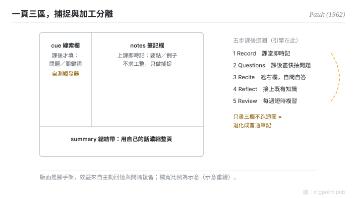

Canonical: https://trigpoint.pub/zh-Hant/collections/pkm/cornell-note-taking-pauk-1962  
Captured: 2026-10-05T03:32:21.331302+08:00

> 公開理論閱讀鏡像。驗證層及 Lab 案例請到原站閱讀。

「筆記抄得整齊就記得住」：錯在結構。

# 康乃爾筆記法

Cornell Note-Taking System · Pauk (1962)

書目已核 ✓  
個人知識管理 · 筆記法

## 三句講透

康乃爾筆記法把一頁紙分成三區：右欄上課即時記，左欄課後抽問題，底帶用自己的話總結。  
設計核心不是版面，是把「捕捉」與「加工」在時間上分開，再用遮蓋自測與每週複習對抗遺忘。  
只畫三欄而不做課後迴圈，它就退化成普通筆記。

<strong>圖 1</strong> · 三區版面示意：右欄上課即時記，左窄欄課後抽問題與關鍵詞，底帶用自己的話總結；配合遮蓋自測與每週複習的課後迴圈。  
示意重繪，非原書圖版。

## 一、發生什麼事

Pauk 是康乃爾大學閱讀與學習技巧中心主任，1962 年在《How to Study in College》把這套方法系統化，方法名取自校名[\[1\]](#reference-note-1)。它要解的問題：單純抄錄不等於學習，筆記若無後續加工，很快被遺忘吃掉。三區各司其職：右欄上課只做即時捕捉，不求工整；左窄欄課後盡快反推問題與關鍵詞；底帶用自己的話濃縮整頁。然後是複習迴圈：遮住右欄，看左欄線索出聲自答，再追問它與既有知識的關係，每週固定至少十分鐘複習，對抗遺忘[\[2\]](#reference-note-2)。

<strong>署名要給對：</strong>方法名取自校名，不是 Pauk 自冠姓名；方法 1950 年代已在校內漸成，1962 年專書定式，「1962」是出版年不是發明時點。官方頁列五步（Record–Questions–Recite–Reflect–Review，自述改編自 Pauk 第 7 版），流傳版本另有以 Reduce 取代 Questions 的寫法；流傳的 6R 多了 Recapitulate，未確證出自原書，引用時要標明版本。

## 二、為什麼這對你重要

用它之前先認清它的設計領域：單次輸入的消化（講座、閱讀、會議），不是跨筆記的想法網絡。它與網狀筆記法不是競爭，是分工：康乃爾強在輸入端的複習，弱在跨節點連結；先用它消化單次輸入，精煉出的概念再升格進永久筆記系統。

還有一個常被漏掉的位：版面只是腳手架，學習效益全部來自課後的主動回憶與間隔複習。這兩個機制在認知科學裡獨立成立；Pauk 的貢獻是把它們操作化成一套可執行的版面與流程，而不是提出機制本身。所以評價這套方法，看的是你有沒有跑迴圈，不是抄得整不整齊。

## 參考文獻

<strong>如何閱讀來源註記</strong> 「書目經…核對」指作者、年份、題名與出版項已確認；不代表該來源的主張已被核對。「對照原站核實」指主張已與該項目的原始網站比對。 定義版本：2026-09-20。

- \[1\] Pauk, W. (1962). How to Study in College (1st ed.).
- \[2\] Cornell University Learning Strategies Center. The Cornell Note Taking System. https://lsc.cornell.edu/notes.html

引用格式：Trigpoint，〈康乃爾筆記法〉，trigpoint.pub/zh-Hant/collections/pkm/cornell-note-taking-pauk-1962 · © Strategitect Limited. · 內容最後修訂 2026-10-01

## 來源註記

**[1]** Pauk, W. (1962). How to Study in College. 書目經多源交叉核對。（初版；現行第 11 版）。三區版面與五個步驟經康乃爾大學學習策略中心官方頁與多源交叉核對，未逐頁引錄原書。

**[2]** Cornell University Learning Strategies Center. The Cornell Note Taking System. 書目經官方記錄核對。五步名稱與課後整理時點已對照原站核實。（lsc.cornell.edu）。官方頁步驟名為 Record–Questions–Recite–Reflect–Review，頁面自述改編自 Pauk, How to Study in College 第 7 版（2001）；流傳版本寫作 Record–Reduce–Recite–Reflect–Review，兩者並存。官方頁第二步時限為 as soon after class as possible，每週複習至少十分鐘。

---

[English](../../../en/collections/pkm/cornell-note-taking-pauk-1962.md) · [简体中文](../../../zh-Hans/collections/pkm/cornell-note-taking-pauk-1962.md)

[Index](../../README.md) · [Original page](https://trigpoint.pub/zh-Hant/collections/pkm/cornell-note-taking-pauk-1962) · [Citation and versions](../../../READING.md)

[Original SVG](assets/cornell-note-taking-pauk-1962.svg) · Display copy adds a white background only.
