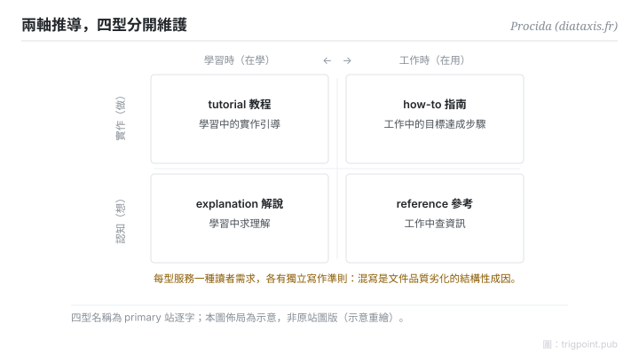

Canonical: https://trigpoint.pub/zh-Hant/collections/pkm/diataxis-procida  
Captured: 2026-10-05T03:32:21.724558+08:00

> 公開理論閱讀鏡像。驗證層及 Lab 案例請到原站閱讀。

「一份文件全部講完就好」：沒這麼簡單。

# Diátaxis 文件四型

Diátaxis · Procida

已對照來源本身 ✓  
個人知識管理 · 文件學

## 三句講透

文件寫不好，多數不是文筆問題，是四種讀者需求被塞進同一份文件。  
Diátaxis 用兩條軸拆開：讀者在做還是在想、在學還是在用，推出四型：tutorial、how-to、reference、explanation。  
核心紀律只有一條：四型分開維護，不混寫。

<strong>圖 1</strong> · 兩軸推導四型示意：實作對認知（做還是想）× 學習對應用（在學還是在用），落出 tutorial、how-to、reference、explanation 四格，各服務一種讀者需求。  
示意重繪，佈局非原站圖版。

## 一、發生什麼事

Procida 在 Divio 任職期間（2014 至 2021）發表過這套想法的早期版本，他後來自認其中部分看錯，其後獨立為 diataxis.fr 持續打磨[\[1\]](#reference-note-1)。推導不是任意分類：讀者處境沿兩條軸分化，實作（knowing-how）對認知（knowing-that），學習時對工作時，二乘二落出四型，每型服務一種需求、各有獨立寫作準則。tutorial 是學習中的實作引導，how-to 是工作中的達成步驟，reference 是工作中查資訊，explanation 是學習中求理解。混寫的失敗形態每個人都見過：一份「教學」開頭教操作、中段變參數表、結尾寫設計哲學，每種讀者都要跳讀。

<strong>署名要給對：</strong>框架沒有單一首發年：早期版本發表於 Divio 時期，「2021」指 Software Sustainability Institute fellowship，勿當「2021 年提出」引用。採用廣度（站方稱數百個文件專案）為自述，未經第三方驗證；引用時保留這個限定[\[1\]](#reference-note-1)。

## 二、為什麼這對你重要

判斷一份文件該不該拆，先問讀者此刻在哪個象限，而不是問內容屬於哪個主題。這也是知識系統設計裡三個常被混答的問題之一：東西放哪（組織法的事）、怎麼找回來（導航的事）、寫成什麼型（本框架的事）。三問正交，混答互相拖累。對個人筆記的推論：你寫給自己的操作手冊與你寫給自己的概念解釋，也不該是同一份檔案，兩者更新節奏不同、失效方式不同。

## 參考文獻

<strong>如何閱讀來源註記</strong> 「對照原站核實」指主張已與該項目的原始網站比對。 定義版本：2026-09-20。

- \[1\] Procida, D. Diátaxis. https://diataxis.fr/ 兩軸推導、Divio 時期與 2021 年之說明已對照原站核實。（早期版本於 Divio 任職期 2014–2021 發表）.

引用格式：Trigpoint，〈Diátaxis 文件四型〉，trigpoint.pub/zh-Hant/collections/pkm/diataxis-procida · © Strategitect Limited. · 內容最後修訂 2026-10-01

## 來源註記

**[1]** Procida, D. Diátaxis. 兩軸推導、Divio 時期與 2021 年之說明已對照原站核實。（diataxis.fr）。primary 站三頁（主頁、foundations、colophon）核對：四型名稱與詞源逐字對上；早期版本於 Divio 任職期（2014–2021）發表，Procida 後來自認其中部分看錯；「2021」指 Software Sustainability Institute fellowship，非首發年；採用廣度為站方自述，未經第三方驗證。

---

[English](../../../en/collections/pkm/diataxis-procida.md) · [简体中文](../../../zh-Hans/collections/pkm/diataxis-procida.md)

[Index](../../README.md) · [Original page](https://trigpoint.pub/zh-Hant/collections/pkm/diataxis-procida) · [Citation and versions](../../../READING.md)

[Original SVG](assets/diataxis-procida.svg) · Display copy adds a white background only.
