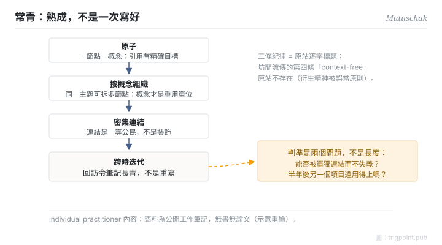

Canonical: https://trigpoint.pub/zh-Hant/collections/pkm/evergreen-notes-matuschak  
Captured: 2026-10-05T03:32:21.965227+08:00

> 公開理論閱讀鏡像。驗證層及 Lab 案例請到原站閱讀。

「寫得越詳細越好」：錯。

# 常青筆記

Evergreen Notes · Matuschak

已對照來源本身 ✓  
Lab 實測 ✓  
個人知識管理 · 筆記法

## 三句講透

常青筆記是一套筆記紀律：一節點一概念（原子）、按概念而非來源或主題組織、節點之間密集連結，筆記隨每次回訪迭代而非重寫。  
判準不是長度：一則筆記夠不夠「常青」，看它能否被精確引用、能否在新場合重用。  
把「詳細」當目標，恰好會寫出引用不了的長文。

<strong>圖 1</strong> · 常青筆記三條紀律的機制流示意：一節點一概念、按概念而非主題組織、密集連結，筆記隨回訪迭代長青。  
三條為原站逐字標題；坊間流傳的第四條「context-free」原站不存在。  
示意重繪。

## 一、發生什麼事

Matuschak（曾任 Apple iOS 工程師與 Khan Academy 研發）在其公開的工作筆記站上實踐並提出這套紀律，該站持續更新，頁面未標成文日期[\[1\]](#reference-note-1)。三條原則是站上的逐字標題：筆記應該原子（一節點一概念，令引用有精確目標，但仍盡量完整涵蓋該概念）、應該按概念組織（同一主題可以拆成多個概念節點，概念才是重用單位）、應該密集連結（連結是一等公民，不是裝飾）。他自承這套概念深深受惠於卡片盒傳統：這是網狀筆記在數位工具時代的重述與細化，不是新發明。坊間常見的第四條「筆記應該去脈絡（context-free）」在原站並不存在，是衍生精神被誤當獨立原則；站上另有兩條原則標題，皆非「去脈絡」。

<strong>署名要給對：</strong>Matuschak 自承概念「深深受惠於」卡片盒傳統，他是數位時代的普及聲音，不是概念祖。三條紀律（原子、概念導向、密集連結）是原站逐字標題；「context-free」不是第四條。另須保留身位：這是 individual practitioner 內容，語料是公開工作筆記，無書、無論文，頁面未標成文日期[\[1\]](#reference-note-1)。

## 二、為什麼這對你重要

「寫得越詳細越好」的直覺，錯在把筆記當文章：文章的單位是論述，筆記系統的單位是概念。一則八百字的心得引用不了其中那個真正有用的判準；拆成三個原子節點，每個都能被未來的你精確調用。所以常青的操作性判準是兩個問題：這則筆記能否被單獨連結而不失義？半年後在另一個項目裡，它還用得上嗎？

另一個容易反轉的位：常青是「熟成」，不是「一次寫好」。筆記靠回訪迭代變熟；一開始寫得完美反而阻止你回去改它。

## 參考文獻

<strong>如何閱讀來源註記</strong> 「對照原站核實」指主張已與該項目的原始網站比對。 定義版本：2026-09-20。

- \[1\] Matuschak, A. Working Notes. https://notes.andymatuschak.org/Evergreen_notes 三條紀律已對照原站核實。（持續更新、未標成文日期；individual practitioner 工作筆記）.

## 知識圖譜

- [<em>對照 ▸</em>超文本與跨包含 Hypertext & Transclusion（Ted Nelson 1965）](hypertext-transclusion-nelson-1965.md)
- [<em>被應用 ▸</em>Memex（Vannevar Bush 1945）](memex-bush-1945.md)

引用格式：Trigpoint，〈常青筆記〉，trigpoint.pub/zh-Hant/collections/pkm/evergreen-notes-matuschak · © Strategitect Limited. · 內容最後修訂 2026-10-01

## 來源註記

**[1]** Matuschak, A. Working Notes. 三條紀律已對照原站核實。見 notes.andymatuschak.org（持續更新，頁面未標成文日期）。individual practitioner 工作筆記（無書、無論文）；atomic／concept-oriented／densely linked 三條紀律為站上逐字標題；「context-free 第四原則」經核對於原站不存在，為坊間誤傳。

---

[English](../../../en/collections/pkm/evergreen-notes-matuschak.md) · [简体中文](../../../zh-Hans/collections/pkm/evergreen-notes-matuschak.md)

[Index](../../README.md) · [Original page](https://trigpoint.pub/zh-Hant/collections/pkm/evergreen-notes-matuschak) · [Citation and versions](../../../READING.md)

[Original SVG](assets/evergreen-notes-matuschak.svg) · Display copy adds a white background only.
