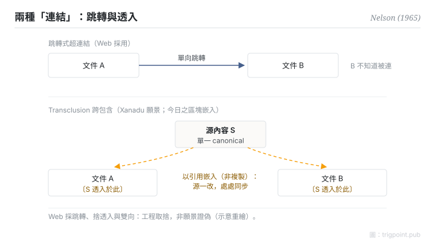

Canonical: https://trigpoint.pub/zh-Hant/collections/pkm/hypertext-transclusion-nelson-1965  
Captured: 2026-10-05T03:32:22.057783+08:00

> 公開理論閱讀鏡像。驗證層及 Lab 案例請到原站閱讀。

「連結就是連結」：沒這麼簡單。

# 超文本與跨包含

Hypertext & Transclusion · Nelson (1965)

書目已核 ✓  
個人知識管理 · 思想史

## 三句講透

「超文本」一詞於 1965 年 Nelson 的論文中給出定義：指無法用紙本呈現的互聯文本。  
Nelson 稱其概念已含於同一構想之內的 transclusion 更深一層：同一內容以引用方式嵌入多處，源頭一改，處處同步。  
今日筆記工具的雙向連結與區塊嵌入，都是這個願景的局部實現。

<strong>圖 1</strong> · 兩種「連結」的對照示意：跳轉式超連結（單向，目標不知道被連）與 transclusion（內容以引用嵌入多處，源頭一改處處同步）。  
Web 採前者、捨後者，是工程取捨而非願景證偽。  
示意重繪。

## 一、發生什麼事

Nelson 要解的問題：人類思想互聯、可變、不確定，紙本與循序檔案結構卻強迫線性。1965 年他在 ACM 會議論文提出承載非線性文本的檔案結構，並在文中給出 hypertext 一詞的定義（常說 1963 年造詞，未見 Nelson 一手出處）[\[1\]](#reference-note-1)。願景的深層機制是 transclusion：內容「以引用而非複製」存在於多處，源變動則所有嵌入處同步；這個詞通說出自 1981 年首版的《Literary Machines》（本頁未逐版核該詞首見處），但 Nelson 自稱概念已在 1965 年的描述之內[\[2\]](#reference-note-2)。完整願景（雙向連結、transclusion、版本、微支付）從未完整實現：Project Xanadu 成了著名的長期未竟工程，真正普及超文本的是 Web，而 Web 刻意捨棄了雙向與 transclusion，換取簡單與可擴展。

<strong>署名要給對：</strong>概念祖是 Bush 1945 年的聯想軌跡，Nelson 援引其為前例[\[3\]](#reference-note-3)；1963 年造詞之說常見，未見 Nelson 一手出處；1965 年那篇 ACM 論文給出定義，但據 Nelson 自註，不是他首篇使用該詞的出版物。transclusion 一詞通說見於 1981 年首版《Literary Machines》，Nelson 自稱概念早於命名十餘年。概念、造詞、印行三件事分開給，署名才給得對。

## 二、為什麼這對你重要

分辨三種不同的「連結」承諾：跳轉（Web 的超連結，單向，目標不知道被連）、反向可見（連結兩端互知）、嵌入同步（內容透入而非複製）。你的筆記工具若支援反向連結與區塊嵌入，它做的正是被 Web 捨棄的那部分願景。所以「連結就是連結」不成立：三種承諾的維護成本與回報各不相同，選工具時值得逐項問清楚。

另一課來自 Xanadu：從未 ship 不等於設計錯。被一代工程取捨犧牲的特性，幾十年後可以在新約束下平反；把「未實現」讀成「無價值」，會錯過正在回歸的設計。

## 參考文獻

<strong>如何閱讀來源註記</strong> 「書目經…核對」指作者、年份、題名與出版項已確認；不代表該來源的主張已被核對。「對照全文核實」指主張已與來源文本本身比對。「依多源一致轉述」指主張建立於多份彼此一致、轉述該來源的資料，而非原文件本身。「驗證繼承」指核對在本站另一頁完成，未在本頁重做。 定義版本：2026-09-20。

- \[1\] Nelson, T. H. (1965). Complex Information Processing: A File Structure for the Complex, the Changing and the Indeterminate. Proceedings of the ACM 20th National Conference, 84–100. https://doi.org/10.1145/800197.806036
- \[2\] Nelson, T. H. (1981). Literary Machines. Swarthmore, PA: self-published. 書目經多源交叉核對。「transclusion」一詞出自此書之說依多源一致轉述。（首版 1981；部分目錄作 1980）
- \[3\] Bush, V. (1945). As We May Think. The Atlantic, 176(1), 101–108. https://www.theatlantic.com/magazine/archive/1945/07/as-we-may-think/303881/

## 知識圖譜

- [<em>前置 ▸</em>Memex（Vannevar Bush 1945）](memex-bush-1945.md)
- [<em>對照 ▸</em>Zettelkasten · Luhmann 1981](zettelkasten-luhmann-1981.md)
- [<em>對照 ▸</em>Evergreen Notes · Andy Matuschak](evergreen-notes-matuschak.md)

引用格式：Trigpoint，〈超文本與跨包含〉，trigpoint.pub/zh-Hant/collections/pkm/hypertext-transclusion-nelson-1965 · © Strategitect Limited. · 內容最後修訂 2026-10-01

## 來源註記

**[1]** Nelson, T. H. (1965). Complex Information Processing: A File Structure for the Complex, the Changing and the Indeterminate. Proceedings of the ACM 20th National Conference, 84–100. DOI 10.1145/800197.806036. 書目經官方記錄核對。主張已對照全文核實。「hypertext」一詞於此文（p.96）給出定義，為最廣被引之處；Nelson 自述其同年 FID 會議論文《The Hypertext》才是他首篇使用該詞的出版物。經 DOI 紀錄與 Internet Archive 一手掃描對照。

**[2]** Nelson, T. H. (1981). Literary Machines. Swarthmore, PA: self-published. 書目經多源交叉核對。「transclusion」一詞出自此書之說依多源一致轉述。「transclusion」一詞通說出自此書（本頁未逐版核該詞首見處），定義為 the same content knowably in more than one place；概念已存於 1965 年論文的描述。首版為 1981 年（Internet Archive 所藏首版與第三版版權頁；部分目錄作 1980）。

**[3]** Bush, V. (1945). As We May Think. The Atlantic, 176(1), 101–108. 驗證繼承自 記憶延伸機；本頁未重驗。聯想軌跡為 hypertext 之概念祖；Nelson 援引其為前例。

---

[English](../../../en/collections/pkm/hypertext-transclusion-nelson-1965.md) · [简体中文](../../../zh-Hans/collections/pkm/hypertext-transclusion-nelson-1965.md)

[Index](../../README.md) · [Original page](https://trigpoint.pub/zh-Hant/collections/pkm/hypertext-transclusion-nelson-1965) · [Citation and versions](../../../READING.md)

[Original SVG](assets/hypertext-transclusion-nelson-1965.svg) · Display copy adds a white background only.
