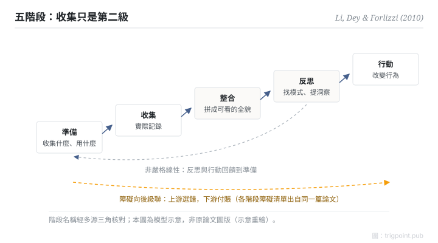

Canonical: https://trigpoint.pub/zh-Hant/collections/pkm/li-dey-forlizzi-2010-personal-informatics  
Captured: 2026-10-05T03:32:22.219921+08:00

> 公開理論閱讀鏡像。驗證層及 Lab 案例請到原站閱讀。

「收集到就等於用到」：是兩回事。

# 個人資訊學五階段

Stage-Based Model of Personal Informatics · Li, Dey & Forlizzi (2010)

已對照來源本身 ✓  
個人知識管理 · 實證科學

## 三句講透

自我追蹤系統走五個階段：準備、收集、整合、反思、行動。  
每個階段有自己的障礙，而且障礙會向後級聯：收集工具選錯，到反思階段才發現數據拼不起來。  
後三個階段（整合、反思、行動）各有自己的障礙，每級都要另外設計。

<strong>圖 1</strong> · 五階段模型示意：準備、收集、整合、反思、行動；階段是迭代的（使用者隨進展更換資料、工具或流程），且各階段的障礙會向後級聯。  
示意重繪，非原論文圖版。

## 一、發生什麼事

Li、Dey 與 Forlizzi 以 68 人問卷與 11 人後續訪談為基礎，在 CHI 2010 提出五階段模型[\[1\]](#reference-note-1)：準備（決定收集什麼、選什麼工具）、收集（實際記錄）、整合（把異質數據拼成可看的全貌）、反思（找模式、提取洞察）、行動（據此改變行為）。模型有兩個常被漏讀的性質：階段是迭代的，使用者隨進展會更換資料、工具或流程；每階段的障礙會級聯到後面的階段，上游選錯，下游付賬。這篇論文同時逐階段列出了障礙清單，讓工具設計可以針對特定階段介入。

<strong>署名要給對：</strong>這篇是階段模型的首次學術定式；「personal informatics」一詞在論文中已作為既有名稱使用，Quantified Self 社群也先於論文。各階段的障礙清單出自同一篇 2010 年論文；2011 年的後續論文把反思細分為發現與維持兩型，常被誤當障礙清單的出處，引用時分開[\[1\]](#reference-note-1)。

## 二、為什麼這對你重要

把五階段當診斷格用：你的知識系統或自我追蹤實踐，現在卡在哪一級？「收集到就等於用到」的錯覺，來自收集有即時滿足感而後三級沒有：記錄完成的一刻像是做了事，但整合要拼數據、反思要固定回看節奏、行動要改行為，每一級都是獨立的工程。設計自己的系統時，資源應該花在最弱的那一級；多買一個收集工具，通常只是把瓶頸往後推。級聯性質還給出一條先後次序：上游的選擇要帶著下游的需求做，先想清楚要反思什麼，再決定收集什麼。

## 參考文獻

<strong>如何閱讀來源註記</strong> 「書目經…核對」指作者、年份、題名與出版項已確認；不代表該來源的主張已被核對。「對照全文核實」指主張已與來源文本本身比對。 定義版本：2026-09-20。

- \[1\] Li, I., Dey, A. K., & Forlizzi, J. (2010). A Stage-Based Model of Personal Informatics Systems. CHI 2010, 557–566. https://doi.org/10.1145/1753326.1753409

引用格式：Trigpoint，〈個人資訊學五階段〉，trigpoint.pub/zh-Hant/collections/pkm/li-dey-forlizzi-2010-personal-informatics · © Strategitect Limited. · 內容最後修訂 2026-10-01

## 來源註記

**[1]** Li, I., Dey, A. K., & Forlizzi, J. (2010). A Stage-Based Model of Personal Informatics Systems. CHI 2010, 557–566. DOI 10.1145/1753326.1753409. 書目經多源交叉核對。主張已對照全文核實。書目與五階段名稱經作者出版頁與多個索引三角核對，並已對照全文；各階段障礙清單出自同一篇論文。

---

[English](../../../en/collections/pkm/li-dey-forlizzi-2010-personal-informatics.md) · [简体中文](../../../zh-Hans/collections/pkm/li-dey-forlizzi-2010-personal-informatics.md)

[Index](../../README.md) · [Original page](https://trigpoint.pub/zh-Hant/collections/pkm/li-dey-forlizzi-2010-personal-informatics) · [Citation and versions](../../../READING.md)

[Original SVG](assets/li-dey-forlizzi-2010-personal-informatics.svg) · Display copy adds a white background only.
