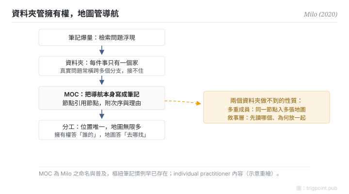

Canonical: https://trigpoint.pub/zh-Hant/collections/pkm/lyt-nick-milo  
Captured: 2026-10-05T03:32:22.579865+08:00

> 公開理論閱讀鏡像。驗證層及 Lab 案例請到原站閱讀。

「MOC 只是換個名的資料夾」：未必。

# LYT 與內容地圖

LYT / Map of Content · Milo (2020)

已對照來源本身 ✓  
Lab 實測 ✓  
個人知識管理 · 導航

## 三句講透

MOC（Map of Content，內容地圖）是一則引用其他筆記的筆記：一個匯集、發展與導航的中樞，不是一個容器。  
它與資料夾的本質差異在歸屬：資料夾要求每件東西只有一個家；地圖只是引用，同一節點可以同時出現在任意多張地圖上。  
資料夾管擁有權，地圖管導航，兩者是分工不是替代。

<strong>圖 1</strong> · MOC 機制流示意：筆記爆量後，資料夾的單一歸屬接不住跨域檢索；MOC 以節點引用節點作導航中樞，資料夾管擁有權、地圖管導航，同一節點可入多張地圖。  
示意重繪。

## 一、發生什麼事

Milo 2020 年 5 月發布首版 LYT Kit（筆記庫模板，後更名 Ideaverse），在雙向連結工具社群普及了 MOC 這個命名[\[1\]](#reference-note-1)。它回應的是筆記爆量後的檢索問題：資料夾的樹狀結構要求單一歸屬，但真實問題常常橫跨多個分支；標籤太平，搜尋要先知道找什麼。MOC 的答法是把導航本身寫成筆記：一則節點引用一批相關節點，附上為什麼相關、按什麼次序讀。地圖是一等公民，可以有很多張，可以互相引用，過期了可以改，這些都是資料夾做不到的。

<strong>署名要給對：</strong>MOC 是 Milo 的推廣與普及，不是全新發明：「一則筆記引用其他筆記」的樞紐慣例早已存在，第三方評述指其受 Matuschak 與 Luhmann 影響，本頁沒有他本人的第一手說法作依據。另須保留身位：這是 individual practitioner 內容，語料是 YouTube、模板與付費工作坊，無書、無論文；「MOC 不是資料夾」是概念轉述，不是可頁碼錨定的逐字引句[\[1\]](#reference-note-1)。

## 二、為什麼這對你重要

「換個名的資料夾」這個誤讀，錯過了兩個結構性質。一，多重成員：同一個節點按不同問題入不同地圖，不需要複製，也不需要在兩個資料夾之間二選一。二，敘事層：地圖可以告訴你先讀哪個、為什麼這幾個放在一起，資料夾的排序做不到這件事。實踐上的分工判準：位置答「誰擁有這個節點」，永遠唯一；地圖答「解這類問題要看哪些節點」，可以無限多。兩層混用，庫一大就會塌。

## 參考文獻

<strong>如何閱讀來源註記</strong> 「書目經…核對」指作者、年份、題名與出版項已確認；不代表該來源的主張已被核對。「對照原站核實」指主張已與該項目的原始網站比對。 定義版本：2026-09-20。

- \[1\] Milo, N. Linking Your Thinking. https://www.linkingyourthinking.com/ 書目經多源交叉核對。LYT 名稱與 MOC 之定義已對照原站核實。（首版 LYT Kit 2020-05，後更名 Ideaverse；individual practitioner 內容）.

引用格式：Trigpoint，〈LYT 與內容地圖〉，trigpoint.pub/zh-Hant/collections/pkm/lyt-nick-milo · © Strategitect Limited. · 內容最後修訂 2026-10-01

## 來源註記

**[1]** Milo, N. Linking Your Thinking. 書目經多源交叉核對。LYT 名稱與 MOC 之定義已對照原站核實。（linkingyourthinking.com）。individual practitioner 內容（YouTube、模板、付費工作坊；無書、無論文）；首版 LYT Kit 2020 年 5 月經多源核對（後更名 Ideaverse）；「MOC 不是資料夾」為概念轉述，確切首發片段未錨定。

---

[English](../../../en/collections/pkm/lyt-nick-milo.md) · [简体中文](../../../zh-Hans/collections/pkm/lyt-nick-milo.md)

[Index](../../README.md) · [Original page](https://trigpoint.pub/zh-Hant/collections/pkm/lyt-nick-milo) · [Citation and versions](../../../READING.md)

[Original SVG](assets/lyt-nick-milo.svg) · Display copy adds a white background only.
