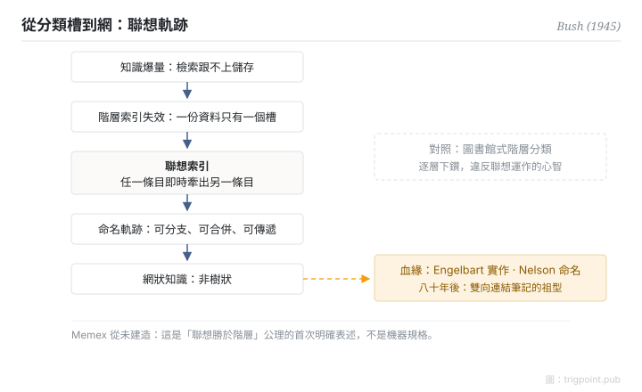

Canonical: https://trigpoint.pub/zh-Hant/collections/pkm/memex-bush-1945  
Captured: 2026-10-05T03:32:22.809222+08:00

> 公開理論閱讀鏡像。驗證層及 Lab 案例請到原站閱讀。

「Memex 就是超文本的起點」：是兩回事。

# 記憶延伸機

Memex · Bush (1945)

書目已核 ✓  
個人知識管理 · 思想史

## 三句講透

Memex 是 1945 年提出的假想個人資訊桌：以縮微膠卷儲存個人全部書籍與紀錄，用「聯想軌跡」把條目串連起來。  
核心創見不在儲存量，在檢索範式：任一條目可即時牽出另一條目，取代圖書館式的階層索引。  
機器從未造出，但這條「聯想勝於階層」的設計公理，是其後整個數位 PKM 的共同祖型。

<strong>圖 1</strong> · 聯想軌跡機制流示意：知識爆量令階層索引失效，聯想索引讓任一條目牽出另一條目，命名軌跡可分支、合併、傳遞，終點是網狀而非樹狀的知識。  
Memex 從未建造；此為設計公理示意，非機器規格。

## 一、發生什麼事

二戰結束前夕，Bush 在《The Atlantic》發表〈As We May Think〉，指出戰後科學知識爆量，瓶頸不在儲存而在檢索：既有索引都是人為的，資料只能放進一個分類槽，要找它得逐層下鑽，違反心智靠聯想運作的方式[\[1\]](#reference-note-1)。他描述的解法是聯想索引：使用者把兩份文件並置，按鍵建立一條命名軌跡，之後一鍵就能從一份跳到下一份；軌跡可以分支、合併、長存，甚至傳給別人[\[1\]](#reference-note-1)。Memex 是思想實驗，從未建造：它是設計願景，不是工程產物。

<strong>署名要給對：</strong>「hypertext」一詞不是 Bush 的：Ted Nelson 於 1965 年在 ACM 會議論文給出定義[\[2\]](#reference-note-2)，常說的 1963 年造詞未見一手出處。Bush 是問題框架的提出者、聯想軌跡的概念祖；實作血緣經 Engelbart（NLS 與 hyperlink），命名血緣經 Nelson。概念祖與字面詞首創，署名要分開給。

## 二、為什麼這對你重要

每次你在筆記工具猶豫「這個應該放哪個資料夾」，你就站在 Bush 指出的裂縫上：階層分類要求每件事只有一個家；聯想連結容許一件事有無數條路徑通向它。現代雙向連結工具的整個賣點，八十年前已經講完。所以評估工具時值得問的不是「有沒有連結功能」，而是「檢索靠預先分類，還是靠你自己鋪過的軌跡」：前者是別人替你想好的世界，後者才是 Memex 的本義。

## 參考文獻

<strong>如何閱讀來源註記</strong> 「書目經…核對」指作者、年份、題名與出版項已確認；不代表該來源的主張已被核對。 定義版本：2026-09-20。

- \[1\] Bush, V. (1945). As We May Think. The Atlantic, 176(1), 101–108. https://www.theatlantic.com/magazine/archive/1945/07/as-we-may-think/303881/
- \[2\] Nelson, T. H. (1965). Complex Information Processing: A File Structure for the Complex, the Changing and the Indeterminate. Proceedings of the ACM 20th National Conference. https://doi.org/10.1145/800197.806036

## 知識圖譜

- [<em>應用於 ▸</em>Evergreen Notes · Andy Matuschak](evergreen-notes-matuschak.md)
- [<em>下游 ▸</em>超文本與跨包含 Hypertext & Transclusion（Ted Nelson 1965）](hypertext-transclusion-nelson-1965.md)

引用格式：Trigpoint，〈記憶延伸機〉，trigpoint.pub/zh-Hant/collections/pkm/memex-bush-1945 · © Strategitect Limited. · 內容最後修訂 2026-10-01

## 來源註記

**[1]** Bush, V. (1945). As We May Think. The Atlantic, 176(1), 101–108. 書目經多源交叉核對。Memex 定義與 associative indexing 兩命題，逐字對照兩份網路轉錄（W3C 託管之 Duchier 1994 版；柏林自由大學 PDF，另一份轉錄）；兩份皆非印本掃描；1945 年雜誌文章無 DOI，屬結構性限制，非缺漏。

**[2]** Nelson, T. H. (1965). Complex Information Processing: A File Structure for the Complex, the Changing and the Indeterminate. ACM 20th National Conference. 書目經多源交叉核對。「hypertext」一詞見於其中（p.96）；Nelson 自述其同年 FID 會議論文《The Hypertext》才是他首篇使用該詞的出版物；經百科與計算機史料多源交叉核對。

---

[English](../../../en/collections/pkm/memex-bush-1945.md) · [简体中文](../../../zh-Hans/collections/pkm/memex-bush-1945.md)

[Index](../../README.md) · [Original page](https://trigpoint.pub/zh-Hant/collections/pkm/memex-bush-1945) · [Citation and versions](../../../READING.md)

[Original SVG](assets/memex-bush-1945.svg) · Display copy adds a white background only.
