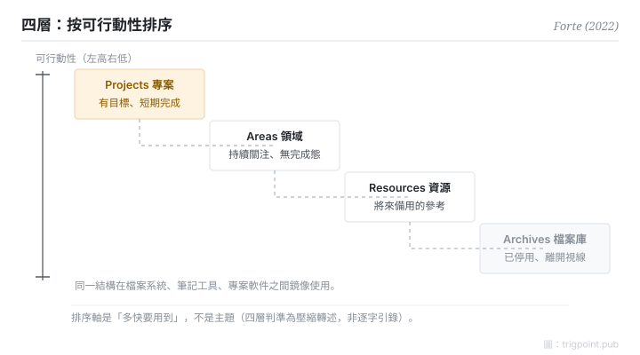

Canonical: https://trigpoint.pub/zh-Hant/collections/pkm/para-tiago-forte-2022  
Captured: 2026-10-05T03:32:22.911101+08:00

> 公開理論閱讀鏡像。驗證層及 Lab 案例請到原站閱讀。

「按主題分類就夠」：接不了。

# PARA 組織法

PARA Method · Forte (2022)

書目已核 ✓  
Lab 實測 ✓  
個人知識管理 · 組織法

## 三句講透

個人組織的第一個問題不是「這屬於哪個主題」，而是「這什麼時候要用」。  
PARA 把答案排成四層：Projects 帶目標、Areas 需持續關注、Resources 備參考、Archives 已停用，按可行動性由高至低。  
同一結構跨所有工具鏡像，分類為行動服務，不為收藏服務。

<strong>圖 1</strong> · 四層按可行動性由高至低排列示意：Projects（帶目標的短期工作）、Areas（需持續關注）、Resources（備參考）、Archives（已停用）。  
分類軸是「多快要用到」，不是主題。  
示意重繪，非原書圖表。

## 一、發生什麼事

Forte 在 2017 年的網上文章首次提出 PARA（月份未核），2022 年在《Building a Second Brain》一書中把它系統化[\[2\]](#reference-note-2)。他的診斷是：像圖書館員那樣按主題歸檔，檔案櫃看起來整齊，但工作進行到一半時，它答不到你真正在問的問題：「跟眼前這件事有關的東西在哪」。他的口號是「organize by actionability」（按可行動性組織）[\[1\]](#reference-note-1)：Projects（帶目標的短期工作）、Areas（需持續關注、沒有完成態）、Resources（將來可能用到的參考）、Archives（已停用），四層按「多快要用到」排成一條斜坡。同一套結構在檔案系統、筆記工具、專案軟件之間鏡像使用，搬工具不用重新發明分類[\[1\]](#reference-note-1)。

<strong>署名要給對：</strong>PARA 首發於 2017 年（月份未核），2022 年的書是系統化與普及的里程碑，不是首創年份；引用「2022」指書。通用縮寫展開是複數 Archives：Forte 訪談口語與官網個別頁面也用過單數，引用時建議採複數。「organize by actionability」是他的原話；常見的「不按情境組織」對照句在作者官頁未見，較像是對 GTD 的轉述對照；官頁上的對照軸是「按主題」。引用時把原話與轉述分開。

## 二、為什麼這對你重要

檢驗一套組織系統，不是看它整齊與否，而是看任務進行到一半時，能否立刻取到相關材料。按主題分類在收藏時最舒服，在行動時最遲鈍；按可行動性分類剛好相反。它還附帶一條誠實的衰退路徑：project 完結就落 Archives，沒有人維持標準的 area 其實已經停用。主題式歸檔會讓過期的東西體面地住在原位；可行動性一問，它們即刻現形。

一條邊界要記住：PARA 管「放在哪」，不管「怎樣連結」。它與網狀筆記不是競爭關係，是分工：前者答「東西擺邊」，後者答「概念點串」。

## 參考文獻

<strong>如何閱讀來源註記</strong> 「書目經…核對」指作者、年份、題名與出版項已確認；不代表該來源的主張已被核對。「對照原站核實」指主張已與該項目的原始網站比對。「依多源一致轉述」指主張建立於多份彼此一致、轉述該來源的資料，而非原文件本身。 定義版本：2026-09-20。

- \[1\] Forte, T. (2022). Building a Second Brain: A Proven Method to Organize Your Digital Life and Unlock Your Creative Potential. New York: Atria Books / Simon & Schuster. https://www.simonandschuster.com/books/Building-a-Second-Brain/Tiago-Forte/9781982167387
- \[2\] Forte Labs blog. The PARA Method: The Simple System for Organizing Your Digital Life in Seconds. https://fortelabs.com/blog/para/ 書目經官方記錄核對。「organize by actionability」措辭與四層名稱已對照原站核實。（2017 首發；2023 年重刊版本）.

引用格式：Trigpoint，〈PARA 組織法〉，trigpoint.pub/zh-Hant/collections/pkm/para-tiago-forte-2022 · © Strategitect Limited. · 內容最後修訂 2026-10-01

## 來源註記

**[1]** Forte, T. (2022). Building a Second Brain: A Proven Method to Organize Your Digital Life and Unlock Your Creative Potential. Atria Books / Simon & Schuster. ISBN 9781982167387. 書目經多源交叉核對。「organize by actionability」口號措辭依多源一致轉述。

**[2]** Forte Labs. 書目經官方記錄核對。「organize by actionability」措辭與四層名稱已對照原站核實。部落格（fortelabs.com/blog/para）。PARA 於 2017 年首發（月份未核）；現行線上版本為 2023 年重刊。經多源交叉核對。

---

[English](../../../en/collections/pkm/para-tiago-forte-2022.md) · [简体中文](../../../zh-Hans/collections/pkm/para-tiago-forte-2022.md)

[Index](../../README.md) · [Original page](https://trigpoint.pub/zh-Hant/collections/pkm/para-tiago-forte-2022) · [Citation and versions](../../../READING.md)

[Original SVG](assets/para-tiago-forte-2022.svg) · Display copy adds a white background only.
