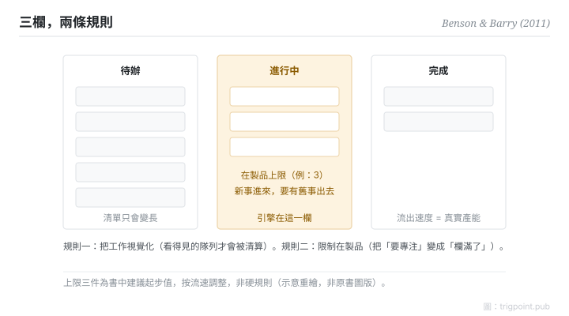

Canonical: https://trigpoint.pub/zh-Hant/collections/pkm/personal-kanban-benson-barry-2011  
Captured: 2026-10-05T03:32:23.088546+08:00

> 公開理論閱讀鏡像。驗證層及 Lab 案例請到原站閱讀。

「看板就是 to-do list」：是兩回事。

# 個人看板

Personal Kanban · Benson & Barry (2011)

書目已核 ✓  
Lab 實測 ✓  
個人知識管理 · 工作流

## 三句講透

個人看板只有兩條規則：把工作視覺化，限制同時進行的數量。  
to-do list 答「有什麼要做」；看板多答兩個問題：「現在正做多少」和「卡在哪」。  
第二條規則才是引擎：在製品上限迫使你完成而不是開新，切換成本因此下降。

<strong>圖 1</strong> · 三欄看板示意：待辦、進行中（掛在製品上限）、完成。  
兩條規則：把工作視覺化、限制同時進行的數量。  
書中建議個人自上限三件起步，屬建議值非硬規則。  
示意重繪，非原書圖版。

## 一、發生什麼事

看板源自豐田產線：約 1953 年落地的信號機制，用實體卡控制在製品流量，是精實生產的核心構件之一[\[2\]](#reference-note-2)。Anderson 2010 年的專書把它系統化為軟件開發的變革方法[\[3\]](#reference-note-3)；2011 年 Benson 與 Barry 再把它個人化：一塊板、三欄（待辦、進行中、完成）、兩條規則：把工作視覺化、限制在製品[\[1\]](#reference-note-1)。書中建議個人從上限三件起步，再按自己的流速調整；這是建議值，不是硬規則。個人化版本的洞察在於：知識工作者的超載多數不是任務太多，是同時打開的任務太多，每一件都在收切換稅。

<strong>署名要給對：</strong>看板不是 Benson 與 Barry 發明：機制約 1953 年落地於豐田產線（大野耐一）[\[2\]](#reference-note-2)，1990 年隨精實生產進入學術正典，Anderson 2010 年的專書把它系統化為軟件開發的變革方法[\[3\]](#reference-note-3)，2011 年兩位作者再個人化[\[1\]](#reference-note-1)。這是一條應用梯度，不是發明鏈；引用時把層次分開。

## 二、為什麼這對你重要

to-do list 與看板的分別，是「清單」與「流量控制」的分別。清單只會變長；看板的「進行中」欄有上限，新事想進來，就要有舊事出去。這個約束把一個模糊的品德問題（「要專注」）變成一個機械的結構問題（「欄滿了」）。實踐上最大的坑是把上限當裝飾：欄裡貼了八件事，上限寫三，等於沒有。上限要咬得住，通常需要一個會迫你表態的面，而不是靠每天自我提醒。

「把工作視覺化」也不只是貼卡好看：看得見的隊列才會被清算，看不見的隊列只會發酵。

## 參考文獻

<strong>如何閱讀來源註記</strong> 「書目經…核對」指作者、年份、題名與出版項已確認；不代表該來源的主張已被核對。「對照原站核實」指主張已與該項目的原始網站比對。 定義版本：2026-09-20。

- \[1\] Benson, J., & Barry, T. D. (2011). Personal Kanban: Mapping Work | Navigating Life. Seattle: Modus Cooperandi Press. https://moduscooperandi.com/modus-cooperandi/blog/personal-kanban-the-book
- \[2\] Ohno, T. (1988). Toyota Production System: Beyond Large-Scale Production. Cambridge, MA: Productivity Press. 2019 digital reprint: https://doi.org/10.4324/9780429273018
- \[3\] Anderson, D. J. (2010). Kanban: Successful Evolutionary Change for Your Technology Business. Blue Hole Press.
- \[4\] Womack, J. P., Jones, D. T., & Roos, D. (1990). The Machine That Changed the World. Rawson Associates.

引用格式：Trigpoint，〈個人看板〉，trigpoint.pub/zh-Hant/collections/pkm/personal-kanban-benson-barry-2011 · © Strategitect Limited. · 內容最後修訂 2026-10-01

## 來源註記

**[1]** Benson, J., & Barry, T. D. (2011). Personal Kanban: Mapping Work | Navigating Life. Modus Cooperandi Press. ISBN 9781453802267. 書目經多源交叉核對。兩條核心規則措辭已對照原站核實。坊間流傳一個不對應的錯誤 ISBN。「上限三件起步」為書中建議值，非硬規則。

**[2]** Toyota Production System: Beyond Large-Scale Production. Productivity Press. 書目經雙源核對。Ohno, T. (1978／英譯 1988). 看板機制約 1953 年落地於豐田產線（廣義豐田生產系統自約 1948 年發展）；日文原版逐字未驗。

**[3]** Anderson, D. J. (2010). Kanban: Successful Evolutionary Change for Your Technology Business. Blue Hole Press. 書目經雙源核對。看板由製造業移植至軟件開發之橋。

---

[English](../../../en/collections/pkm/personal-kanban-benson-barry-2011.md) · [简体中文](../../../zh-Hans/collections/pkm/personal-kanban-benson-barry-2011.md)

[Index](../../README.md) · [Original page](https://trigpoint.pub/zh-Hant/collections/pkm/personal-kanban-benson-barry-2011) · [Citation and versions](../../../READING.md)

[Original SVG](assets/personal-kanban-benson-barry-2011.svg) · Display copy adds a white background only.
