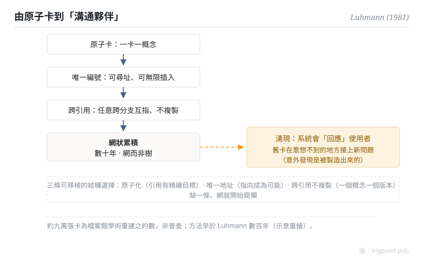

Canonical: https://trigpoint.pub/zh-Hant/collections/pkm/zettelkasten-luhmann-1981  
Captured: 2026-10-05T03:32:23.475330+08:00

> 公開理論閱讀鏡像。驗證層及 Lab 案例請到原站閱讀。

「卡片盒是 Luhmann 發明的」：未必。

# 卡片盒筆記法

Zettelkasten · Luhmann (1981)

書目已核 ✓  
Lab 實測 ✓  
個人知識管理 · 筆記法

## 三句講透

卡片盒是一套網狀累積的筆記系統：每張卡只載一個概念、有唯一編號，卡與卡用引用互指，幾十年累積成一張知識網。  
社會學家 Luhmann 以約九萬張卡實踐終身，並在 1981 年自述這套系統是他的「溝通夥伴」：它會用你忘記的舊卡回應你，不只是儲存。  
方法本身早於他數百年，他是最著名的實踐者與理論化者。

<strong>圖 1</strong> · 卡片盒機制流示意：原子卡、唯一編號、跨引用累積成網，到「溝通夥伴」的湧現層。  
約九萬張卡為檔案館學術重建之約數，非普查。  
示意重繪。

## 一、發生什麼事

Luhmann 從 1950 年代起累積實體卡片：每張卡原子化載一個概念，配唯一的位置編號，編號在數字與字母間交替分支，可以在任意兩張卡之間無限插入新卡。卡上手寫其他卡的編號作交叉引用，不受樹狀分類限制，任意跨分支互指。累積數十年後，這堆卡不再是檔案櫃：1981 年他在一篇經驗報告裡形容它是可以對話的「第二記憶」，雙方要能互相給對方驚喜[\[1\]](#reference-note-1)。約九萬張卡的規模，出自檔案館後來的學術重建[\[2\]](#reference-note-2)。重建研究給這個湧現性質起了個準確的名字：意外發現是被「製造」出來的，網的密度到了，舊卡就會在你意想不到的地方接上新問題。

<strong>署名要給對：</strong>卡片索引法自近代早期（十六世紀以降）即有，Luhmann 是它最著名的實踐者與理論化者：1981 年那篇經驗報告把「系統會回應使用者」這層講清楚了。約九萬張卡是 Schmidt 2018 年學術重建的約數，勿當精確統計引用[\[2\]](#reference-note-2)。英語世界流行的做法多出自 Ahrens 2017 年的普及書，它把做法整理成可操作的流程；其步驟與 Luhmann 本人做法的差異，本頁未核；兩者要分開引用[\[3\]](#reference-note-3)。

## 二、為什麼這對你重要

卡片盒的可移植教訓不是「用卡片」，是三條結構選擇：原子化（一卡一概念，令引用有精確目標）、唯一地址（令「指向」可能）、跨引用不複製（令同一概念只有一個版本）。這三條在數位工具裡對應原子筆記、穩定連結與嵌入引用；缺一條，網就開始腐爛：概念糊在長文裡引用不了，或同一事實複製出多個互相漂移的版本。

它也有設計領域：這是跨時累積的長期系統，不是單次輸入的消化工具。想清楚你在建哪一種，再決定學它哪一部分。

## 參考文獻

<strong>如何閱讀來源註記</strong> 「書目經…核對」指作者、年份、題名與出版項已確認；不代表該來源的主張已被核對。「對照全文核實」指主張已與來源文本本身比對。 定義版本：2026-09-20。

- \[1\] Luhmann, N. (1981). Kommunikation mit Zettelkästen. In Öffentliche Meinung und sozialer Wandel. Opladen: Westdeutscher Verlag, 222–228. https://doi.org/10.1007/978-3-322-87749-9_19
- \[2\] Schmidt, J. F. K. (2018). Niklas Luhmann's Card Index: The Fabrication of Serendipity. Sociologica, 12(1), 53–60. https://doi.org/10.6092/issn.1971-8853/8350
- \[3\] Ahrens, S. (2017). How to Take Smart Notes.

## 知識圖譜

- [<em>對照 ▸</em>超文本與跨包含 Hypertext & Transclusion（Ted Nelson 1965）](hypertext-transclusion-nelson-1965.md)

引用格式：Trigpoint，〈卡片盒筆記法〉，trigpoint.pub/zh-Hant/collections/pkm/zettelkasten-luhmann-1981 · © Strategitect Limited. · 內容最後修訂 2026-10-01

## 來源註記

**[1]** Luhmann, N. (1981). Kommunikation mit Zettelkästen. Ein Erfahrungsbericht. In Baier, Kepplinger & Reumann (Hrsg.), Öffentliche Meinung und sozialer Wandel. Opladen: Westdeutscher Verlag, 222–228. 書目經多源交叉核對。原始 1981 出處（常見誤標為 1992 年重刊本《Universität als Milieu》）；「溝通夥伴」語經英譯本核對，德文原文未逐字核對。

**[2]** Schmidt, J. F. K. (2018). Niklas Luhmann's Card Index: The Fabrication of Serendipity. Sociologica, 12(1), 53–60. DOI 10.6092/issn.1971-8853/8350. 書目經出版社記錄核對。主張已對照全文核實。約九萬張卡之計數出處（Bielefeld 檔案館學術重建；約數非普查）。

**[3]** Ahrens, S. (2017). How to Take Smart Notes. 書目經多源交叉核對。英語圈普及本；系統化為可操作流程，非 Luhmann 原始實踐本身。

---

[English](../../../en/collections/pkm/zettelkasten-luhmann-1981.md) · [简体中文](../../../zh-Hans/collections/pkm/zettelkasten-luhmann-1981.md)

[Index](../../README.md) · [Original page](https://trigpoint.pub/zh-Hant/collections/pkm/zettelkasten-luhmann-1981) · [Citation and versions](../../../READING.md)

[Original SVG](assets/zettelkasten-luhmann-1981.svg) · Display copy adds a white background only.
