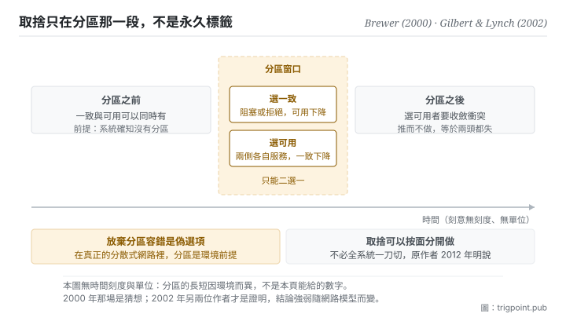

Canonical: https://trigpoint.pub/zh-Hant/collections/software-systems-architecture/cap-theorem-brewer-2000  
Captured: 2026-11-02T21:27:56.873605+08:00

> 公開理論閱讀鏡像。驗證層及 Lab 案例請到原站閱讀。

2012 年，原作者撰文說「三選二」一向具誤導性。

# CAP 定理

CAP Theorem · Brewer (2000) / Gilbert & Lynch (2002)

已對照來源本身 ✓  
Lab 實測 ✓  
系統設計 · 分散式取捨  
先讀：微服務

## 三句講透

網路分區發生時，一致與可用只能選一個。  
分區不是可以放棄的選項，是環境前提。  
所以真正的問題不是三選二，是分區當下你要哪一邊。

<strong>圖 1</strong> · 橫軸是時間，中間那一段是網路分區發生的窗口。  
窗口之外，只要系統確知沒有分區，一致與可用可以同時有；窗口之內，只能二選一，而且選哪一邊決定了窗口結束後要不要收斂衝突。  
本圖刻意無時間刻度與單位：分區的長短因環境而異，不是本頁能給的數字。

## 一、發生什麼事

這個說法提出十二年後，原作者自己寫了一篇回顧，指流行的講法把三者之間的張力過度簡化。三個性質先講清楚。一致：每次讀都看到最近一次寫的結果。可用：每個沒故障的節點對每個請求都回一個有效回應。分區容錯：即使節點之間的訊息任意遺失或延遲，系統仍運作。

2000 年那場主題演講提出：三者至多得其二[\[1\]](#reference-note-1)。而那句話的流行版本正是它最大的問題。<strong>因為它把分區容錯講成一個選項</strong>，而在真正的分散式網路裡，封包遺失與節點失聯一定會發生：分區是環境前提，不是勾選項。

所以正確的形狀是這樣：分區<strong>沒有發生</strong>、而且系統確知沒有發生的時候，一致與可用可以同時有，不必取捨。分區<strong>一旦發生</strong>，你只能二選一：要嘛拒絕或阻塞那些會破壞一致的請求（可用下降），要嘛讓分區兩側各自繼續服務（一致下降，事後再收斂衝突）。

「確知」兩個字不是多餘的。在訊息延遲沒有上界、節點也沒有時鐘的網路裡，訊息遲到與訊息遺失分不出來，所以即使實際上一封都沒丟，一個堅持隨時回應的系統也保證不了一致[\[4\]](#reference-note-4)。有了時鐘，情況就不同：同一篇論文指出，這時存在這樣的演算法，訊息全數送達時回傳一致的資料，只在訊息遺失時才回傳過期資料。實務上的對應是替通訊設一個時間上限，逾時沒達成一致，就當作分區處理。

歸屬這一頁必須分三段，而多數轉述會壓成一段。2000 年那場是<strong>猜想</strong>：其中一張投影片的標題就叫「The CAP Theorem」，正文也以「Theorem:」起首，卻沒有附任何證明[\[1\]](#reference-note-1)。2002 年另兩位作者以「Brewer 的猜想」為題的論文才是<strong>證明</strong>：先在非同步網路模型（無時鐘，訊息延遲無上界）下證明，再證明在各節點有時鐘的部分同步模型裡，只要訊息可能任意遺失，結論依然成立[\[2\]](#reference-note-2)[\[4\]](#reference-note-4)。「定理」這個地位來自那篇，不是 2000 年那場。而 2012 年，原作者本人寫了一篇回顧，明說流行的<strong>「三選二」表述一向具誤導性</strong>，因為它把三者之間的張力過度簡化；並澄清：分區罕見，系統未分區時沒有理由放棄一致或可用[\[3\]](#reference-note-3)。

這三段合起來的教訓不只關於分散式系統：<strong>一個被廣泛引用的說法，其原作者可能十二年後公開說它被讀錯了，而流行版本仍然繼續流行。</strong>

<strong>署名要給對：</strong>取捨之提出歸 Brewer（據他 2012 年的回顧，這個定理 1998 年秋首次出現、1999 年見刊，而一致與可用之爭更早已以 ACID 對 BASE 的形式見於 1997 年一篇他參與合著的論文[\[3\]](#reference-note-3)；2000 年 7 月那場主題演講的投影片自稱定理而未附證明，文獻上稱猜想[\[1\]](#reference-note-1)）；<strong>形式證明歸 Gilbert 與 Lynch（2002，ACM SIGACT News）</strong>，定理地位來自該篇而非 2000 年那場[\[2\]](#reference-note-2)；對流行誤讀之澄清歸 Brewer 本人（2012）[\[3\]](#reference-note-3)。三段要分開署名，且第三段特別重要：原作者公開說過流行版本誤導人。

## 二、為什麼這對你重要

只要你有「同一件事在兩個地方各自被改」的情況，這頁就適用，不需要有伺服器。

最常見的形態：你的筆記或檔案在兩台裝置上、或者你跟協作者各改一份、或者你同時開了幾條工作在動同一批東西。網路斷了、或你忘了同步、或兩邊同時在改：這就是分區。而你在那一刻其實已經選了一邊，只是通常不是有意識地選。

<strong>選一致長什麼樣</strong>：非要等同步完成才能繼續動（鎖住、排隊、寧可停下來）。好處是不會有兩個版本，代價是你被擋住。

<strong>選可用長什麼樣</strong>：兩邊各自繼續改，事後再處理衝突。好處是不停工，代價是收斂那一刻你得真的去收斂：而多數人在這一步偷懶，於是留下兩個都不完整的版本。

三個可以直接用的判斷。

第一，<strong>分區之外不必預先取捨</strong>。這是原作者 2012 年那篇的重點，也是最實用的一句：分區罕見，沒分區的時候沒有理由放棄一致或可用，不要因為讀過這個定理就預先犧牲什麼。但「沒分區」必須是系統知道的事，不是假設出來的：給同步設一個時限，逾時就當作分區處理，而不是默認網路永遠不斷。

第二，<strong>取捨可以按面分開做</strong>，不必全系統一刀切。對外發佈的東西選一致（寧可排隊），內部草稿選可用（各自跑），派生的看板選可用但明標生成時間。

第三，也是最少人做的一條：<strong>選了可用，就要把收斂那一步當成工作排進去。</strong> 選可用不等於不用處理衝突，只是把處理往後推。推而不做，等於既失一致又失可用。

## 常見誤讀

所屬頁核驗：已對照來源本身 ✓ · 本頁版次 v2 · 內容最後修訂 2026-10-25

- 常見轉述「三個性質裡面挑兩個」：作者本人 2012 年那篇明說，「三選二」這個表述一向具誤導性，因為它把三者之間的張力過度簡化；分區罕見，系統未分區時沒有理由放棄一致或可用。取捨只在分區當下、局部地發生。
- 常見轉述「放棄分區容錯也是一個選項」：在真正的分散式網路裡分區是環境前提而非可勾選項。同時保一致與可用只在假設分區不會發生時成立，典型是單機或單站點。
- 常見轉述「這是 2000 年被證明的定理」：2000 年那場的投影片雖有一張以「定理」為題，卻沒有附證明；2002 年另兩位作者以「Brewer 的猜想」為題的論文才是證明，而且證明綁定特定的網路模型與定義。三件要分開記。

## 修正記錄

- 2026-10-09 · 本頁前版有三處與原始材料不符，已依原文改正。其一，前版說 2000 年那場的作者不把這個取捨框為定理、來源是運維觀察；其中一張投影片其實以「The CAP Theorem」為題，只是沒有附證明，「猜想」之名出自 2002 年那篇的標題。其二，前版當作 2012 年那篇作者原句引用的兩句話（包括「這個定理具誤導性」），實出自第三方讀書摘要；作者原文說的是「三選二」這個表述具誤導性，不是定理本身。其三，前版把「未分區時一致與可用可以兼得」寫成無條件；這只在系統確知沒有分區時成立。

## 參考文獻

<strong>如何閱讀來源註記</strong> 「書目經…核對」指作者、年份、題名與出版項已確認；不代表該來源的主張已被核對。「對照全文核實」指主張已與來源文本本身比對。 定義版本：2026-09-20。

- \[1\] Brewer, E. A. (2000). Towards Robust Distributed Systems. Keynote, ACM PODC, Portland, OR, 19 July 2000. Abstract in Proceedings of PODC '00, p. 7.
- \[2\] Gilbert, S. & Lynch, N. (2002). Brewer's Conjecture and the Feasibility of Consistent, Available, Partition-Tolerant Web Services. ACM SIGACT News, 33(2), 51–59.
- \[3\] Brewer, E. (2012). CAP Twelve Years Later: How the 'Rules' Have Changed. Computer, 45(2), 23–29.
- \[4\] Gilbert, S. & Lynch, N. (2002). Brewer's Conjecture and the Feasibility of Consistent, Available, Partition-Tolerant Web Services. ACM SIGACT News, 33(2), 51–59.
- \[5\] 編輯註，無外部來源；全文見正文註 \[5\]。

## 知識圖譜

- [<em>對照 ▸</em>單一真相來源（Single Source of Truth (concept history)）](single-source-of-truth-concept-history.md)

引用格式：Trigpoint，〈CAP 定理〉，trigpoint.pub/zh-Hant/collections/software-systems-architecture/cap-theorem-brewer-2000 · © Strategitect Limited. · 內容最後修訂 2026-10-25

## 來源註記

**[1]** Brewer, E. A. (2000-07-19). Towards Robust Distributed Systems. Keynote, ACM PODC, Portland, OR. Abstract in Proceedings of PODC '00, p. 7. DOI 10.1145/343477.343502. 書目經雙源核對。主張已對照全文核實。分散式運算原理研討會（PODC）之主題演講投影片。其中一張投影片題為「The CAP Theorem」，正文以「Theorem:」起首，但未附證明；「猜想」之名出自 2002 年那篇論文的標題。據作者 2012 年的回顧，這個定理 1998 年秋首次出現、1999 年見刊，並在 2000 年這場主題演講中提出；同文並記，一致與可用之爭的最早版本是 1997 年一篇系統論文裡的 ACID 對 BASE，他是作者之一。

**[2]** Gilbert, S. & Lynch, N. (2002). Brewer's Conjecture and the Feasibility of Consistent, Available, Partition-Tolerant Web Services. ACM SIGACT News, 33(2), 51–59. DOI 10.1145/564585.564601. 書目經官方記錄核對。主張已對照全文核實。在非同步網路模型下證明：容許訊息遺失時，讀寫物件不可能同時保證可用與原子一致；另證明在各節點有時鐘的部分同步模型下，只要訊息可能任意遺失，結論依然成立。此文才是「定理」地位的來源。

**[3]** Brewer, E. (2012). CAP Twelve Years Later: How the ‘Rules’ Have Changed. Computer, 45(2), 23–29. DOI 10.1109/MC.2012.37. 書目經官方記錄核對。主張已對照全文核實。作者原句：“The ‘2 of 3’ formulation was always misleading because it tended to oversimplify the tensions among properties.” 以及 “Because partitions are rare, there is little reason to forfeit C or A when the system is not partitioned.” 誤導的是「三選二」這個表述，不是定理本身。

**[4]** Gilbert, S. & Lynch, N. (2002). Brewer's Conjecture and the Feasibility of Consistent, Available, Partition-Tolerant Web Services. ACM SIGACT News, 33(2), 51–59. 書目經官方記錄核對。主張已對照全文核實。同文推論 1.1：非同步模型下（無時鐘），即使在沒有任何訊息遺失的執行中，恆可用的演算法也保證不了原子一致，因為訊息遺失與任意延遲無法區分。在各節點有時鐘的部分同步模型下，同文另證不可兼得仍成立（定理 2），但推論 1.1 的對應版本不成立：存在演算法在訊息全數送達時回傳一致的資料，只在訊息遺失時才回傳過期資料。

---

[English](../../../en/collections/software-systems-architecture/cap-theorem-brewer-2000.md) · [简体中文](../../../zh-Hans/collections/software-systems-architecture/cap-theorem-brewer-2000.md)

[Index](../../README.md) · [Original page](https://trigpoint.pub/zh-Hant/collections/software-systems-architecture/cap-theorem-brewer-2000) · [Citation and versions](../../../READING.md)

[Original SVG](assets/cap-theorem-brewer-2000.svg) · Display copy adds a white background only.
