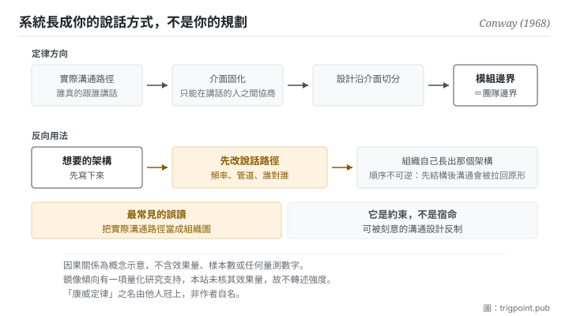

Canonical: https://trigpoint.pub/zh-Hant/collections/software-systems-architecture/conways-law-conway-1968  
Captured: 2026-11-02T21:27:57.169694+08:00

> 公開理論閱讀鏡像。驗證層及 Lab 案例請到原站閱讀。

組織圖上的線，和每天實際說話的路徑，是兩張不同的圖。

# 康威定律

Conway's Law · Conway (1968)

摘要已核 ✓  
Lab 實測 ✓  
軟體架構 · 組織與結構  
先讀：模組化與薄切面

## 三句講透

設計系統的組織，會產出鏡像自身溝通結構的設計。  
這裡的溝通結構指實際的說話路徑，不是組織圖。  
它是約束不是宿命，所以最有價值的用法是反過來：先改說話路徑。

<strong>圖 1</strong> · 上排是定律本身的方向：組織的實際溝通路徑固化成介面，設計沿介面切分，於是模組邊界長成團隊邊界。  
下排是它的反向用法：先改溝通結構，讓組織自己長出想要的架構。  
左下角標出最常見的誤讀，把實際溝通路徑當成組織圖。

## 一、發生什麼事

這條定律裡的溝通結構，指誰實際跟誰說話，組織圖上的連線是另一張圖。1968 年那篇論文的命題只有一句：設計系統的組織，被<strong>約束</strong>成產出的設計是這些組織之溝通結構的副本[\[1\]](#reference-note-1)。

機制不神秘。分工一旦定下來，就形成了固定的溝通界面：誰跟誰每天講話、誰跟誰一季講一次、誰跟誰從來不講。而模組之間的介面<strong>只能在能溝通的人之間協商出來</strong>。兩個每天講話的人會協商出細緻、可以隨時調整的介面；兩個不講話的人之間只會出現一個粗糙、寫死、雙方都不敢動的介面。系統的邊界因此長成團隊的邊界。

這條命題後來被實證檢驗過：一項 2012 年的研究發現，鬆耦合組織產出的產品顯著更模組化[\[4\]](#reference-note-4)。所以它不只是一個好用的隱喻，有量化支持（本站只核到該研究的摘要，未核全文）。

而它最有價值的用法是<strong>反過來</strong>。既然架構會鏡像溝通結構，那麼想要某種架構，就先去建那種溝通結構：讓組織自己長出你要的形狀，而不是硬推一個與組織錯位的設計。這個反向用法在實務上被稱為反向操作，是這條定律從「觀察」變成「工具」的關鍵。

歸屬有一處必須說清楚：<strong>這個名字不是作者取的</strong>。來源有兩種記載：一說 1968 年 7 月一場模組化程式設計研討會上已有人這樣稱它；作者本人網站則記為一本廣為流傳的軟體工程書（初版 1975 年）引用他的論文時如此稱呼[\[2\]](#reference-note-2)。作者提出的是命題與論文。期號本站標 14(4)，與多數書目記錄一致；另有來源標 14(5)[\[3\]](#reference-note-3)。

<strong>署名要給對：</strong>命題與論文歸 Conway（1968，該期刊 14(4)）[\[1\]](#reference-note-1)；<strong>「康威定律」這個名字歸他人</strong>（一說 1968 年研討會上已有人如此稱呼，一說一本廣為流傳的書（初版 1975 年）引用時所稱）[\[2\]](#reference-note-2)；鏡像假說之實證檢驗歸 2012 年那篇研究政策論文的三位作者[\[4\]](#reference-note-4)。三段要分開署名：把名字歸給作者本人是最常見的一條錯，本站在此頁明文更正。

## 二、為什麼這對你重要

這頁對你最直接的一句話是：<strong>你的工作系統會長成你的說話方式，而不是長成你的規劃。</strong>

具體一點。你跟模型的協作方式決定了你會做出什麼工具。如果你的習慣是每次開一個新對話、把背景重貼一次，你會做出一批「提示詞模板」。如果你的習慣是讓同一個脈絡持續累積，你會做出「狀態檔案」。這兩種產物不是品味差異，是溝通方式的鏡像。

同一件事在跟人協作時更明顯。你跟某位協作者每天講話，你們之間的介面會是模糊而靈活的（「你看著辦」）；跟一位一個月講一次的，介面會變成一份寫死的規格。<strong>兩種介面都是溝通頻率的產物，不是設計決定的產物。</strong> 而當你抱怨那份規格太僵硬時，真正該改的可能是講話的頻率。

所以這頁給的實務是兩問加一個順序。

第一問：<strong>我現在的工作結構，是我設計的，還是我說話方式的副本。</strong> 多數時候是後者，而且後者長得比前者快。

第二問：<strong>我想要的那個結構，需要什麼樣的說話路徑才長得出來。</strong> 如果答案是「需要每天對話」而你實際上一週對一次，那個結構不會出現，硬推也不會。

順序：<strong>先動溝通，後等結構。</strong> 反過來做（先改結構、期待溝通跟上）幾乎總是被組織慣性拉回原形，這是定律的另一半在說話。

## 常見誤讀

所屬頁核驗：摘要已核 ✓ · 內容最後修訂 2026-10-25

- 常見轉述「康威自己把它命名為康威定律」：名字由他人冠上。一說 1968 年一場研討會上已有人如此稱呼，一說（作者本人網站之記載）是一本廣為流傳的軟體工程書（初版 1975 年）引用該文時所稱。作者提出的是命題與論文，不是這個名字。
- 常見轉述「架構會鏡像組織圖」：定律講的是<strong>實際的溝通路徑</strong>（誰真的跟誰講話），這常常與正式的階層圖不符。拿組織圖去套架構會誤判。
- 常見轉述「這是鐵律，所以改架構沒用」：它是約束，不是宿命。可以透過刻意的溝通結構設計去反向利用，這正是它最有價值的用法。

## 修正記錄

- 期號本站標 14(4)，與多數書目記錄一致；另有來源標 14(5)。

## 參考文獻

<strong>如何閱讀來源註記</strong> 「書目經…核對」指作者、年份、題名與出版項已確認；不代表該來源的主張已被核對。「與摘要一致」指主張與論文摘要相符；不含逐句對照全文。「對照全文核實」指主張已與來源文本本身比對。 定義版本：2026-09-20。

- \[1\] Conway, M. E. (1968). How Do Committees Invent? Datamation, 14(4), 28–31.
- \[2\] Brooks, F. P. (1975). The Mythical Man-Month: Essays on Software Engineering. Addison-Wesley.
- \[3\] Conway, M. E. (1968). How Do Committees Invent? Datamation, 14(4), 28–31.
- \[4\] MacCormack, A., Baldwin, C., & Rusnak, J. (2012). Exploring the duality between product and organizational architectures: A test of the “mirroring” hypothesis. Research Policy, 41(8), 1309–1324.

## 知識圖譜

- [<em>應用於 ▸</em>微服務（Microservices）](microservices-lewis-fowler-2014.md)
- [<em>下游 ▸</em>模組化與薄切面（Modularity & Thin Crossing Points）](modularity-baldwin-clark-2000.md)
- [<em>下游 ▸</em>團隊拓撲（Team Topologies）](team-topologies-skelton-pais-2019.md)
- [<em>下游 ▸</em>資料網格（Data Mesh）](data-mesh-dehghani-2022.md)

引用格式：Trigpoint，〈康威定律〉，trigpoint.pub/zh-Hant/collections/software-systems-architecture/conways-law-conway-1968 · © Strategitect Limited. · 內容最後修訂 2026-10-25

## 來源註記

**[1]** Conway, M. E. (1968). How Do Committees Invent? Datamation, 14(4), 28–31. 書目經雙源核對。主張已對照全文核實。刊於該刊 1968 年 4 月號。命題那句已對照全文逐字確認，中譯：設計系統（取本文所用的廣義）的組織，被約束成產出的設計是這些組織之溝通結構的副本。

**[2]** 命名歸屬：這個名字不是作者自取，現有兩種記載。IEEE 電腦學會的先驅人物史料記為 1968 年 7 月一場模組化程式設計研討會上由 George Mealy 命名；作者本人網站則記為 Brooks 在《人月神話》引用該文時稱之為康威定律。本站並列兩說，不代為裁定。

**[3]** 期號：多數書目記錄標 14(4)，本站從之；該刊 1968 年第 14 卷共 12 期。另有來源標 14(5)。

**[4]** MacCormack, A., Baldwin, C., & Rusnak, J. (2012). Exploring the duality between product and organizational architectures: A test of the “mirroring” hypothesis. Research Policy, 41(8), 1309–1324. 書目經官方記錄核對。要旨與摘要一致。鏡像假說之實證檢驗。摘要所述：以配對產品比較，每一對中鬆耦合組織開發的產品都顯著更模組化。本站核到同題工作論文版之摘要，未核期刊全文。

---

[English](../../../en/collections/software-systems-architecture/conways-law-conway-1968.md) · [简体中文](../../../zh-Hans/collections/software-systems-architecture/conways-law-conway-1968.md)

[Index](../../README.md) · [Original page](https://trigpoint.pub/zh-Hant/collections/software-systems-architecture/conways-law-conway-1968) · [Citation and versions](../../../READING.md)

[Original SVG](assets/conways-law-conway-1968.svg) · Display copy adds a white background only.
