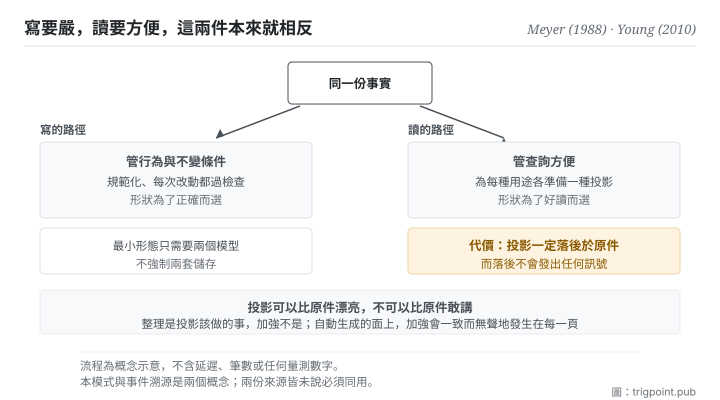

Canonical: https://trigpoint.pub/zh-Hant/collections/software-systems-architecture/cqrs-young-2010  
Captured: 2026-11-02T21:27:57.426438+08:00

> 公開理論閱讀鏡像。驗證層及 Lab 案例請到原站閱讀。

讀與寫要共用一個模型，還是沿兩者的邊界切成兩個？

# 命令查詢職責分離

Command Query Responsibility Segregation (CQRS) · Young (2010) / Meyer CQS (1988)

書目已核 ✓  
Lab 實測 ✓  
軟體架構 · 讀寫分離  
先讀：事件溯源

## 三句講透

更新資訊用的模型，不必等於讀取資訊用的模型。  
兩邊的需求本來就相反：寫要嚴，讀要方便。  
分開之後多出一個東西要顧，就是那份會落後於原件的投影。

<strong>圖 1</strong> · 同一份事實往兩邊走：左邊是寫的路徑，管行為與不變條件；右邊是讀的路徑，管查詢方便。  
兩邊各自可以有自己的形狀。  
底部標出一條紀律：投影可以比原件漂亮，不可以比原件敢講。

## 一、發生什麼事

讀與寫該共用一份模型，還是各用一份，是一個要逐塊判斷的取捨。一份模型同時服務讀與寫時，它得同時滿足兩組互相拉扯的要求。寫的那一邊要嚴：資料要規範化、不變條件要守得住、每次改動都得通過檢查。讀的那一邊要方便：常常需要跨好幾處拼起來的視圖、需要為不同用途各準備一種形狀、需要快。

模型被兩邊同時拉的結果是扭曲：為了讀方便而放寬結構，或為了寫嚴謹而讓每個查詢都要繞遠路。這個模式的主張很單純：<strong>沿讀與寫的邊界，把一個模型切成兩個</strong>[\[2\]](#reference-note-2)。寫的那一邊專注行為與一致性，讀的那一邊專注查詢優化的投影。

它的祖系是 1988 年那本原典裡的「命令與查詢分離」：一個方法要嘛改狀態而不回值，要嘛回值而無副作用[\[1\]](#reference-note-1)。那條規矩管的是方法層，這個模式把同一個切法<strong>升到模型層</strong>。命令與查詢這組詞彙也來自那本原典：而 2011 年那篇文章（本站標為把模式帶進主流架構討論的一篇）其實沒有提到那位原典作者[\[3\]](#reference-note-3)，本站因此直接錨到原典，不從二手回推。

歸屬還有兩處要說。2010 年 11 月那份作者自行發布的文件把這個模式系統化整理[\[2\]](#reference-note-2)，但它不是起點：2008 年已有另一位實務者的文章在架構層把命令與查詢分給兩個服務，同一位作者 2009 年 12 月的文章已通篇使用這個縮寫[\[4\]](#reference-note-4)，本站因此把 2010 年那份文件的作者標為<strong>結晶化者，不標為孤立首創</strong>。至於他第一次公開講這套想法是哪一年，本頁未能從當事人原話核定，因此不寫年份[\[5\]](#reference-note-5)。

最後一件事，那篇 2011 年的文章特別強調：這個模式應該<strong>局部施用</strong>在確實被讀寫衝突扭曲的那一塊，不是整個系統統一架構[\[3\]](#reference-note-3)。

<strong>署名要給對：</strong>命令與查詢分離之原典與該組詞彙歸 Meyer（1988）[\[1\]](#reference-note-1)；本模式之系統化整理，本站歸 Young（2010 年 11 月那份文件）[\[2\]](#reference-note-2)，惟架構層的讀寫分離與這個縮寫在此之前已見於 Dahan 2008 與 2009 年的文章，故本站標 Young 為結晶化者，非孤立首創[\[4\]](#reference-note-4)；主張局部施用歸 Fowler（2011 年 7 月 14 日），本站並把該文標為把模式帶入主流架構論述的一篇[\[3\]](#reference-note-3)。首講年份未能從當事人原話核定，本頁不寫[\[5\]](#reference-note-5)。四段要分開署名：把整條線壓成「某某在 2010 年提出」會一次弄錯詞彙來源與先行者。

## 二、為什麼這對你重要

你已經在用這個模式了，只是沒有把它的紀律一起帶進來。

任何「派生出來給人看的東西」都是讀模型：一份月報、一張看板、一頁對外說明、一段餵給模型的摘要。它們的原件在別處。你之所以做它們，正是因為原件的形狀不適合那個用途：這就是分離的理由，而且理由是對的。

分離帶來的成本只有一項，但它是結構性的：<strong>投影一定會落後於原件。</strong> 落後多少取決於你多久重新生成一次，而落後這件事本身<strong>不會發出任何訊號</strong>。一份三週前生成的看板，看起來跟今天生成的一模一樣。

所以這頁給的實務是三條，第三條最少人做。

<strong>第一，決定要不要分之前先問：讀的人跟寫的人是同一群嗎。</strong> 如果是同一個人（例如你自己的決策記錄），分離大概只是多一份要維護的東西。如果不是（對外頁面、交給協作者的說明、餵給模型的脈絡），分離幾乎總是對的。

<strong>第二，投影一律標生成時間。</strong> 這是承認落後，而不是假裝同步。

<strong>第三，也是本頁真正要留下的一句：投影可以比原件漂亮，不可以比原件敢講。</strong> 派生的過程很容易加料：把一個模糊的等級換成一句明確的措辭、把一段有保留的敘述整理成一句乾淨的結論。整理是投影該做的事，加強不是。而這種加強在自動生成的面上特別危險，因為它會<strong>一致地、無聲地</strong>發生在每一頁上。

## 常見誤讀

所屬頁核驗：書目已核 ✓ · 內容最後修訂 2026-10-25

- 常見轉述「這個模式就是事件溯源的一部分」：兩者是兩個概念，命令查詢職責分離可以配一般的資料存取方式，不必先改成事件溯源。兩份原始來源都把兩者分開介紹：2010 年那份文件說兩者結合時最有意思、彼此相輔，2011 年那篇說它與事件式的程式模型很相配；兩份都沒有說必須同用。
- 常見轉述「分離就要用兩個資料庫、接受最終一致」：最小形態只需要兩個模型，不強制兩套儲存。把分庫的最終一致性當成必選，是把可選的放大當成定義。
- 常見轉述「這是那位實務者 2010 年發明的」：本站把 2010 年 11 月那份文件標為系統化整理，不是起點。架構層的讀寫分離 2008 年已有文章寫過，這個縮寫 2009 年 12 月已在公開文章中通篇使用；命令與查詢這組詞彙則來自 1988 年那本原典。發明、定名與詞彙來源要分開記。

## 修正記錄

- 首講年份：先前版本並列的兩處當事人自述（2006 與 2007 年）未能從原話核對，已改為不寫年份。

## 參考文獻

<strong>如何閱讀來源註記</strong> 「書目經…核對」指作者、年份、題名與出版項已確認；不代表該來源的主張已被核對。「對照全文核實」指主張已與來源文本本身比對。「依多源一致轉述」指主張建立於多份彼此一致、轉述該來源的資料，而非原文件本身。 定義版本：2026-09-20。

- \[1\] Meyer, B. (1988). Object-Oriented Software Construction. Prentice Hall. ISBN 0-13-629049-3.
- \[2\] Young, G. (2010). CQRS Documents. cqrs.files.wordpress.com/2010/11/cqrs_documents.pdf.
- \[3\] Fowler, M. (2011). CQRS. martinfowler.com/bliki/CQRS.html. Published 14 July 2011.
- \[4\] Dahan, U. (2008). Command Query Separation and SOA. udidahan.com/2008/08/11/command-query-separation-and-soa/; Dahan, U. (2009). Clarified CQRS. udidahan.com/2009/12/09/clarified-cqrs/.
- \[5\] 編輯註，無外部來源；全文見正文註 \[5\]。

## 知識圖譜

- [<em>對照 ▸</em>事件溯源（Event Sourcing）](event-sourcing-fowler-2005.md)

引用格式：Trigpoint，〈命令查詢職責分離〉，trigpoint.pub/zh-Hant/collections/software-systems-architecture/cqrs-young-2010 · © Strategitect Limited. · 內容最後修訂 2026-10-25

## 來源註記

**[1]** Meyer, B. (1988). Object-Oriented Software Construction (1st ed.). Prentice Hall. 書目經雙源核對。命令與查詢分離及其用詞之歸屬依多源一致轉述。命令與查詢分離之原典：一個方法要嘛改狀態而不回值，要嘛回值而無副作用；命令與查詢這組詞彙的來源。書內章節本頁未逐字核對。

**[2]** Young, G. (2010-11). CQRS Documents (PDF). 書目經官方記錄核對。主張已對照全文核實。作者自行發布、把這個模式系統化整理的實務文件。文中自述：它起初只被當成在更高層次套用命令查詢分離，經過一段混淆之後才被認定為另一個模式。

**[3]** Fowler, M. (2011-07-14). CQRS. martinfowler.com/bliki/CQRS.html. 書目經官方記錄核對。主張已對照全文核實。原句說這個模式是作者最先從 Young 口中聽到的描述；同文主張它只應施用在系統的特定部分，而非整個系統。

**[4]** Dahan, U. (2008, August 11). Command Query Separation and SOA. udidahan.com; Dahan, U. (2009, December 9). Clarified CQRS. udidahan.com. 書目經官方記錄核對。主張已對照全文核實。兩篇皆早於 2010 年 11 月那份文件：2008 年那篇已在架構層把命令與查詢分給兩個服務、各用自己的資料存放，但仍稱命令查詢分離；2009 年那篇通篇使用這個縮寫。

**[5]** 首講年份：本頁未能從當事人原話核定他第一次公開講述這套想法的年份，故不寫年份。

---

[English](../../../en/collections/software-systems-architecture/cqrs-young-2010.md) · [简体中文](../../../zh-Hans/collections/software-systems-architecture/cqrs-young-2010.md)

[Index](../../README.md) · [Original page](https://trigpoint.pub/zh-Hant/collections/software-systems-architecture/cqrs-young-2010) · [Citation and versions](../../../READING.md)

[Original SVG](assets/cqrs-young-2010.svg) · Display copy adds a white background only.
