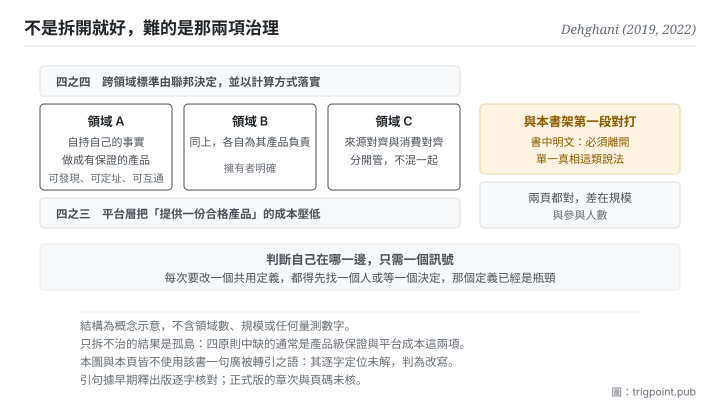

Canonical: https://trigpoint.pub/zh-Hant/collections/software-systems-architecture/data-mesh-dehghani-2022  
Captured: 2026-11-02T21:27:57.719929+08:00

> 公開理論閱讀鏡像。驗證層及 Lab 案例請到原站閱讀。

資料該由中央團隊統一管，還是交給各領域自己持有？

# 資料網格

Data Mesh · Dehghani (2019, 2022)

書目已核 ✓  
軟體架構 · 聯邦式治理  
先讀：單一真相來源  
先讀：CAP 定理

## 三句講透

規模上來之後，維持一個全域統一的正典模型會讓那個模型變成瓶頸。  
資料網格的處置是把事實留在各領域自己手上，並要求它做成有品質保證的產品。  
跨領域的互通標準由聯邦決定，不由中央指定。

<strong>圖 1</strong> · 四個原則的關係：領域各自持有自己的事實並把它做成有品質保證的產品，平台層把提供產品的成本壓低，跨領域的互通標準由聯邦決定而非中央指定。  
右側標出本頁與本書架第一段的對打點：這裡明文把單一真相列為要離開的說法之一。

## 一、發生什麼事

資料該由一個中央團隊統一管理，還是留在產生它的各領域手上，是企業規模下的一個取捨。這一頁是本書架唯一<strong>明文反對第一段</strong>的節點，而它反對的方式值得看清楚。

它的診斷從一個運維現象開始：中央資料團隊成為瓶頸，而整合式的大水池在企業規模下整合複雜度爆炸。原因不是技術不夠好，是<strong>結構</strong>：每個新需求都要經過同一批人、同一個模型。

它的處置是四件事[\[2\]](#reference-note-2)。第一，<strong>領域自己持有自己的資料</strong>。第二，<strong>資料要做成產品</strong>：可被發現、可被定址、可與他人互通，也就是要有品質保證，不是把檔案丟出去就算。第三，<strong>平台層要把「提供一份產品」的成本壓低</strong>，否則自治只是把負擔轉嫁給領域。第四，<strong>跨領域的標準由聯邦決定並以計算方式落實</strong>，不由中央指定。

而它最直接的一句話是：資料網格必須離開諸如<strong>單一真相來源</strong>、或單一受嚴格控制的正典模型這類說法[\[2\]](#reference-note-2)。這句曾對照該書早期釋出版逐字確認，不是後人歸納。

它還做了一個很有用的區分[\[1\]](#reference-note-1)：來源對齊的資料集（各領域自己產生的、不可變的帶時間事實）與消費對齊的資料集（為了下游用途而轉換、加工出來的視圖）。這兩者不該混在一起管：前者是事實，後者是派生物。<strong>這個區分其實就是本書架段二那兩頁的放大版</strong>：事實在一處，派生物可以有很多個。

歸屬與譜系這一頁很乾淨：概念與命名同一人，2019 年一篇文章、2022 年一本書[\[1\]](#reference-note-1)[\[2\]](#reference-note-2)；本站在本書架內為它標出的祖系有三頁（組織溝通結構的約束、領域驅動設計、團隊拓撲），只是舉例[\[5\]](#reference-note-5)；學界已有一篇系統性回顧，但它整理的是業界灰色文獻，並指出學界對這個概念的界定仍然缺乏[\[4\]](#reference-note-4)。

<strong>署名要給對：</strong>概念與命名皆歸 Dehghani（2019 年那篇文章、2022 年那本書）[\[1\]](#reference-note-1)[\[2\]](#reference-note-2)，原創與造詞為同一人。祖系，本站舉本書架已有之三頁為例：組織溝通結構之約束（1968）、領域驅動設計（2003）、團隊拓撲（2019）[\[5\]](#reference-note-5)。學術層之系統性回顧歸 2024 年那篇綜述期刊論文之作者群[\[4\]](#reference-note-4)。<strong>一句被廣泛轉引的話本頁不使用</strong>：其逐字定位未解，判為改寫[\[3\]](#reference-note-3)。

## 二、為什麼這對你重要

這頁是本書架給你的<strong>尺度感</strong>，而尺度感通常比原則本身更難得。

段一那頁說：每個元素只在一處被維護，他處引用。那條在你自己的知識庫裡幾乎總是對的。這頁說：當領域數量與變更速度超過某個點，維持一個全域統一的正典模型會讓那個模型變成瓶頸。兩頁都對，差別在規模與參與人數。

判斷自己在哪一邊，有一個很實際的訊號：<strong>如果每次要改一個共用的定義，都得先找一個人（或等一個決定），那個共用定義已經是瓶頸了。</strong> 一個人的系統沒有這個問題（那個人就是你）；兩三個人的系統開始有；十個人的系統一定有。

而這頁真正該帶走的是那四個原則中最容易被跳過的兩個。

<strong>「做成產品」這一項比自治重要。</strong> 把事實留在各領域手上很容易，難的是要求每一份都可被發現、有明確的擁有者、有品質承諾。少了這一項，去中心化就退化成一堆各自為政的孤島：你把瓶頸換成了迷路。

<strong>「平台把成本壓低」這一項決定成敗。</strong> 如果提供一份合格產品的成本很高，各領域就會敷衍它，或乾脆繞過去。這一項在個人層面的對應物是：如果你的歸檔規矩太麻煩，你就不會照做，然後你會怪自己不夠自律，而真正該修的是成本。

## 常見誤讀

所屬頁核驗：書目已核 ✓ · 內容最後修訂 2026-10-25

- 常見轉述「資料網格就是把資料湖拆成幾個小湖」：四個原則裡有兩個與拆分無關（產品級品質保證、聯邦式治理）。只拆不治，得到的是幾個各自為政的孤島。
- 常見轉述「聯邦式治理就是沒有治理」：它指的是跨領域的互通標準由參與者共同決定並以計算方式落實，不是取消標準。這與中央指定的差別在誰決定，不在有沒有。

## 修正記錄

- 本頁不使用某句被廣泛轉引的話：深度覆核未能在所查版本中逐字定位它，最接近者是一個小節標題，因此該句被判為改寫而非引文，狀態未解。本站不引用狀態未解的句子。

## 參考文獻

<strong>如何閱讀來源註記</strong> 「書目經…核對」指作者、年份、題名與出版項已確認；不代表該來源的主張已被核對。「與摘要一致」指主張與論文摘要相符；不含逐句對照全文。「對照全文核實」指主張已與來源文本本身比對。 定義版本：2026-09-20。

- \[1\] Dehghani, Z. (2019). How to Move Beyond a Monolithic Data Lake to a Distributed Data Mesh. martinfowler.com/articles/data-monolith-to-mesh.html. Published 20 May 2019.
- \[2\] Dehghani, Z. (2022). Data Mesh: Delivering Data-Driven Value at Scale. O'Reilly. ISBN 978-1-492-09239-1.
- \[3\] 編輯註，無外部來源；全文見正文註 \[3\]。
- \[4\] Goedegebuure, A., Kumara, I., Driessen, S., Van Den Heuvel, W.-J., Monsieur, G., Tamburri, D. A., & Di Nucci, D. (2024). Data Mesh: A Systematic Gray Literature Review. ACM Computing Surveys, 57(1), Article 11, 1–36.
- \[5\] 編輯註，無外部來源；全文見正文註 \[5\]。

## 知識圖譜

- [<em>前置 ▸</em>領域驅動設計（Domain-Driven Design (DDD)）](domain-driven-design-evans-2003.md)
- [<em>前置 ▸</em>康威定律（Conway's Law）](conways-law-conway-1968.md)
- [<em>對照 ▸</em>單一真相來源（Single Source of Truth (concept history)）](single-source-of-truth-concept-history.md)
- [<em>對照 ▸</em>事件溯源（Event Sourcing）](event-sourcing-fowler-2005.md)

引用格式：Trigpoint，〈資料網格〉，trigpoint.pub/zh-Hant/collections/software-systems-architecture/data-mesh-dehghani-2022 · © Strategitect Limited. · 內容最後修訂 2026-10-25

## 來源註記

**[1]** Dehghani, Z. (2019-05-20). How to Move Beyond a Monolithic Data Lake to a Distributed Data Mesh. martinfowler.com. 書目經出版社記錄核對。主張已對照全文核實。出處經跨模型雙查核實。原文逐字確認：來源對齊的領域資料集必須與內部作業系統的資料集分開，前者體量更大、代表不可變的帶時間事實、且變動頻率低於其來源系統。

**[2]** Dehghani, Z. (2022). Data Mesh: Delivering Data-Driven Value at Scale. O'Reilly. 書目經雙源核對。出處經跨模型雙查核實。此句曾對照早期釋出版逐字確認：資料網格必須離開諸如單一真相來源、或單一受嚴格控制的正典模型這類資料神話。早期釋出版把這段放在題為〈After the Inflection Point〉的一章；正式版目錄中此題為第 7 章，第 2 章另有一節題為〈Embrace the Most Relevant Domain Data: Don’t Expect a Single Source of Truth〉。正式版的章次與頁碼本站未核。

**[3]** 深度覆核之殘留一件：另一句被廣泛轉引的話未能在所查版本中逐字定位，最接近者為早期釋出版的一個小節標題。判為改寫而非引文，狀態未解。本頁因此完全不使用該句。

**[4]** Goedegebuure, A., Kumara, I., Driessen, S., Van Den Heuvel, W.-J., Monsieur, G., Tamburri, D. A., & Di Nucci, D. (2024). Data Mesh: A Systematic Gray Literature Review. ACM Computing Surveys, 57(1), Article 11, 1–36. DOI 10.1145/3687301. 書目經官方記錄核對。要旨與摘要一致。2024 年一篇計算機領域綜述期刊的系統性灰色文獻回顧：整理 114 篇業界文章，歸納出四個原則。摘要指出，業界的灰色文獻已相當多，學界對這個概念的界定與延伸則仍然缺乏。

**[5]** 本站整理之知識祖系（舉例，非全部）：組織溝通結構之約束（1968）→ 領域驅動設計（2003）→ 團隊拓撲（2019）→ 本概念（2019、2022）。四段皆為本書架已有之節點。

---

[English](../../../en/collections/software-systems-architecture/data-mesh-dehghani-2022.md) · [简体中文](../../../zh-Hans/collections/software-systems-architecture/data-mesh-dehghani-2022.md)

[Index](../../README.md) · [Original page](https://trigpoint.pub/zh-Hant/collections/software-systems-architecture/data-mesh-dehghani-2022) · [Citation and versions](../../../READING.md)

[Original SVG](assets/data-mesh-dehghani-2022.svg) · Display copy adds a white background only.
