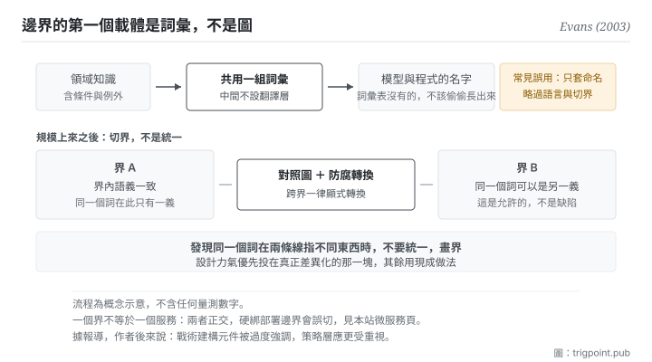

Canonical: https://trigpoint.pub/zh-Hant/collections/software-systems-architecture/domain-driven-design-evans-2003  
Captured: 2026-11-02T21:27:58.082101+08:00

> 公開理論閱讀鏡像。驗證層及 Lab 案例請到原站閱讀。

先畫架構圖，還是先讓專家與開發者用同一組詞？

# 領域驅動設計

Domain-Driven Design (DDD) · Evans (2003)

書目已核 ✓  
軟體架構 · 語言與邊界  
先讀：模組化與薄切面

## 三句講透

複雜度的主戰場在領域本身，不在技術層。  
處理它的第一個動作不是畫架構圖，是把詞彙統一：領域專家與開發者共用一組詞，那組詞直接成為系統裡的名字。  
規模上來之後再切界，界內語義一致，跨界靠顯式轉換。

<strong>圖 1</strong> · 上排是知識怎麼進到系統裡：領域專家與開發者共用一組詞彙，那組詞彙直接成為模型與程式的名字，中間不設翻譯層。  
下排是規模上來之後的處置：切成幾個界，界內語義一致，跨界靠一張對照圖與一層防腐轉換。  
右側標出常見誤用：只套戰術命名而略過語言與界。

## 一、發生什麼事

要先定架構，還是先定一套領域專家與開發者共用的詞彙，是系統開工時就得做的取捨。2003 年那本書的立場是：軟體真正的難處在<strong>業務領域</strong>，不在框架與資料庫[\[1\]](#reference-note-1)。而知識要無損地進到系統裡，第一個瓶頸不是技術，是<strong>翻譯</strong>。

典型的失敗長這樣：領域專家講一套詞，開發者在腦裡翻譯成另一套詞，再寫成第三套詞（程式裡的變數與類別名）。每一次翻譯都掉一點東西，而且掉的通常是條件與例外：專家說的「這種客戶通常不用預付，除非上一單有爭議」，翻到程式裡剩下一個布林欄位。

書裡的第一個要求因此是<strong>共用語言</strong>：一組領域專家與開發者共同使用的詞彙，中間不設翻譯層，而且那組詞<strong>直接成為模型與程式裡的名字</strong>。這聽起來像溝通建議，實際上是設計約束：如果一個概念在詞彙表裡沒有名字，它就不該在程式裡有一個偷偷長出來的實作。

第二個要求來自規模。大系統裡<strong>維持不了單一統一的模型</strong>：同一個詞在銷售與物流那邊本來就指不同東西，硬要統一只會讓模型變成沒人滿意的妥協。書的處置是切成幾個<strong>界限脈絡</strong>：每個界內語義一致，界與界之間用一張對照圖顯式管理，必要時在交界處加一層防腐轉換，避免外部模型的形狀滲進來[\[1\]](#reference-note-1)。

第三個要求是資源分配：設計力氣有限，要優先投在<strong>核心領域</strong>（真正產生差異化的那一塊），周邊與通用的部分能買現成就買現成。

歸屬這一頁比較單純：方法之名與策略層的核心詞彙（共用語言、界限脈絡）一般歸於這本書。但戰術層那組建構元件不能整組歸給它：例如儲存庫一式，前一年出版的企業應用架構模式書已經收錄，且署名另兩位作者[\[2\]](#reference-note-2)。另有一件作者自己的後見值得放進來：據 2009 年一次講座的會後報導，他說戰術層那組建構元件被過度強調，界與核心領域則應更受重視[\[3\]](#reference-note-3)。

<strong>署名要給對：</strong>方法與其策略層詞彙（共用語言、界限脈絡、策略設計）一般歸 Evans（2003）[\[1\]](#reference-note-1)；戰術層建構元件之系統化歸該書，但<strong>部分元件另有前例</strong>，如儲存庫一式見於 2002 年之企業應用架構模式書，該條署名 Hieatt 與 Mee[\[2\]](#reference-note-2)。關於戰術層被過度強調、策略層應更受重視之後見，據其 2009 年講座之會後報導[\[3\]](#reference-note-3)。概念上的鄰居（模組邊界的成本判準、服務邊界、組織溝通結構）各有其主，見本書架段三第一頁與段四、段五。

## 二、為什麼這對你重要

這頁對你最直接的用途，是它解釋了為什麼你跟模型的協作常常在<strong>同一個詞</strong>上翻車。

你手上有一套自己的詞彙：某個檔案叫什麼、某個階段叫什麼、某個判準叫什麼。當你把工作交給模型，你用的是你的詞，它用的是它從整個網路學來的通用義。兩者八成重疊，剩下兩成就是誤解的來源，而且<strong>誤解不會表現為它答不出來，會表現為它答得很順但答的是另一件事</strong>。

共用語言的做法直接可搬：把你的詞彙固定下來，一個概念一個名字，並且<strong>在給模型的脈絡裡帶上那組定義</strong>。這比反覆糾正它更省，因為你不是在修結果，是在修輸入。

界限脈絡那一層更有意思，因為它反過來允許不一致。你不必讓「專案」這個詞在所有地方都指同一件事：你只需要在<strong>每一個界內</strong>一致，並且在跨界的時候明確轉換。這對一人多線的工作特別有用：對客戶那條線的「交付」和對自己那條線的「交付」本來就不是同一件事，硬統一比分開更貴。

實務上這頁給三個動作。第一，寫下那份詞彙表，一個概念一個名字，同義詞明確標為同義。第二，當你發現同一個詞在兩條線指不同東西，<strong>不要統一，畫界</strong>。第三，設計力氣優先投在你真正差異化的那一塊；其他地方用現成的做法，不要自己發明。

## 常見誤讀

所屬頁核驗：書目已核 ✓ · 內容最後修訂 2026-10-25

- 常見轉述「領域驅動設計就是那套命名慣例（實體、值物件、聚合、儲存庫）」：那是戰術層。據作者 2009 年一次講座的會後報導，他說這組建構元件被過度強調，界限脈絡與核心領域應更受重視。只套命名不做語言與界，會退化成換了花俏名字的普通增刪查改。
- 常見轉述「一個界限脈絡就是一個微服務」：兩者正交。一個服務可以含多個界，反之亦然。把界的邊界硬綁部署邊界會誤切。

## 參考文獻

<strong>如何閱讀來源註記</strong> 「書目經…核對」指作者、年份、題名與出版項已確認；不代表該來源的主張已被核對。「對照原站核實」指主張已與該項目的原始網站比對。「轉引自」指本頁未讀原文，引註取自所列來源。 定義版本：2026-09-20。

- \[1\] Evans, E. (2003). Domain-Driven Design: Tackling Complexity in the Heart of Software. Boston: Addison-Wesley Professional. ISBN-13 978-0-321-12521-7. 560 pp.
- \[2\] Hieatt, E. & Mee, R. Repository. In Fowler, M. (2002). Patterns of Enterprise Application Architecture. martinfowler.com/eaaCatalog/repository.html.
- \[3\] Evans, E. (2009). What I've learned about DDD since the book. QCon London 2009. As reported in Adzic, G. (2009, March 12), gojko.net/2009/03/12/qcon-london-2009-eric-evans-what-ive-learned-about-ddd-since-the-book.

## 知識圖譜

- [<em>應用於 ▸</em>微服務（Microservices）](microservices-lewis-fowler-2014.md)
- [<em>被應用 ▸</em>模組化與薄切面（Modularity & Thin Crossing Points）](modularity-baldwin-clark-2000.md)
- [<em>被應用 ▸</em>六角架構（Hexagonal Architecture (Ports and Adapters)）](hexagonal-architecture-cockburn-2005.md)
- [<em>下游 ▸</em>資料網格（Data Mesh）](data-mesh-dehghani-2022.md)

引用格式：Trigpoint，〈領域驅動設計〉，trigpoint.pub/zh-Hant/collections/software-systems-architecture/domain-driven-design-evans-2003 · © Strategitect Limited. · 內容最後修訂 2026-10-25

## 來源註記

**[1]** Evans, E. (2003). Domain-Driven Design: Tackling Complexity in the Heart of Software. Addison-Wesley. ISBN-13 978-0-321-12521-7. 書目經出版社記錄核對。560 頁，2003 年 8 月出版。書中系統化共用語言、界限脈絡、模型驅動設計的建構元件，以及策略設計（脈絡對照圖、蒸餾、核心領域）；書內段落本頁未逐字核對。

**[2]** Hieatt, E. & Mee, R. Repository. In Fowler, M. (2002). Patterns of Enterprise Application Architecture. martinfowler.com/eaaCatalog/repository.html. 書目經官方記錄核對。儲存庫一式之署名與出處已對照原站核實。早於 2003 年那本書的前例：儲存庫一式已收於 2002 年的企業應用架構模式書，作者站上該條署名另兩位作者。戰術層的建構元件因此不能整組歸給 2003 年那本書。

**[3]** Evans, E. (2009, March). What I've learned about DDD since the book. Talk at QCon London 2009. 轉引自 Adzic (2009)。會後報導（Adzic, 2009 年 3 月 12 日, gojko.net）記其說：戰術建構元件（值物件、實體、工廠、儲存庫、服務）被過度強調；脈絡邊界一章是他對成書方式少數的遺憾之一；核心領域在書中出現得很晚，應在整個過程中得到更多重視。

---

[English](../../../en/collections/software-systems-architecture/domain-driven-design-evans-2003.md) · [简体中文](../../../zh-Hans/collections/software-systems-architecture/domain-driven-design-evans-2003.md)

[Index](../../README.md) · [Original page](https://trigpoint.pub/zh-Hant/collections/software-systems-architecture/domain-driven-design-evans-2003) · [Citation and versions](../../../READING.md)

[Original SVG](assets/domain-driven-design-evans-2003.svg) · Display copy adds a white background only.
