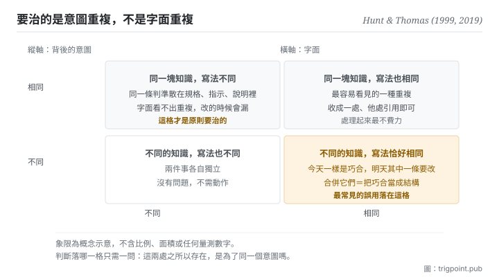

Canonical: https://trigpoint.pub/zh-Hant/collections/software-systems-architecture/dry-pragmatic-programmer-1999  
Captured: 2026-11-02T21:27:58.466096+08:00

> 公開理論閱讀鏡像。驗證層及 Lab 案例請到原站閱讀。

二十年後，兩位作者補了一句：原則講的是知識與意圖。

# 不重複原則

Don't Repeat Yourself (DRY) · Hunt & Thomas (1999)

書目已核 ✓  
軟體架構 · 設計原則

## 三句講透

原則的原文說的是：每一塊知識在系統裡只能有一個明確而權威的表述。  
它管的是知識與意圖，不是字面。  
所以兩段完全不同的文字可能違反它，而兩段一字不差的文字可能完全沒問題。

<strong>圖 1</strong> · 兩個軸分開看的四種情形：橫軸是兩段東西的字面是否相同，縱軸是它們背後的意圖是否相同。  
原則要治的只有左上那一格；右下那一格是最常見的誤用，把字面相同而意圖不同的東西硬合成一個。

## 一、發生什麼事

這條原則寫下二十年後，兩位作者在新版裡回頭替它補了一句說明。1999 年那本書把這條原則寫成一句話：系統內的每一塊知識，必須有單一、無歧義、權威的表述[\[1\]](#reference-note-1)。書裡放它的那一節叫「重複之惡」。二十週年版把病症講得很直白：同一件事寫在兩處以上，改了一處就得記得改其他幾處；問題不在你會不會記得，而在你什麼時候忘記[\[2\]](#reference-note-2)。舉個常見的例子：同一條業務規則同時活在資料庫的欄位定義、後端的檢核、前端的表單、以及一份給人看的文件裡。規則改的時候，你要記得改四處。人不會每次都記得，於是系統開始自我矛盾。

二十年後，兩位作者在新版裡補了一句，而這句補充比原句更常被需要：這條原則講的是<strong>知識與意圖</strong>的重複，是「把同一件事在兩個地方、甚至用兩種完全不同的方式說出來」[\[2\]](#reference-note-2)。他們補這句，是因為初版沒把它講清楚，許多人把它讀成了「不要複製貼上程式碼」[\[2\]](#reference-note-2)。

這兩種讀法會導致相反的行為。照原意，你會去找「同一個判斷散落在幾處」，然後指定一處為準、其餘引用它。照誤讀，你會去找「長得像的兩段文字」，然後把它們合併成一個共用的東西。後者在字面相同而意圖不同的時候會出事：兩段規則今天恰好一樣，明天其中一條因為業務原因要改，而它們已經被綁在一起了。你省下的那次複製，換來一個更難拆的耦合。

歸屬上有一處要說清楚。這條原則的定義逐字確認在 1999 年初版，章名也確認；但編號在兩版不同（初版是第 11 條提示；二十週年版放在第 9 主題，提示改為第 15 條），而初版定義句所在的頁碼未能對照原書核實[\[3\]](#reference-note-3)。本站因此只標章與編號，不標頁。

<strong>署名要給對：</strong>原則的表述與名稱歸 Hunt 與 Thomas（1999 年初版第 2 章第 11 條提示）[\[1\]](#reference-note-1)；二十週年版（2019）的意圖層澄清為同兩位作者所補，並把它移為第 9 主題（第 15 條提示）[\[2\]](#reference-note-2)。本頁不把「單一真相來源」這個詞歸給這兩位作者：那是另一條概念線，見本站的單一真相來源概念史頁。兩者相容但不同源，署名要分開記。

## 二、為什麼這對你重要

把「知識」這個詞換成「判準」，這頁就直接落到你的工作流上。

你手上的判準現在住在幾個地方？一份寫給自己看的規格、一段貼給模型的指示、一份交給協作者的說明、可能還有一個你記在腦裡但沒寫下來的例外。這四份會漂。而它們漂的時候<strong>不會報錯</strong>：每一份單獨看都合理，只有把它們並排才看得出矛盾，而你平常不會並排。

原意的做法是指定一處為準，其他地方寫「見那一處」。這聽起來像行政手續，實際上是在改變失效的形狀：漂移從「四份各自演化，你不知道哪份對」變成「一份改了，引用它的地方自動跟上」。

但誤讀那條路也要防，而且在使用模型的時候更容易踩到。你會很想把三段看起來重複的指示合成一段通用的，因為它們的文字八成相同。停一下，問那個真正的問題：<strong>這三段背後是同一個意圖嗎？</strong> 如果其中一段之所以存在，是為了處理另外兩段不處理的例外，那它的字面重複是巧合，合併它就等於刪掉那個例外。

實務上這頁只留一句可以直接用的話：先問這是不是同一塊知識，再決定要不要合。反過來做，你會把巧合當成結構。

## 常見誤讀

所屬頁核驗：書目已核 ✓ · 內容最後修訂 2026-10-25

- 常見轉述「這條原則就是叫你不要有重複的程式碼」：原文治的是知識與意圖的重複，不是字面的重複。作者在二十年後那一版明文再講一次，並承認初版沒把它講清楚，許多人因此以為它只關乎程式碼。
- 常見轉述「這是書裡的第 11 條提示」：1999 年初版是第 11 條提示；2019 年二十週年版把它放在第 9 主題，提示編號改為第 15 條。引用時要一併標版本，否則讀者按編號翻不到。初版定義句所在的頁碼本站不標，因為未能對照原書核實。

## 參考文獻

<strong>如何閱讀來源註記</strong> 「書目經…核對」指作者、年份、題名與出版項已確認；不代表該來源的主張已被核對。「對照全文核實」指主張已與來源文本本身比對。「依多源一致轉述」指主張建立於多份彼此一致、轉述該來源的資料，而非原文件本身。 定義版本：2026-09-20。

- \[1\] Hunt, A. & Thomas, D. (1999). The Pragmatic Programmer: From Journeyman to Master. Addison-Wesley. ISBN 0-201-61622-X. Chapter 2, Tip 11.
- \[2\] Hunt, A. & Thomas, D. (2019). The Pragmatic Programmer, 20th Anniversary Edition. Addison-Wesley. ISBN 978-0-13-595705-9. Chapter 2, Topic 9.
- \[3\] 編輯註，無外部來源；全文見正文註 \[3\]。

引用格式：Trigpoint，〈不重複原則〉，trigpoint.pub/zh-Hant/collections/software-systems-architecture/dry-pragmatic-programmer-1999 · © Strategitect Limited. · 內容最後修訂 2026-10-25

## 來源註記

**[1]** Hunt, A. & Thomas, D. (1999). The Pragmatic Programmer: From Journeyman to Master. Addison-Wesley. Chapter 2, The Evils of Duplication; Tip 11. 書目經官方記錄核對。第 11 條提示的編號與定義句依多源一致轉述。原文定義：every piece of knowledge must have a single, unambiguous, authoritative representation within a system. 該節題為 The Evils of Duplication。

**[2]** Hunt, A. & Thomas, D. (2019). The Pragmatic Programmer: Your Journey to Mastery, 20th Anniversary Edition. Addison-Wesley. Chapter 2, Topic 9; Tip 15. 書目經出版社記錄核對。主張已對照全文核實。作者二十年後的補充：DRY is about the duplication of knowledge, of intent. 同一節並說明，初版沒把這條講清楚，許多人把它理解成只關乎程式碼。

**[3]** 初版的第 11 條提示與定義句，見於該版的提示清單；館藏目錄記初版該節起於第 26 頁，但定義句所在的頁碼未對照原書核實，本站因此不標頁。二十週年版把它放在第 9 主題（起於第 30 頁），提示編號改為第 15 條。

---

[English](../../../en/collections/software-systems-architecture/dry-pragmatic-programmer-1999.md) · [简体中文](../../../zh-Hans/collections/software-systems-architecture/dry-pragmatic-programmer-1999.md)

[Index](../../README.md) · [Original page](https://trigpoint.pub/zh-Hant/collections/software-systems-architecture/dry-pragmatic-programmer-1999) · [Citation and versions](../../../READING.md)

[Original SVG](assets/dry-pragmatic-programmer-1999.svg) · Display copy adds a white background only.
