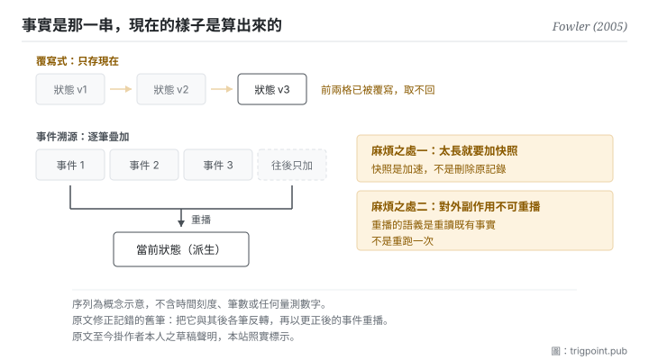

Canonical: https://trigpoint.pub/zh-Hant/collections/software-systems-architecture/event-sourcing-fowler-2005  
Captured: 2026-11-02T21:27:58.760070+08:00

> 公開理論閱讀鏡像。驗證層及 Lab 案例請到原站閱讀。

變更紀錄與當前狀態，一個是事實，一個由事實算出。

# 事件溯源

Event Sourcing · Fowler (2005)

已對照來源本身 ✓  
軟體架構 · 事實與派生  
先讀：單一真相來源

## 三句講透

把每一次變更存成一筆不可改的事件，當前狀態改由重播那串事件得出。  
於是「現在是什麼樣」不再是被保存的東西，而是被算出來的東西。  
代價是你得永遠不去改舊的那幾筆。

<strong>圖 1</strong> · 上半是只存當前狀態的做法：每次變更覆寫上一次，歷史隨之消失。  
下半是事件溯源：變更逐筆疊上去、永不就地修改，當前狀態由重播得出，也因此任何過去時點都重建得回來。  
右側標出原文談到的兩個難處：事件太多時重建會慢、要加快照；對外的副作用不能在重播時再發一次。

## 一、發生什麼事

變更的紀錄與此刻的狀態是兩樣東西：由前者可以重播出後者，由後者推不回前者。多數系統只存當前狀態：一筆資料改了，新值覆蓋舊值。這種做法有一個安靜的損失：<strong>變更史被覆寫的那一刻就永久消失了。</strong> 你有現在的樣子，但沒有「為什麼會走到這個樣子」。於是三件事同時做不到：稽核、重建任一過去時點、以及回頭修正一個早先的錯誤。

事件溯源把順序反過來：<strong>那串事件才是事實，當前狀態是派生物。</strong> 原文的定義是把對應用狀態的每一次變更捕捉為一串事件[\[1\]](#reference-note-1)。做法上只有兩條硬規矩：事件只能往後加、永不就地修改；當前狀態由空狀態起重播全部事件得出。這兩條一成立，時間旅行就自動附贈：重播到第 k 筆，你就得到那個時點的樣子。

原文同時談到幾個實作上的難處，以下三項比定義更有教學價值[\[1\]](#reference-note-1)。第一，事件太多時從頭重建會慢，於是需要快照：存下某時點的狀態，之後只從快照往後播。第二，發現早先某筆事件記錯時，原文的做法是把它與其後各筆反轉，再以更正後的事件重播；事件若寫成差額（「加 10 元」而非「設為 110 元」），反轉最容易。第三，也是最容易出事的一項：如果事件的處理過程會觸發對外的副作用（寄一封信、扣一次款），重播就不能真的再執行一次，否則你會重複扣款，而且結果不再可重現。重播的語義必須是「重讀既有事實」，不是「重跑一次」。

歸屬有兩處要說清楚。這位作者自己在原文把版本控制系統舉為常見的例子，也說在會計系統裡見過很強的例子[\[3\]](#reference-note-3)，所以本站把他標為系統化記錄者，不是發明者。而那頁至今掛著他本人的草稿聲明，明言這批寫作停在 2000 年代中期、在他能重拾之前不會修訂[\[2\]](#reference-note-2)。它常被當成標準參照，同時自陳是草稿：這件事本身值得記一筆。

<strong>署名要給對：</strong>以此為名的系統化記錄，本站歸 Fowler（2005 年 12 月 12 日該文）[\[1\]](#reference-note-1)；他本人在原文舉版本控制系統與會計系統為既有的例子，故本站<strong>不標他為發明者</strong>，名稱是否由他首創本站未查證[\[3\]](#reference-note-3)。與命令查詢職責分離的配對是後續實務推廣的結果，<strong>不在</strong> 2005 年原文之內[\[4\]](#reference-note-4)。該文的草稿狀態為作者自陳，並非本站推測[\[2\]](#reference-note-2)。四段要分開署名。

## 二、為什麼這對你重要

你的工作流裡最接近這個模式的東西，是你的決策記錄。

多數人的判準是覆寫式的：規矩改了，就把舊那句刪掉、寫上新那句。一年後你手上有一份看起來很乾淨的規矩，以及零筆「為什麼會變成這樣」。這在你自己記得的時候沒問題，在你忘了、或需要說服別人、或需要判斷「當初那個理由現在還成立嗎」的時候，就完全沒有材料。

事件溯源的做法是：規矩那一頁是<strong>派生物</strong>，逐筆的變更記錄才是事實。改規矩時你新增一筆（改了什麼、為什麼、當時的觸發是什麼），派生的那一頁重新生成。這樣一年後你有兩樣東西：可讀的現值，以及可查的來歷。

三條可以直接搬的規矩，都從上面那三項難處改寫而來。<strong>第一，永不改舊筆。</strong> 發現先前記錯了，補一筆更正，不要回去修：一旦允許回去修，整串記錄就失去它唯一的價值。<strong>第二，太長就加摘要層，但摘要不取代原記錄。</strong> 這是快照，不是刪除。<strong>第三，重播不等於重做。</strong> 你回頭讀舊決策是為了理解當時的判斷，不是為了照著再執行一次；當時的前提可能已經不在。第三條在使用模型時特別容易踩到：你把一整串歷史決策餵進去要它「照這個模式繼續」，它會很配合地把過期的前提一併沿用。

## 常見誤讀

所屬頁核驗：已對照來源本身 ✓ · 內容最後修訂 2026-10-25

- 常見轉述「事件溯源就是命令查詢職責分離的一部分」：2005 年那篇全文沒有提到後者。兩者常一起出現是後續實務推廣的結果，不是定義上的依賴。可以只用其中一個。
- 常見轉述「這個做法是那位作者發明的」：他自己在原文裡把版本控制系統舉為常見的例子，也說在會計系統裡見過很強的例子。本站因此把他標為系統化記錄者，不標為發明者。這兩件要分開講。
- 常見轉述「原文是一篇成熟的架構文獻」：該頁至今掛著作者本人的草稿聲明，明言在他能重拾之前不會修訂。它常被當成標準參照，但它自陳是草稿。

## 參考文獻

<strong>如何閱讀來源註記</strong> 「對照全文核實」指主張已與來源文本本身比對。 定義版本：2026-09-20。

- \[1\] Fowler, M. (2005). Event Sourcing. martinfowler.com/eaaDev/EventSourcing.html. Published 12 December 2005 (draft status per author's own notice).
- \[2\] Fowler, M. (2005). Event Sourcing. martinfowler.com/eaaDev/EventSourcing.html. Published 12 December 2005 (draft status per author's own notice).
- \[3\] Fowler, M. (2005). Event Sourcing. martinfowler.com/eaaDev/EventSourcing.html. Published 12 December 2005 (draft status per author's own notice).
- \[4\] Fowler, M. (2005). Event Sourcing. martinfowler.com/eaaDev/EventSourcing.html. Published 12 December 2005 (draft status per author's own notice).
- \[5\] Fowler, M. (2004). Reporting Database. martinfowler.com/bliki/ReportingDatabase.html. Original publication 2 April 2004.

## 知識圖譜

- [<em>對照 ▸</em>命令查詢職責分離（Command Query Responsibility Segregation (CQRS)）](cqrs-young-2010.md)
- [<em>對照 ▸</em>資料網格（Data Mesh）](data-mesh-dehghani-2022.md)

引用格式：Trigpoint，〈事件溯源〉，trigpoint.pub/zh-Hant/collections/software-systems-architecture/event-sourcing-fowler-2005 · © Strategitect Limited. · 內容最後修訂 2026-10-25

## 來源註記

**[1]** Fowler, M. (2005-12-12). Event Sourcing. martinfowler.com/eaaDev/EventSourcing.html. 主張已對照全文核實。原文定義為把對應用狀態的每一次變更捕捉為一串事件。同頁談到幾個實作上的難處：事件多時從頭重建會慢，可改存快照；記錯的事件可連同其後各筆反轉，再以更正後的事件重播；外部系統分不出真正的處理與重播，要經閘道處理。

**[2]** 同一頁面的草稿聲明：作者自述這批寫作是他在 2000 年代中期進行的，此後被其他事情佔去時間，材料仍為草稿形態，在他能重拾之前不會修訂或更新。

**[3]** 同一頁面把版本控制系統舉為採用這種做法的常見例子，並說他在會計系統裡見過很強的例子；可見做法早於這篇文章。本站把作者標為系統化記錄者，非發明者；這個名稱是否由他首創，本站未查證。

**[4]** 2005 年該文全文未提命令查詢職責分離；兩者常被配對是後續實務推廣的結果，非定義之必要成分。見本站命令查詢職責分離頁。

---

[English](../../../en/collections/software-systems-architecture/event-sourcing-fowler-2005.md) · [简体中文](../../../zh-Hans/collections/software-systems-architecture/event-sourcing-fowler-2005.md)

[Index](../../README.md) · [Original page](https://trigpoint.pub/zh-Hant/collections/software-systems-architecture/event-sourcing-fowler-2005) · [Citation and versions](../../../READING.md)

[Original SVG](assets/event-sourcing-fowler-2005.svg) · Display copy adds a white background only.
