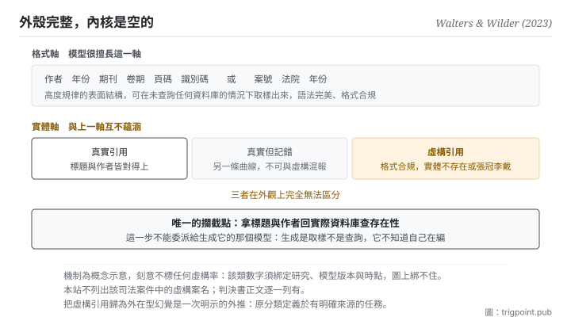

Canonical: https://trigpoint.pub/zh-Hant/collections/software-systems-architecture/fabricated-citations-walters-wilder-2023  
Captured: 2026-11-02T21:27:59.034222+08:00

> 公開理論閱讀鏡像。驗證層及 Lab 案例請到原站閱讀。

律師用生成工具找判例寫進書狀，其中多件並不存在。

# 虛構引用

Fabricated Citations · Walters & Wilder (2023)

已對照來源本身 ✓  
機器學習 · 高危實例類  
先讀：生成幻覺  
先讀：忠實性與事實性

## 三句講透

引用的格式完整逼真，而它指向的東西不存在。  
危險不在它看起來不可信，在它<strong>看起來完全可信</strong>。  
格式可信度與內容真實性在此徹底脫鉤，而唯一能攔住它的動作是回去查存在性。

<strong>圖 1</strong> · 兩條軸在此徹底脫鉤：上排是格式軸，書目與案號的表面結構高度規律，模型取樣得極熟練；下排是實體軸，那份東西到底存不存在。  
讀者慣用的「格式即憑證」捷思在此失效，因為判斷依據與判斷對象互不蘊涵。  
唯一的攔截點是回去查存在性。  
本圖刻意不標任何比率。

## 一、發生什麼事

美國一起聯邦地院案件裡，律師把生成工具找來的判例寫進書狀，其中多件判例並不存在，法院最後處以罰款。書目與判例的格式是<strong>高度規律的表面結構</strong>：作者、年份、期刊、卷期、頁碼、識別碼，或案號、法院、年份。生成模型對這種結構取樣得極熟練：它可以在完全沒有查詢任何實際資料庫的情況下，產出語法完美、格式合規的引用字串。

於是一件事發生了：讀者與審查者慣用的「格式即憑證」捷思<strong>失效</strong>。因為判斷依據（格式是否規範）與判斷對象（那份東西是否存在）<strong>彼此獨立、互不蘊涵</strong>。這不是一個程度問題，是兩條軸完全脫鉤。

那篇 2023 年的研究把這件事量了出來，而它的方法定義值得逐字留著：若能找到一份在<strong>標題與作者兩者</strong>上皆相符或近似相符的真實作品，即視該引用為真實[\[1\]](#reference-note-1)。反面即為虛構。

它的數字很有名，而<strong>引用它必須連同條件一起帶</strong>：在該研究的樣本中（42 個跨學科主題、84 篇短文、636 條書目引用，量測時點為 2023 年），來自其中一個版本的引用有 55% 為虛構，來自較新版本的則為 18%[\[2\]](#reference-note-2)。兩個數字都綁定那個研究、那兩個模型版本與那個時點。脫離這些條件去講「虛構率是多少」，本身就是一次過度概括。

它還做了一個容易被忽略的區分[\[3\]](#reference-note-3)：<strong>虛構率與「真實引用之中的錯誤率」是兩條獨立曲線</strong>。一份真實存在的文獻被記錯年份或頁碼，跟一份不存在的文獻被生成出來，不是同一件事，也不該合併報告。

司法場景有一個代價明確的實例：2023 年美國一起聯邦地院案件，律師用生成工具查找判例，寫進一份反對被告駁回起訴動議的書狀，其中引用多件不存在的判例；法院認定其行為構成規則下之主觀惡意並處連帶罰款[\[4\]](#reference-note-4)。<strong>本站不列出那些虛構案名</strong>，判決書正文逐一列有，要核對請回原文[\[5\]](#reference-note-5)。這個處置本身就是本頁在講的那件事：一筆引用在不在，回原文查。

<strong>署名要給對：</strong>虛構率之實證量測與方法定義歸 Walters 與 Wilder（2023，同儕審查期刊）[\[1\]](#reference-note-1)[\[2\]](#reference-note-2)；該研究為<strong>實證量測而非造詞</strong>，本頁不作術語歸屬宣稱。司法實例為判例而非學術著作，無造詞歸屬問題，其細節已對照判決書正文[\[4\]](#reference-note-4)[\[5\]](#reference-note-5)。內外型分類之歸屬見本書架前兩頁，本頁對它的使用是一次<strong>明示的外推</strong>[\[6\]](#reference-note-6)。四段要分開記。

## 二、為什麼這對你重要

這頁是全書架的最後一頁，因為它是前面十六頁的收束點：<strong>一個系統的可信度，不能建立在它看起來對。</strong>

你會遇到的形態很具體。你請模型幫你找支持某個說法的文獻，它回你五筆，格式整齊、有識別碼、有頁碼。其中三筆真的存在，一筆存在但作者被換了，一筆完全不存在。<strong>而這五筆從外觀上完全無法區分。</strong>

所以要做的事只有一件，而且沒有替代方案：<strong>回去查存在性。</strong> 不是查格式對不對，是拿標題與作者去實際的資料庫找那份東西在不在。這一步無法委派給生成它的那個模型，因為它的生成過程是取樣不是查詢：它不知道自己在編。

三個可以直接落成規矩的動作。

<strong>第一，把「有沒有這份東西」與「這份東西有沒有說這句話」分成兩個獨立的檢查。</strong> 前者是存在性，後者是上一頁那條忠實軸。兩者都可能單獨失敗。

<strong>第二，引用任何比率都綁條件。</strong> 哪個研究、哪個模型版本、哪個時間點。這條規矩看起來瑣碎，但它擋掉的是一種典型的二次傳播錯誤：一個 2023 年的數字被拿去描述今天。

<strong>第三，核到哪一層就說到哪一層。</strong> 這是本站的做法，也是本頁在示範的：每一條來源都標明核到書目、摘要還是全文，沒核到的不寫成核過。標得低會讓頁面看起來「不夠完整」，而那正是誠實的形狀。

## 常見誤讀

所屬頁核驗：已對照來源本身 ✓ · 內容最後修訂 2026-11-01

- 常見轉述「這是引用錯誤的一種」：不是。真實文獻但年份或頁碼記錯，與那份文獻根本不存在，是兩個範疇。原研究把兩者分開量測，兩條曲線不可混報。
- 常見轉述「模型在說謊」：無意圖可言。這是取樣機制的結構性副作用，模型不知道自己在編。把它框成故意欺騙是擬人化誤讀，也會讓人去修錯的東西。
- 常見轉述「某個研究說虛構率是 X」：虛構率隨模型與版本劇烈變動。引用任何數字都必須綁定哪個研究、哪個模型版本、哪個時間點，否則構成脫離情境的過度概括。

## 修正記錄

- 2026-10-25 · 本頁開架前更正兩處，皆已對照判決書正文。其一，前版說律師以生成工具撰寫的是一份動議；實為反對被告駁回起訴動議的書狀。其二，前版說虛構案名只見於搜尋摘要、法院原文全文未能取得，案件細節因此標為次級；判決書正文已對讀，案名在其中逐一列明，本頁仍不列出。

## 參考文獻

<strong>如何閱讀來源註記</strong> 「書目經…核對」指作者、年份、題名與出版項已確認；不代表該來源的主張已被核對。「對照全文核實」指主張已與來源文本本身比對。 定義版本：2026-09-20。

- \[1\] Walters, W. H., & Wilder, E. I. (2023). Fabrication and errors in the bibliographic citations generated by ChatGPT. Scientific Reports, 13, 14045. DOI [10.1038/s41598-023-41032-5](https://doi.org/10.1038/s41598-023-41032-5).
- \[2\] Walters, W. H., & Wilder, E. I. (2023). Fabrication and errors in the bibliographic citations generated by ChatGPT. Scientific Reports, 13, 14045. DOI [10.1038/s41598-023-41032-5](https://doi.org/10.1038/s41598-023-41032-5).
- \[3\] Walters, W. H., & Wilder, E. I. (2023). Fabrication and errors in the bibliographic citations generated by ChatGPT. Scientific Reports, 13, 14045. DOI [10.1038/s41598-023-41032-5](https://doi.org/10.1038/s41598-023-41032-5).
- \[4\] Mata v. Avianca, Inc., 678 F. Supp. 3d 443 (S.D.N.Y. 2023), No. 1:22-cv-01461 (PKC), Opinion and Order on Sanctions (22 June 2023). 書目經多源交叉核對。主張已對照全文核實。
- \[5\] Mata v. Avianca, Inc., 678 F. Supp. 3d 443 (S.D.N.Y. 2023), No. 1:22-cv-01461 (PKC), Opinion and Order on Sanctions (22 June 2023).
- \[6\] 編輯註，無外部來源；全文見正文註 \[6\]。

## 知識圖譜

- [<em>特化自 ▸</em>生成幻覺（Hallucination in NLG）](llm-hallucination-ji-2023.md)
- [<em>基於 ▸</em>生成幻覺（Hallucination in NLG）](llm-hallucination-ji-2023.md)
- [<em>應用 ▸</em>先紅隊，再採信：以單一主張為單位的紅隊程序](https://trigpoint.pub/zh-Hant/methods/red-team-a-claim)

引用格式：Trigpoint，〈虛構引用〉，trigpoint.pub/zh-Hant/collections/software-systems-architecture/fabricated-citations-walters-wilder-2023 · © Strategitect Limited. · 內容最後修訂 2026-11-01

## 來源註記

**[1]** Walters, W. H., & Wilder, E. I. (2023-09-07). Fabrication and errors in the bibliographic citations generated by ChatGPT. Scientific Reports, 13, Article 14045. DOI 10.1038/s41598-023-41032-5. 書目經官方記錄核對。主張已對照全文核實。方法定義：若能找到一份在標題與作者兩者上皆相符或近似相符的真實作品，即視該引用為真實（非虛構）。

**[2]** 同篇之量測（引用時必須連同條件一起帶）：在該研究的樣本中（42 個跨學科主題、84 篇短文、636 條書目引用，量測時點為 2023 年），來自其中一個版本的引用有 55% 為虛構，而來自較新版本的引用為 18%。兩個數字皆綁定該研究、該兩個模型版本與該時點，脫離條件即為過度概括。

**[3]** 同篇之另一項獨立量測：真實引用之中仍有實質性引用錯誤；該比率只以真實引用為分母，與虛構率分開計算，不可混報。

**[4]** 司法場景實例：一起 2023 年美國聯邦地院案件，律師用生成工具查找判例，寫進一份反對被告駁回起訴動議的書狀，其中引用多件不存在的判例；法院認定其行為構成聯邦民事訴訟規則第 11 條下之主觀惡意，對相關律師與律所處連帶罰款。本站不列出那些虛構案名，判決書正文逐一列有。

**[5]** 案件細節：案號、罰款金額（5,000 美元）、判決日期與書狀性質已對照判決書正文核對；判決報告之卷頁引註依多個公開書目一致。

**[6]** 分類延伸：前兩頁的內外型分類原生定義於有明確來源的條件式生成任務；虛構引用多發生於開放式生成，本站仍歸為外在型之下位特例（本質相同），但這是一次概念外推，非原分類之直接涵蓋。

---

[English](../../../en/collections/software-systems-architecture/fabricated-citations-walters-wilder-2023.md) · [简体中文](../../../zh-Hans/collections/software-systems-architecture/fabricated-citations-walters-wilder-2023.md)

[Index](../../README.md) · [Original page](https://trigpoint.pub/zh-Hant/collections/software-systems-architecture/fabricated-citations-walters-wilder-2023) · [Citation and versions](../../../READING.md)

[Original SVG](assets/fabricated-citations-walters-wilder-2023.svg) · Display copy adds a white background only.
