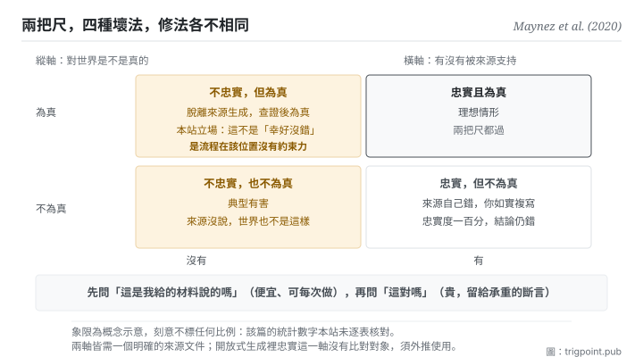

Canonical: https://trigpoint.pub/zh-Hant/collections/software-systems-architecture/faithfulness-factuality-maynez-2020  
Captured: 2026-11-02T21:27:59.306470+08:00

> 公開理論閱讀鏡像。驗證層及 Lab 案例請到原站閱讀。

忠於來源，和對世界為真，是兩條各自獨立的判定線。

# 忠實性與事實性

Faithfulness vs Factuality · Maynez et al. (2020)

已對照來源本身 ✓  
機器學習 · 評估軸  
先讀：生成幻覺

## 三句講透

忠實問的是這段話有沒有被來源支持，事實問的是它對世界是不是真的。  
兩者是獨立的判定線，交叉出四種情形，每一種的修法都不同。  
用一個分數代表兩者，你會修錯方向。

<strong>圖 1</strong> · 兩條獨立的判定線交叉出四種情形：橫軸問這段話有沒有被來源支持，縱軸問它對世界是不是真的。  
右上是理想；左上是脫離來源但查證為真；右下是來源自己錯而你如實複寫；左下是典型有害。  
本圖刻意不標任何比例，理由見驗證層。

## 一、發生什麼事

一段輸出有沒有被來源支持，和它對世界是不是真的，要分兩條線各自判定。這篇 2020 年的論文把一個長期混用的東西拆開了。

<strong>忠實</strong>的判準是觸發式的：若一段輸出含有<strong>未被輸入文件支持</strong>的片段，即判為幻覺[\[1\]](#reference-note-1)。注意這條完全不問世界：它只問來源。

<strong>事實</strong>的判準是獨立條款：若一段輸出含有<strong>不在文件中而為事實正確</strong>的資訊，則它含有事實性幻覺[\[1\]](#reference-note-1)。這句話的措辭值得停一下：它承認一段輸出可以同時「不忠於來源」與「對世界為真」，而且那仍然被算作一種幻覺（因為它不是來源說的）。

兩軸交叉出四種情形，每一種都真實存在：忠實且正確（理想）；忠實但不正確（<strong>來源自己錯，你如實複寫，判定仍是忠實，但你傳遞了錯誤</strong>）；不忠實但正確（脫離來源生成，但查證為真）；不忠實且不正確（典型有害）。

而這個拆分的實務價值在於<strong>它指向不同的修法</strong>：忠實的問題是複寫失真，可以用蘊涵檢查或強制引用來治；事實的問題是世界知識錯誤，只能靠外部查核或檢索。混成一個分數，你會拿錯的工具去修。

本篇同時給了摘要領域的內外型界定[\[2\]](#reference-note-2)，而這裡有一個追溯上的陷阱：後續的通用綜述把它簡化為「與來源矛盾」與「來源無法驗證」，與本篇的原始措辭（誤述已有內容／完全脫離來源）<strong>不逐字等價</strong>[\[4\]](#reference-note-4)。兩個版本都在流通，追溯定義時要分清是哪一版。

歸屬：這組正交拆分的<strong>關切早於本篇</strong>，更早已見於 2017 至 2019 年間的摘要研究；例如 2019 年一篇評估批判已把事實正確性列為當時評估協定的缺口，但未提出兩軸正交或這組命名[\[3\]](#reference-note-3)。本站因此把本篇標為<strong>結晶化與形式化者</strong>，不是關切本身的首次提出者。

<strong>署名要給對：</strong>兩軸正交之形式化（本站之歸屬）與摘要領域之內外型區分歸 Maynez 等四位作者（2020；該篇自述依資訊來源把幻覺分為內在與外在兩型）[\[1\]](#reference-note-1)[\[2\]](#reference-note-2)；<strong>該關切更早已見於 2017 至 2019 年間的摘要研究</strong>（例：2019 年那篇評估批判，列為評估協定缺口，未提出正交拆分）[\[3\]](#reference-note-3)；後續通用綜述之簡化措辭歸該綜述，與本篇不逐字等價[\[4\]](#reference-note-4)。三段要分開署名。本頁不引用該篇之具體統計數字，理由見驗證層[\[5\]](#reference-note-5)。

## 二、為什麼這對你重要

這頁是本書架給你的<strong>驗收工具</strong>，而且它可以今天就用。

你請模型整理一份材料，拿到結果之後，多數人問的是「這對不對」。這頁要你把那一問拆成兩問，而且順序很重要。

<strong>先問：這句話是我給的材料說的嗎。</strong> 這一問便宜、快、而且答案是二元的：回去比對就知道。它抓的是複寫失真。

<strong>再問：這句話對嗎。</strong> 這一問貴，需要外部知識或另一份來源。它抓的是世界知識錯誤。

順序很重要，因為第一問能過濾掉大部分問題，而且<strong>它的成本低到可以每次都做</strong>。第二問則要留給真正承重的斷言。

第二個實務點是那個最容易被忽略的象限：<strong>忠實但不正確</strong>。你給的材料本身錯了，模型如實複寫，於是它「完全忠實」而你拿到一個錯的結論。這一格提醒你：對來源的忠實度做到一百分，也不會修正來源的錯誤。所以要用檢索增強的工作流，檢索庫的品質仍然是天花板：這一條扣回段六第一頁。

第三個，也是這頁最反直覺的一句，而且它是<strong>本站的立場，論文本身站在另一邊</strong>。論文明說，摘要系統可以融入背景知識：脫離來源的內容，只要能帶來更好、而且就文件與相關背景知識而言為真的摘要，就可以接受；它也指出，學界對此並無共識[\[1\]](#reference-note-1)。放在摘要裡，這說得通：好的摘要本來就會帶進作者的背景知識。但本頁講的是驗收：你交出一份材料，要模型照它整理。在這個情境裡，<strong>脫離來源而為真的那一格，不該被當成「幸好沒錯」。</strong> 它代表你的流程在那個位置沒有約束力；下一次同樣的位置可能就不真了。碰巧為真是流程失效的偽陰性，不是成功。

## 常見誤讀

所屬頁核驗：已對照來源本身 ✓ · 內容最後修訂 2026-11-01

- 常見轉述「忠實與正確是同一件事」：它們是兩條獨立的判定線。一段完全忠於來源的輸出可以是錯的（來源自己錯），一段脫離來源的輸出也可以是對的。混用會讓你修錯方向。
- 常見轉述「這組軸是這篇憑空原創」：關切早於它（例：2019 年一篇評估批判已把事實正確性列為缺口），但把兩軸列為正交、並把忠實與事實兩詞成對使用，本站歸為這篇所形式化。原創與形式化要分開記。
- 常見轉述「內在型與外在型在各篇論文裡是同一組定義」：本篇的原始措辭（誤述已有內容／完全脫離來源）與後續通用綜述的簡化措辭不逐字等價。追溯定義時要分清版本。

## 修正記錄

- 本頁不引用該篇的具體百分比：本站未逐表核對其統計數字，只作定性陳述。

## 參考文獻

<strong>如何閱讀來源註記</strong> 「書目經…核對」指作者、年份、題名與出版項已確認；不代表該來源的主張已被核對。「對照全文核實」指主張已與來源文本本身比對。 定義版本：2026-09-20。

- \[1\] Maynez, J., Narayan, S., Bohnet, B., & McDonald, R. (2020). On Faithfulness and Factuality in Abstractive Summarization. Proceedings of ACL 2020, 1906–1919.
- \[2\] Maynez, J., Narayan, S., Bohnet, B., & McDonald, R. (2020). On Faithfulness and Factuality in Abstractive Summarization. Proceedings of ACL 2020, 1906–1919.
- \[3\] Kryściński, W., Keskar, N. S., McCann, B., Xiong, C., & Socher, R. (2019). Neural Text Summarization: A Critical Evaluation. Proceedings of EMNLP-IJCNLP 2019, 540–551. DOI [10.18653/v1/D19-1051](https://doi.org/10.18653/v1/D19-1051). 書目經官方記錄核對。主張已對照全文核實。
- \[4\] 編輯註，無外部來源；全文見正文註 \[4\]。
- \[5\] 編輯註，無外部來源；全文見正文註 \[5\]。

## 知識圖譜

- [<em>特化自 ▸</em>生成幻覺（Hallucination in NLG）](llm-hallucination-ji-2023.md)
- [<em>基於 ▸</em>生成幻覺（Hallucination in NLG）](llm-hallucination-ji-2023.md)
- [<em>應用 ▸</em>先紅隊，再採信：以單一主張為單位的紅隊程序](https://trigpoint.pub/zh-Hant/methods/red-team-a-claim)

引用格式：Trigpoint，〈忠實性與事實性〉，trigpoint.pub/zh-Hant/collections/software-systems-architecture/faithfulness-factuality-maynez-2020 · © Strategitect Limited. · 內容最後修訂 2026-11-01

## 來源註記

**[1]** Maynez, J., Narayan, S., Bohnet, B., & McDonald, R. (2020). On Faithfulness and Factuality in Abstractive Summarization. Proceedings of the 58th Annual Meeting of the Association for Computational Linguistics (ACL 2020), 1906–1919. DOI 10.18653/v1/2020.acl-main.173. 書目經官方記錄核對。主張已對照全文核實。忠實判準之觸發式定義：若摘要含有未被輸入文件支持的片段，即判為幻覺。事實判準之獨立條款：若摘要含有不在文件中而為事實正確的資訊，則含有事實性幻覺。同篇並明說其立場：摘要中脫離來源的內容，若能帶來更好、且就文件與相關背景知識而言為真的摘要，即可接受；並指出學界對此並無共識。

**[2]** 同篇對摘要領域之內外型界定：內在型為利用文件中已有的資訊但誤述；外在型為完全脫離來源材料生成。

**[3]** 歸屬：此拆分的關切早於本篇，更早已見於 2017 至 2019 年間的摘要研究。例如這篇 2019 年的評估批判已指出當時的評估協定未顧及事實正確性等重要特性，但未提出兩軸正交，也未使用忠實與事實這組名稱；又如 2017 年 11 月一篇摘要預印本（arXiv 1711.04434）的標題已用上「忠實」一詞，摘要並指出當時的神經摘要系統傾向製造虛假事實。本站把本篇標為把拆分結晶化、形式化的一篇，不是關切本身的首次提出者。

**[4]** 與後續通用綜述之措辭差異：後續把內外型簡化為「與來源矛盾」與「來源無法驗證」，與本篇原始措辭（誤述已有內容／完全脫離來源）不逐字等價。追溯定義時須分清版本。

**[5]** 統計數字：本站未逐表核對該篇的統計，因此不引具體百分比，只作定性陳述；正文的定性陳述已對照全文。

---

[English](../../../en/collections/software-systems-architecture/faithfulness-factuality-maynez-2020.md) · [简体中文](../../../zh-Hans/collections/software-systems-architecture/faithfulness-factuality-maynez-2020.md)

[Index](../../README.md) · [Original page](https://trigpoint.pub/zh-Hant/collections/software-systems-architecture/faithfulness-factuality-maynez-2020) · [Citation and versions](../../../READING.md)

[Original SVG](assets/faithfulness-factuality-maynez-2020.svg) · Display copy adds a white background only.
