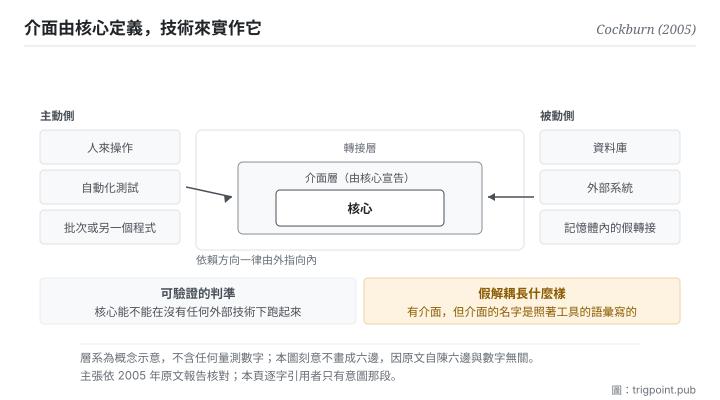

Canonical: https://trigpoint.pub/zh-Hant/collections/software-systems-architecture/hexagonal-architecture-cockburn-2005  
Captured: 2026-11-02T21:27:59.600280+08:00

> 公開理論閱讀鏡像。驗證層及 Lab 案例請到原站閱讀。

「包一層介面就算解耦」：未必。

# 六角架構

Hexagonal Architecture (Ports and Adapters) · Cockburn (2005)

已對照來源本身 ✓  
軟體架構 · 依賴方向  
先讀：領域驅動設計

## 三句講透

核心宣告它需要什麼樣的對話，技術來實作那組介面。  
依賴方向因此一律由外指向內，而不是核心去認識某個資料庫或某個框架。  
判準只有一條：核心能不能在沒有任何外部技術的情況下跑起來。

<strong>圖 1</strong> · 由內往外三層：核心只認自己宣告的那組介面，每種技術各寫一個轉接去實作它，依賴方向一律由外指向內。  
左右兩側是同一件事的兩個方向：人與測試在主動側推核心，資料庫與外部系統在被動側被核心呼叫。  
底部是可驗證的判準：核心能不能在沒有任何外部技術的情況下獨立跑起來。

## 一、發生什麼事

作者當年要處理的病症很具體，而且與測試有關：業務邏輯滲進了介面層，於是系統<strong>沒辦法被自動化測試驅動</strong>，也很難從「人來操作」切換到「批次跑」或「另一個程式來呼叫」。

根因是依賴的方向錯了：核心去認識了具體技術（某個資料庫驅動、某個介面框架）。一旦如此，你要測核心就得先把那些技術架起來。

這套架構把方向反過來：<strong>核心宣告一組介面，技術寫轉接去實作它</strong>[\[1\]](#reference-note-1)。介面是核心定義的、與技術無關的一段「有目的的對話」；轉接是那段對話對某個具體技術的實作。核心只對介面編程，不知道背後是什麼。於是要測核心，你只要接一個記憶體內的假轉接。

作者原文的意圖那句話值得逐字留著：讓一個應用能<strong>同等地</strong>被使用者、程式、自動化測試或批次腳本驅動，並且能在脫離其最終執行期裝置與資料庫的情況下開發與測試[\[1\]](#reference-note-1)。

而 2005 年那篇的關鍵想法是<strong>對稱性</strong>：這個圖沒有上層下層。資料庫與使用者介面被平等對待，兩者都只是接在某個介面上的外部技術。主動側（推核心的：人、測試、批次）與被動側（被核心呼叫的：資料庫、外部系統）只由介面的方向區分，不由架構層級區分。

命名有一段：2005 年那篇報告以 Ports and Adapters 為模式名，六邊形架構列為別名[\[2\]](#reference-note-2)。先後的經過，作者 2020 年受訪時自己說過：1994 年他在物件導向程式設計課的講義上第一次畫出這個六邊形，最初發表時還沒有 Ports and Adapters 這個名字；到 2005 年 6 月，他才想通六邊的每一面就是一個介面，同月在 wiki 上建立以 Ports and Adapters 為名的頁面[\[5\]](#reference-note-5)。而六邊與數字六無關：原文說選六邊只為留出空間畫多個介面，不受一維分層圖的限制[\[2\]](#reference-note-2)。

<strong>署名要給對：</strong>概念之提出與命名皆歸 Cockburn（2005 年那篇報告，Ports and Adapters）[\[1\]](#reference-note-1)；原文把它寫成轉接器模式的一種特定用法，並列出幾個相近的既有模式，本站因此標他為提出者兼命名者，不標為無前例的首創；六邊形架構為別名，該名在先：作者自述 1994 年已畫出六邊形，2005 年 6 月才改以 Ports and Adapters 為名[\[2\]](#reference-note-2)[\[5\]](#reference-note-5)。<strong>洋蔥架構（2008）與整潔架構（2012）各歸其作者</strong>：前者自述與本架構共享前提，後者自述整合了本架構與其他幾種[\[4\]](#reference-note-4)。本頁對原文核到哪一層，見驗證層[\[3\]](#reference-note-3)。

## 二、為什麼這對你重要

把「技術」換成「工具與模型」，這頁就變成一個很實際的建議：<strong>你的判準不該綁定某個工具。</strong>

現在很多人的工作流是反過來的：判準長在工具裡。提示詞寫在某個平台的專案設定裡、分類規則寫在某個筆記軟體的欄位裡、檢查清單存在某個服務的模板裡。這在單一工具好用時完全沒問題，直到你要換工具、或要用第二個工具做同一件事、或那個工具改了它的功能。

這套架構的做法是把方向反過來：判準寫在你自己的地方，用你自己的語彙宣告「我需要什麼樣的輸入與輸出」，然後每個工具各寫一層薄薄的接法。換工具時你只換接法，判準不動。

它同時給你一個<strong>可驗證</strong>的判準，這是這頁最有價值的部分。不是問「我有沒有解耦」（這個問題沒有答案），而是問：<strong>我的判準能不能在沒有任何特定工具的情況下被說清楚、被人執行。</strong> 如果你的分類規則要靠某個軟體的欄位才講得通，那它已經綁死了。

反過來也要提防那個<strong>假解耦</strong>。在工具外面包一層，但那層的形狀完全照著工具長：例如你的規格裡寫滿某個平台的專有名詞。這在形式上是多了一層，在實質上什麼都沒換到，因為換工具時那層要整個重寫。介面的形狀必須由核心決定，這是原則裡最容易被跳過的一句。

## 常見誤讀

所屬頁核驗：已對照來源本身 ✓ · 內容最後修訂 2026-10-25

- 常見轉述「六邊代表六個層或六種介面」：六邊只是畫圖方便，作者選它是為了留出空間畫多個介面，不受一維分層圖的限制。糾結邊數是抓錯重點。
- 常見轉述「洋蔥架構與整潔架構是這套的衍生版」：三者同家族、不同作者、各自命名，共享的是依賴只向內這個原則。作者歸屬不可混。

## 參考文獻

<strong>如何閱讀來源註記</strong> 「書目經…核對」指作者、年份、題名與出版項已確認；不代表該來源的主張已被核對。「對照全文核實」指主張已與來源文本本身比對。 定義版本：2026-09-20。

- \[1\] Cockburn, A. (2005). The Hexagonal (Ports & Adapters) Architecture. HaT Technical Report 2005.02. alistair.cockburn.us/hexagonal-architecture/
- \[2\] 編輯註，無外部來源；全文見正文註 \[2\]。
- \[3\] 編輯註，無外部來源；全文見正文註 \[3\]。
- \[4\] Palermo, J. (2008). The Onion Architecture: part 1. jeffreypalermo.com/2008/07/the-onion-architecture-part-1/; Martin, R. C. (2012). The Clean Architecture. blog.cleancoder.com/uncle-bob/2012/08/13/the-clean-architecture.html
- \[5\] Garrido de Paz, J. M. (2020). Interview with Alistair Cockburn. jmgarridopaz.github.io/content/interviewalistair.html

## 知識圖譜

- [<em>應用於 ▸</em>領域驅動設計（Domain-Driven Design (DDD)）](domain-driven-design-evans-2003.md)
- [<em>對照 ▸</em>模型視圖控制器（Model-View-Controller (MVC)）](mvc-reenskaug-1979.md)

引用格式：Trigpoint，〈六角架構〉，trigpoint.pub/zh-Hant/collections/software-systems-architecture/hexagonal-architecture-cockburn-2005 · © Strategitect Limited. · 內容最後修訂 2026-10-25

## 來源註記

**[1]** Cockburn, A. (2005, September 4). The Hexagonal (Ports & Adapters) Architecture. HaT Technical Report 2005.02, v0.9. alistair.cockburn.us/hexagonal-architecture/. 書目經官方記錄核對。主張已對照全文核實。意圖逐字：讓一個應用能同等地被使用者、程式、自動化測試或批次腳本驅動，並且能在脫離其最終執行期裝置與資料庫的情況下開發與測試。

**[2]** 命名：2005 年那篇報告以 Ports and Adapters 為模式名，六邊形架構列為別名，並說這個別名來自圖的視覺效果；先以六邊形為名、2005 年才加上 Ports and Adapters 之名，一般記述如此，作者 2020 年受訪時的自述亦同（見註 5）。六邊與數字六無關：原文說選它是為了讓畫圖的人有空間隨需要加上介面與轉接，不受一維分層圖的限制。

**[3]** 2005 年那篇報告（作者站上之版本，標為 0.9 版、2005 年 9 月 4 日）已對照全文：意圖、對稱性、主動與被動兩側、六邊的由來皆依原文。命名先後另依作者 2020 年的訪談自述（見註 5）。

**[4]** Palermo, J. (2008, July 29). The Onion Architecture: part 1. jeffreypalermo.com; Martin, R. C. (2012, August 13). The Clean Architecture. blog.cleancoder.com. 書目經官方記錄核對。主張已對照全文核實。洋蔥架構（2008，另一位作者）與整潔架構（2012，又另一位作者）各有其作者與名字：前者自述與六角架構共享同一前提，後者自述是把六角、洋蔥等幾種架構整合成單一可操作的想法。

**[5]** Garrido de Paz, J. M. (2020, September 9). Interview with Alistair Cockburn. jmgarridopaz.github.io/content/interviewalistair.html. 書目經官方記錄核對。主張已對照全文核實。作者受訪自述（第一人稱）：1994 年在物件導向程式設計課的講義上第一次畫出六邊形；最初發表時沒有 Ports and Adapters 這個名字；2005 年 6 月才想通六邊的每一面就是一個介面（port），同月在 wiki 上建立以 Ports and Adapters 為名的頁面。他想通的是介面與轉接，不是對稱性。

---

[English](../../../en/collections/software-systems-architecture/hexagonal-architecture-cockburn-2005.md) · [简体中文](../../../zh-Hans/collections/software-systems-architecture/hexagonal-architecture-cockburn-2005.md)

[Index](../../README.md) · [Original page](https://trigpoint.pub/zh-Hant/collections/software-systems-architecture/hexagonal-architecture-cockburn-2005) · [Citation and versions](../../../READING.md)

[Original SVG](assets/hexagonal-architecture-cockburn-2005.svg) · Display copy adds a white background only.
