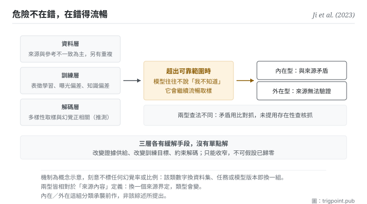

Canonical: https://trigpoint.pub/zh-Hant/collections/software-systems-architecture/llm-hallucination-ji-2023  
Captured: 2026-11-02T21:27:59.846489+08:00

> 公開理論閱讀鏡像。驗證層及 Lab 案例請到原站閱讀。

「再進步一點就不會幻覺」：接不了。

# 生成幻覺

Hallucination in NLG · Ji et al. (2023)

摘要已核 ✓  
機器學習 · 失效模式  
先讀：檢索增強生成

## 三句講透

幻覺是生成流暢卻不忠於來源或不知所云。  
危險不在錯，在<strong>錯得流暢</strong>：流暢度給了真值不具備的可信外觀。  
而它的成因跨資料、訓練、解碼三層，目前只能收窄，不能假設已經歸零。

<strong>圖 1</strong> · 本圖把綜述的兩大類成因拆成三層：資料層以來源與參考答案不一致為主因（另有未濾除的重複資料），訓練層有表徵學習不良、曝光偏差與參數知識偏差，解碼時的多樣性取樣與幻覺正相關（後者原文屬推測）。  
三層各有各的緩解手段，沒有單點解，也沒有一層宣稱能歸零。  
三層成因匯向中段，即這頁最反直覺的一點：超出可靠範圍時，模型往往不說「我不知道」，而是繼續流暢地取樣；這個傾向與現行訓練和評分方式獎勵猜測有關。  
這樣生成的幻覺分兩型，標在右側：內在型是與來源矛盾，外在型是無法從來源驗證。  
本圖刻意不標任何比率。

## 一、發生什麼事

那篇 2023 年綜述採用的定義（沿用先前研究的說法）是：生成的內容不知所云，或<strong>不忠於所提供的來源內容</strong>[\[1\]](#reference-note-1)。分類分兩型：內在型是與來源矛盾，外在型是無法從來源驗證[\[2\]](#reference-note-2)。

機制值得慢慢看，因為它決定了你能做什麼。生成模型本質是對訓練分佈的壓縮，解碼時逐個記號取樣。當任務需要的資訊超出模型可靠壓縮的範圍（分佈外、長尾、或訓練之後世界變了），模型<strong>往往不會停下來說「我不知道」</strong>：它會繼續流暢地取樣。這就是幻覺。這個傾向有一部分是被獎勵出來的：一篇 2025 年的研究主張，現行訓練與評分方式給猜測分數、不給承認不確定的分數，模型因此在沒把握時傾向照猜[\[6\]](#reference-note-6)。所以它不是不能說不知道，而是在現行獎勵下少說。

那篇綜述把成因分成兩大類：資料，以及訓練與推論。本頁把後者再拆成訓練與解碼，合起來看三層，這也是為什麼沒有單點解：資料層（主因是來源與參考答案本身就不一致；資料收集時未濾除的重複是另一種情形）、訓練層（表徵學習不良、訓練與生成之間的曝光偏差、模型偏向預訓練時帶來的知識而非手上的來源）、解碼層（多樣性取樣與幻覺正相關，但其機制原文標為推測）。上一段「往往不說不知道」那條則不在該綜述的範圍內，出自 2025 年那篇研究。緩解也可對應分三路：改變證據供給（檢索增強，上一頁）、改變目標（用忠實度的度量去訓）、改變解碼（約束生成）。

歸屬這一頁有一條<strong>必須說</strong>的更正。那篇綜述在 §2.1 自己寫明，內在型與外在型這組分類是<strong>沿用先前研究的</strong>[\[3\]](#reference-note-3)。所以正確的引用方式是「該綜述採用的分類」，不是「該綜述提出的分類」。另外，這個詞更早已用於視覺語言任務（2018 年那篇）[\[4\]](#reference-note-4)，不是大型語言模型時代才有的。

<strong>署名要給對：</strong>綜述之整理歸 Ji 等十位作者（2023，同儕審查期刊；期刊版），本站以它為該領域的錨[\[1\]](#reference-note-1)；<strong>內在型與外在型之分類承襲前作，不歸該篇</strong>（該篇 §2.1 自述）[\[3\]](#reference-note-3)；此詞更早之已驗用例，例見 2018 年那篇視覺語言任務論文[\[4\]](#reference-note-4)；該綜述自己另記此詞最先出現在 2000 年的電腦視覺研究，當時含意偏正面[\[1\]](#reference-note-1)。三段要分開署名，第二段是本頁明文更正的一條。

## 二、為什麼這對你重要

這頁給你的不是警告，是一個<strong>校準值</strong>：你該對流暢度打多少折。

人判斷可信度時，語言的流暢與結構的整齊是強力線索：這在人寫的東西上大致有效，因為胡說的人通常也講得比較亂。生成模型把這個相關性<strong>切斷了</strong>：它的流暢度與內容真假幾乎無關。所以你的直覺在這裡不是不准，是<strong>被校準在錯的分佈上</strong>。

第二件事是「少說不知道」這個傾向的實務後果。你不能靠模型主動示警來抓幻覺：它在沒把握時往往照猜，猜錯時講得一樣流暢。這意味著查核的責任在你這一側，而且<strong>必須是流程而不是警覺</strong>：警覺會疲勞，流程不會。

第三件事，也是本書架的立場所在：既然沒有任何一層能保證它已經歸零，模型又不會可靠地示警，那麼「值得信任的輸出」就不能靠模型的品質保證，只能靠<strong>可查核性</strong>。這是本書架自己的立場，不是那篇綜述的結論。這正是本站把每一個判定都留下出處與查證狀態的理由：不是因為我們比較嚴謹，是因為結構上沒有別的辦法。

實務上兩個動作就夠了。第一，<strong>把「這句話的依據在哪」變成固定問句</strong>，而不是憑感覺挑句子查。第二，<strong>分開處理兩型</strong>：與你給的來源矛盾（內在型）用比對抓；來源根本沒提（外在型）用存在性查核抓。兩者的查法不同，混在一起會兩邊都漏。

## 常見誤讀

所屬頁核驗：摘要已核 ✓ · 本頁版次 v2 · 內容最後修訂 2026-11-01

- 常見轉述「內在型與外在型這組分類是那篇綜述提出的」：該篇第 2.1 節自己寫明是沿用先前研究的分類。本站把它當作整理整個領域的錨；它不是分類的原創者。
- 常見轉述「新版模型已經不會幻覺了」：那篇綜述列的是成因與分型緩解，沒有任何一層宣稱可以歸零。本站因此把它當作只能收窄、不可假設已歸零的常態風險；這是本站的設計前提，不是該綜述的結論。這句話不是悲觀，是決定你要不要建查核流程的前提。
- 常見轉述「這個詞是大型語言模型時代才有的」：更早的已驗用例，例見 2018 年一篇視覺語言任務的論文；該綜述自己也記此詞最先出現在電腦視覺研究。

## 修正記錄

- 2026-10-12 · 本頁前版有三處超出那篇綜述原文，已依全文改正。其一，前版把「幻覺源自壓縮加取樣的結構，只能收窄不能歸零」寫成源頭的結論；綜述只列成因與分型緩解，沒有主張它不可消除。本書架的立場句保留，但前提改為「沒有任何一層能保證已歸零、模型又不會可靠示警」，並標明是本書架自己的立場。其二，前版把訓練層成因寫成「最大化似然的目標獎勵流暢、不獎勵忠實」；綜述列的是表徵學習不良、曝光偏差與參數知識偏差，資料層主因是來源與參考答案不一致。其三，前版說忠於來源與合於事實「不是同一件事」；綜述原文是兩者可能相同也可能不同。

## 參考文獻

<strong>如何閱讀來源註記</strong> 「書目經…核對」指作者、年份、題名與出版項已確認；不代表該來源的主張已被核對。「與摘要一致」指主張與論文摘要相符；不含逐句對照全文。「對照全文核實」指主張已與來源文本本身比對。 定義版本：2026-09-20。

- \[1\] Ji, Z. et al. (2023). Survey of Hallucination in Natural Language Generation. ACM Computing Surveys, 55(12), Article 248. DOI [10.1145/3571730](https://doi.org/10.1145/3571730).
- \[2\] Ji, Z. et al. (2023). Survey of Hallucination in Natural Language Generation. ACM Computing Surveys, 55(12), Article 248. DOI [10.1145/3571730](https://doi.org/10.1145/3571730).
- \[3\] Ji, Z. et al. (2023). Survey of Hallucination in Natural Language Generation. ACM Computing Surveys, 55(12), Article 248. DOI [10.1145/3571730](https://doi.org/10.1145/3571730).
- \[4\] Rohrbach, A., Hendricks, L. A., Burns, K., Darrell, T., & Saenko, K. (2018). Object Hallucination in Image Captioning. Proceedings of EMNLP 2018, 4035–4045. arXiv:1809.02156.
- \[5\] Ji, Z. et al. (2023). Survey of Hallucination in Natural Language Generation. ACM Computing Surveys, 55(12), Article 248. DOI [10.1145/3571730](https://doi.org/10.1145/3571730).
- \[6\] Kalai, A. T., Nachum, O., Vempala, S. S., & Zhang, E. (2025). Why Language Models Hallucinate. arXiv:2509.04664. https://arxiv.org/abs/2509.04664

## 知識圖譜

- [<em>延伸 ▸</em>忠實性與事實性（Faithfulness vs Factuality）](faithfulness-factuality-maynez-2020.md)
- [<em>延伸 ▸</em>虛構引用（Fabricated Citations）](fabricated-citations-walters-wilder-2023.md)
- [<em>被應用 ▸</em>檢索增強生成（Retrieval-Augmented Generation (RAG)）](retrieval-augmented-generation-lewis-2020.md)
- [<em>被特化 ▸</em>忠實性與事實性（Faithfulness vs Factuality）](faithfulness-factuality-maynez-2020.md)
- [<em>被特化 ▸</em>虛構引用（Fabricated Citations）](fabricated-citations-walters-wilder-2023.md)
- [<em>應用 ▸</em>先紅隊，再採信：以單一主張為單位的紅隊程序](https://trigpoint.pub/zh-Hant/methods/red-team-a-claim)

引用格式：Trigpoint，〈生成幻覺〉，trigpoint.pub/zh-Hant/collections/software-systems-architecture/llm-hallucination-ji-2023 · © Strategitect Limited. · 內容最後修訂 2026-11-01

## 來源註記

**[1]** Ji, Z., Lee, N., Frieske, R., Yu, T., Su, D., Xu, Y., Ishii, E., Bang, Y. J., Madotto, A., & Fung, P. (2023). Survey of Hallucination in Natural Language Generation. ACM Computing Surveys, 55(12), Article 248. DOI 10.1145/3571730. 書目經官方記錄核對。主張已對照全文核實。期刊版共 10 位作者；預印本 arXiv:2202.03629 第一版 2022-02-08，其後版本增列作者，2024 年 7 月版為 13 位。該綜述 §2 採用的定義引自先前研究：生成的內容不知所云，或不忠於所提供的來源內容。

**[2]** 分類定義（該篇 §2.1）：內在型為與來源內容矛盾之輸出；外在型為無法從來源內容驗證之輸出。

**[3]** 歸屬：該篇 §2.1 寫明這組分類沿用先前研究（所引前作包括 Maynez 等 2020）。引用時應寫「該綜述採用的分類」，不寫「該綜述提出的分類」。

**[4]** Rohrbach, A., Hendricks, L. A., Burns, K., Darrell, T., & Saenko, K. (2018). Object Hallucination in Image Captioning. Proceedings of the 2018 Conference on Empirical Methods in Natural Language Processing, 4035–4045. DOI 10.18653/v1/D18-1437. 書目經官方記錄核對。要旨與摘要一致。更早的用例：該篇摘要即以「幻覺」描述圖像描述模型生成畫面中並不存在的物件，說明此詞在大型語言模型流行之前已用於視覺語言任務。

**[6]** Kalai, A. T., Nachum, O., Vempala, S. S., & Zhang, E. (2025). Why Language Models Hallucinate. arXiv:2509.04664. 書目經官方記錄核對。要旨與摘要一致。摘要原意：模型在沒把握時有時會猜，而非承認不確定；作者主張成因是訓練與評估程序獎勵猜測多於承認不確定。

---

[English](../../../en/collections/software-systems-architecture/llm-hallucination-ji-2023.md) · [简体中文](../../../zh-Hans/collections/software-systems-architecture/llm-hallucination-ji-2023.md)

[Index](../../README.md) · [Original page](https://trigpoint.pub/zh-Hant/collections/software-systems-architecture/llm-hallucination-ji-2023) · [Citation and versions](../../../READING.md)

[Original SVG](assets/llm-hallucination-ji-2023.svg) · Display copy adds a white background only.
