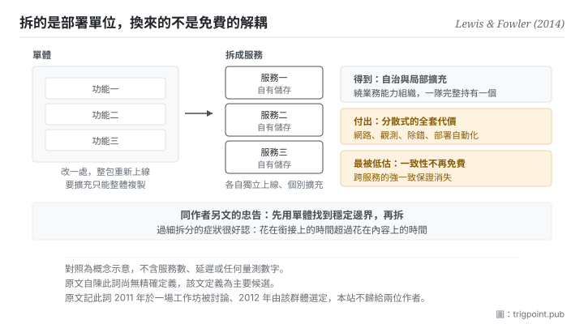

Canonical: https://trigpoint.pub/zh-Hant/collections/software-systems-architecture/microservices-lewis-fowler-2014  
Captured: 2026-11-02T21:28:00.122782+08:00

> 公開理論閱讀鏡像。驗證層及 Lab 案例請到原站閱讀。

「拆得越細就越解耦」：是兩回事。

# 微服務

Microservices · Lewis & Fowler (2014)

已對照來源本身 ✓  
軟體架構 · 服務邊界  
先讀：領域驅動設計  
先讀：康威定律

## 三句講透

把一個應用拆成一組各自獨立上線的服務，於是部署與擴充的單位變小。  
換到的是自治與局部擴充，付出的是分散式系統的全套代價。  
而最容易被低估的那項代價，是跨服務的一致性從此不再免費。

<strong>圖 1</strong> · 左邊是單體：改一處就要整包重新上線，要擴充只能整體複製。  
右邊是拆開之後：部署與擴充的單位變成服務，代價是三件事同時進門，其中最容易被低估的是跨服務的一致性退化。  
底部是同作者另文的忠告：先用單體找到穩定邊界，再拆。

## 一、發生什麼事

單體的問題不是「大」，是<strong>耦合到部署層</strong>：任何一處小改動都要整包重新上線，而要擴充只能整體複製，即使壓力只集中在一個功能上。

這篇 2014 年的文章把替代方案定義下來：把單一應用建構成<strong>一組小型服務</strong>，各自跑在自己的行程、以輕量機制溝通[\[1\]](#reference-note-1)。文章同時列了九項共通特徵，並說明不是每個微服務架構都具備全部九項[\[1\]](#reference-note-1)。本頁著重其中三項：<strong>繞業務能力組織、以服務為元件而各自獨立部署、去中心化（資料與治理都是）</strong>。

「繞業務能力組織」這一項直接扣回上一頁：服務邊界會鏡像團隊溝通邊界，所以理想形態是一個跨功能小團隊完整持有一個服務。這不是巧合，文章明確引了那條定律。

去中心化資料是最容易被低估的一項。每個服務自管自己的儲存，於是跨服務的一致性<strong>從此不再是免費的</strong>：你原本靠單一資料庫交易得到的保證消失了，取而代之是最終一致性、補償流程與分散式除錯。

歸屬有三處要說清楚，而這一頁的歸屬比多數節點複雜。第一，<strong>本站不把這個詞歸給兩位作者</strong>：原文自己說該詞在 2011 年 5 月威尼斯附近一場架構師工作坊上被討論、2012 年 5 月由同一群人選定，並沒有說誰最先提出[\[2\]](#reference-note-2)。第二，據二手記載，更早在 2005 年一場產業會議上已有相近的語彙，出自另一條技術脈絡；本站未核原始出處[\[3\]](#reference-note-3)。第三，原文自陳<strong>此詞尚無精確定義</strong>[\[4\]](#reference-note-4)：所以引用它時該說「這是那篇文章的定義」，不是「這是微服務的定義」。

最後一件，同作者在別處給過一句忠告，而它比整套特徵清單更常被需要：<strong>先用單體找到穩定邊界，再拆</strong>[\[5\]](#reference-note-5)。

<strong>署名要給對：</strong>定義之結晶化與普及，本站歸 Lewis 與 Fowler（2014 年 3 月 25 日該文）[\[1\]](#reference-note-1)；<strong>術語，原文只記其 2011 年 5 月在一場工作坊上被討論、2012 年 5 月由該群體選定為名，未說誰最先提出，本站不歸給兩位作者</strong>[\[2\]](#reference-note-2)；更早的相近語彙（2005 年）據二手記載歸另一條技術脈絡，原始出處本站未核[\[3\]](#reference-note-3)；「先用單體」之忠告與採用前的三項基本能力歸同作者另兩篇短文[\[5\]](#reference-note-5)[\[6\]](#reference-note-6)。四段要分開署名：把整條線壓成「2014 年由那兩位提出」會一次弄錯發明、命名與定義三件事，這是本站在此頁明文更正的一條。

## 二、為什麼這對你重要

這頁對你的用處不在服務，在<strong>拆分的時機</strong>。

你會很想把工作流拆成一堆小塊：一個專門寫大綱的、一個專門查資料的、一個專門潤稿的、一個專門檢查引註的。每一塊各自簡單、各自好測，聽起來完全正確。而這頁要說的是：<strong>拆分的收益需要一組前置條件，前置條件不到，拆分就是淨負擔。</strong>

前置條件是什麼？同作者另一篇短文列了三項：快速開設機器、基本監控、快速部署[\[6\]](#reference-note-6)。換到你身上就是：<strong>你有沒有便宜的方法把那些小塊接起來、看它們現在的狀態、以及在中間出錯時查出是哪一塊。</strong> 如果每次要跑完整流程都要你手動搬三次輸出、而且哪裡錯了要逐塊回頭看，那你付的協調成本已經超過拆分省下的成本。

第二件事是那個「越小越好」的誤讀。小是相對於單體的對比，不是目標。拆得過細的具體症狀很好認：<strong>你花在銜接上的時間超過花在內容上的時間。</strong>

第三件事，也是最實際的一條，就是那句忠告的直譯：<strong>邊界未明之前不要拆。</strong> 先在一個地方把整件事做通、做到你能講出哪幾段是穩定的、哪幾段每次都不一樣，然後再沿那些穩定的接縫拆。反過來做（先拆再摸邊界）會讓你在錯的位置上建接口，而那些接口之後很難拆掉：這正是段三第一頁那個判準在說的事。

## 常見誤讀

所屬頁核驗：已對照來源本身 ✓ · 內容最後修訂 2026-10-25

- 常見轉述「微服務是那兩位作者提出的」：原文自己說，這個詞在 2011 年 5 月一場工作坊上被討論、2012 年 5 月由那群人選定。本站把兩位作者標為定義的結晶化者與普及者。據二手記載，更早還有 2005 年的一個相近語彙，屬另一條技術脈絡。
- 常見轉述「小是重點，越小越好」：小是相對於單體的對比，不是強制拆到最細。原文提醒遠端介面要比程序內呼叫粗；同作者另文主張先用單體，邊界穩定後再拆。
- 常見轉述「這是這個詞的權威定義」：原文自陳此詞尚無精確定義，該文只描述共通特徵，其定義為主要候選。

## 參考文獻

<strong>如何閱讀來源註記</strong> 「書目經…核對」指作者、年份、題名與出版項已確認；不代表該來源的主張已被核對。「對照全文核實」指主張已與來源文本本身比對。 定義版本：2026-09-20。

- \[1\] Lewis, J. & Fowler, M. (2014). Microservices: a definition of this new architectural term. martinfowler.com/articles/microservices.html. Published 25 March 2014.
- \[2\] Lewis, J. & Fowler, M. (2014). Microservices: a definition of this new architectural term. martinfowler.com/articles/microservices.html. Published 25 March 2014.
- \[3\] 編輯註，無外部來源；全文見正文註 \[3\]。
- \[4\] Lewis, J. & Fowler, M. (2014). Microservices: a definition of this new architectural term. martinfowler.com/articles/microservices.html. Published 25 March 2014.
- \[5\] Fowler, M. (2015). MonolithFirst. martinfowler.com/bliki/MonolithFirst.html. Published 3 June 2015.
- \[6\] Fowler, M. (2014). MicroservicePrerequisites. martinfowler.com/bliki/MicroservicePrerequisites.html. Published 28 August 2014.

## 知識圖譜

- [<em>對照 ▸</em>單一真相來源（Single Source of Truth (concept history)）](single-source-of-truth-concept-history.md)
- [<em>被應用 ▸</em>模組化與薄切面（Modularity & Thin Crossing Points）](modularity-baldwin-clark-2000.md)
- [<em>被應用 ▸</em>領域驅動設計（Domain-Driven Design (DDD)）](domain-driven-design-evans-2003.md)
- [<em>被應用 ▸</em>康威定律（Conway's Law）](conways-law-conway-1968.md)
- [<em>被應用 ▸</em>團隊拓撲（Team Topologies）](team-topologies-skelton-pais-2019.md)

引用格式：Trigpoint，〈微服務〉，trigpoint.pub/zh-Hant/collections/software-systems-architecture/microservices-lewis-fowler-2014 · © Strategitect Limited. · 內容最後修訂 2026-10-25

## 來源註記

**[1]** Lewis, J. & Fowler, M. (2014-03-25). Microservices: a definition of this new architectural term. martinfowler.com/articles/microservices.html. 書目經出版社記錄核對。主張已對照全文核實。原文定義：把單一應用建構成一組小型服務，各自跑在自己的行程、以輕量機制溝通，常為基於超文本傳輸協定的資源介面。同文列出九項共通特徵，並說明並非每個微服務架構都具備全部特徵。

**[2]** Lewis, J. & Fowler, M. (2014-03-25). Microservices: a definition of this new architectural term. martinfowler.com/articles/microservices.html. 書目經出版社記錄核對。主張已對照全文核實。術語來歷（原文所述）：該詞在 2011 年 5 月威尼斯附近一場架構師工作坊上被討論，2012 年 5 月同一群人選定此名。原文沒有說誰最先提出這個詞；本站不把它歸給兩位作者，只把他們定位為定義的結晶化者與普及者。

**[3]** 更早的相近語彙：據二手記載，2005 年一場產業會議上已有人以 Micro-Web-Services 描述軟體元件，出自另一條技術脈絡。本站未核原始出處。

**[4]** Lewis, J. & Fowler, M. (2014-03-25). Microservices: a definition of this new architectural term. martinfowler.com/articles/microservices.html. 書目經出版社記錄核對。主張已對照全文核實。原文另一項自陳：此詞尚無精確定義，該文只嘗試描述共通特徵；其定義為主要候選，而非權威裁定。

**[5]** Fowler, M. (2015-06-03). MonolithFirst. martinfowler.com/bliki/MonolithFirst.html. 書目經出版社記錄核對。主張已對照全文核實。同作者 2015 年的短文主張：新專案不要一開始就用微服務，先用單體找出服務之間穩定的邊界；微服務只在邊界穩定時才好用，也只在較複雜的系統上才划算。

**[6]** Fowler, M. (2014-08-28). MicroservicePrerequisites. martinfowler.com/bliki/MicroservicePrerequisites.html. 書目經出版社記錄核對。主張已對照全文核實。同作者 2014 年 8 月的短文列出採用前的三項基本能力：快速開設機器、基本監控、快速部署應用；缺少這些基本能力，就不該考慮微服務這種風格。

---

[English](../../../en/collections/software-systems-architecture/microservices-lewis-fowler-2014.md) · [简体中文](../../../zh-Hans/collections/software-systems-architecture/microservices-lewis-fowler-2014.md)

[Index](../../README.md) · [Original page](https://trigpoint.pub/zh-Hant/collections/software-systems-architecture/microservices-lewis-fowler-2014) · [Citation and versions](../../../READING.md)

[Original SVG](assets/microservices-lewis-fowler-2014.svg) · Display copy adds a white background only.
