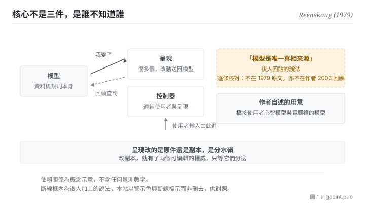

Canonical: https://trigpoint.pub/zh-Hant/collections/software-systems-architecture/mvc-reenskaug-1979  
Captured: 2026-11-02T21:28:00.733967+08:00

> 公開理論閱讀鏡像。驗證層及 Lab 案例請到原站閱讀。

「這是為了讓資料有唯一真相」：是誤讀。

# 模型視圖控制器

Model-View-Controller (MVC) · Reenskaug (1979)

已對照來源本身 ✓  
軟體架構 · 關注點分離  
先讀：單一真相來源

## 三句講透

把資料與畫面分開，讓同一批資料可以有多個同步的呈現。  
模型裡不放任何關於畫面怎麼顯示的資訊，依賴只往一個方向走，這是整個結構的關鍵。  
至於「模型是唯一真相」這句話，經核對確認不在原文裡。

<strong>圖 1</strong> · 三件之間的依賴方向：模型不需要知道有誰在看它，變更以通知的方式往外走（作者 2003 年的講義把這一層寫成模式本身的解法，Smalltalk-80 類別庫是其中一例），看的那一端自己回頭查詢；呈現要改動，也是送回模型那一處去改。  
右側以斷線標出一件後人加上的東西：把模型稱為唯一真相，這個說法經逐條核對確認不在 1979 年的原文裡。

## 一、發生什麼事

1978 至 1979 年間，一位訪問學者在 Xerox PARC 處理一個問題[\[5\]](#reference-note-5)：使用者要同時看到同一批資料的幾種呈現（一張圖、一張表、一個輸入欄），而這些呈現要保持同步。

他的解法是把資料本身跟呈現徹底分開：1979 年 5 月那份備忘明說，模型裡不含任何關於資訊如何在畫面上顯示的資訊[\[1\]](#reference-note-1)；呈現則向模型提問，取得要顯示的資料[\[2\]](#reference-note-2)。同步怎麼做，作者 2003 年的講義寫成一條模式：呈現向模型登記為依附者，<strong>模型一變就通知它們，不需要知道它們是什麼樣的呈現</strong>，呈現收到後自己回頭查詢[\[3\]](#reference-note-3)。講義舉了兩個實作：Smalltalk-80 類別庫的變更通知，以及作者自己的 OOram 工具，後者先把變更累積起來，再一次通知呈現[\[3\]](#reference-note-3)。這套通知機制是否已見於 1979 年的兩份備忘，本站未核。這個單向的依賴帶來一個性質：不管有幾個呈現、後來加了幾個，資料端的完整性都不受影響。

命名有一段小歷史。1979 年 5 月那份備忘用的是四個詞，最後一個是「編輯器」，第一個詞指的是使用者感興趣的那個事物[\[1\]](#reference-note-1)；同年 12 月那份改成今天的三詞[\[2\]](#reference-note-2)，據作者本人說明，是與另一位研究者長時間討論之後定下的[\[5\]](#reference-note-5)。作者在 2003 年寫過一份回顧，把當初的頂層目標寫成支援使用者對相關資訊的心智模型，讓使用者能檢視與編輯這些資訊[\[3\]](#reference-note-3)；他在自己的 MVC 資料頁上說得更直接：根本目的是<strong>橋接使用者的心智模型與電腦裡的數位模型</strong>，起點是讓使用者能掌控一大批複雜資料[\[5\]](#reference-note-5)。那份回顧本身是為業界會議寫的自出版講義草稿，不是同儕審查論文，本站照實標示。

而本頁最重要的一件事是一個<strong>否證</strong>。「模型是單一真相來源」這句話，在深度覆核裡被逐條檢核，判定<strong>不在</strong> 1979 年的兩份備忘，也不在 2003 年的回顧裡[\[4\]](#reference-note-4)。它是後來社群回貼上去的框架。原文的關切是使用者的掌控權，不是資料的權威性。

這兩件事不衝突（分開資料與呈現，確實使資料端更像一個權威處），但<strong>不能把後來的解讀當成原始主張</strong>。這正是本站在段一放它壓軸的原因：一個進了所有教科書的分法，其最廣為流傳的一句解釋，經核對是後人加的。

<strong>署名要給對：</strong>概念與命名歸 Reenskaug（1979 年 5 月與 12 月兩份 Xerox PARC 技術備忘）[\[1\]](#reference-note-1)[\[2\]](#reference-note-2)；兩份備忘中，今天的三詞命名首見於同年 12 月那份，據作者本人說明為與另一位研究者討論後的結果[\[2\]](#reference-note-2)[\[5\]](#reference-note-5)；作者本人的回顧出自 2003 年那份自出版講義草稿[\[3\]](#reference-note-3)，目的敘述另見其 MVC 資料頁[\[5\]](#reference-note-5)。<strong>「模型是單一真相來源」不歸作者</strong>：經逐條核對確認不在原文，屬後人社群回貼的說法[\[4\]](#reference-note-4)。這條是本站有明文更正的一條，署名與說法要分開記。

## 二、為什麼這對你重要

這頁有兩層用途，第二層比第一層有用。

第一層是那個結構本身。你的工作流裡幾乎一定有「同一批東西的多個呈現」：一份規格與它的簡報版、一份清單與它的看板視圖、一份原始記錄與它的月度摘要。這裡的設計問題不是要不要有多個呈現（要），而是<strong>呈現改的是原件，還是它自己手上那一份</strong>。如果是後者，你就有了兩個可編輯的權威，接下來只是等它們分岔。原始設計的答案是：呈現可以要求改動，但改動是送一則訊息回模型那一處去做，用的是模型的詞彙[\[2\]](#reference-note-2)；呈現手上就算留了一份資料，也只是為了顯示快一點的副本[\[1\]](#reference-note-1)。權威只有一處。

第二層是這頁自己示範的那件事：<strong>一個說法被普遍相信，跟它出自原文，是兩回事。</strong> 你今天引用的多數架構詞彙，都經過一層或幾層社群轉述。轉述通常更好用，因為它把概念修得更貼近當代問題。但當你需要往回追（為什麼當初這樣設計、這個設計解的到底是什麼問題），你必須知道自己手上拿的是原話還是轉述。

實務上這頁給的是一個習慣，而且用得上的場合比想像多：<strong>當你引用一個框架的「用意」時，順手問一句這句用意是誰說的。</strong> 如果答不出來，那句話很可能是後人加的：它未必錯，但它不能拿來當作者的意圖去論證。

## 常見誤讀

所屬頁核驗：已對照來源本身 ✓ · 內容最後修訂 2026-10-25

- 常見轉述「這個分法的用意是讓模型成為唯一真相來源」：經逐條核對，該說法<strong>不在</strong> 1979 年的兩份備忘，也不在 2003 年作者本人的回顧裡。作者本人把根本目的寫成橋接使用者的心智模型與電腦裡的數位模型，起點是讓使用者能掌控一大批複雜資料。這是後來社群回貼上去的框架，本站在正文、摘要與此處三處同步更正。
- 常見轉述「控制器負責應用邏輯」：1979 年 12 月那份把它寫成使用者與系統之間的連結，負責安排呈現、把使用者的指令轉成訊息交給呈現，而且不該替呈現補東西。把應用邏輯集中到控制器是後來不少網頁框架的做法；作者本人也說過，這個問題的面向比他 1979 年所想的更多。兩者要分開講。
- 常見轉述「1979 年就叫模型視圖控制器」：1979 年 5 月那份的命名是四個詞，最後一個是編輯器；今天的三詞命名出現在同年 12 月那份，是與另一位研究者討論之後改的。

## 參考文獻

<strong>如何閱讀來源註記</strong> 「書目經…核對」指作者、年份、題名與出版項已確認；不代表該來源的主張已被核對。「對照全文核實」指主張已與來源文本本身比對。「對照原站核實」指主張已與該項目的原始網站比對。 定義版本：2026-09-20。

- \[1\] Reenskaug, T. (1979). Thing-Model-View-Editor — an Example from a planningsystem. Xerox PARC Technical Note, May 12, 1979.
- \[2\] Reenskaug, T. (1979). Models — Views — Controllers. Xerox PARC Technical Note, December 10, 1979.
- \[3\] Reenskaug, T. (2003). The Model-View-Controller (MVC): Its Past and Present. JavaZone / JAOO 2003 handout (self-published draft).
- \[4\] 編輯註，無外部來源；全文見正文註 \[4\]。
- \[5\] Reenskaug, T. (n.d.). MVC: Xerox PARC 1978-79. Author's web page, University of Oslo.

## 知識圖譜

- [<em>對照 ▸</em>六角架構（Hexagonal Architecture (Ports and Adapters)）](hexagonal-architecture-cockburn-2005.md)

引用格式：Trigpoint，〈模型視圖控制器〉，trigpoint.pub/zh-Hant/collections/software-systems-architecture/mvc-reenskaug-1979 · © Strategitect Limited. · 內容最後修訂 2026-10-25

## 來源註記

**[1]** Reenskaug, T. (1979, May 12). Thing-Model-View-Editor: An Example from a Planningsystem. Technical note, Xerox PARC. 書目經雙源核對。主張已對照全文核實。兩份原始備忘中較早的命名版本，四個詞依序為事物、模型、視圖、編輯器；第一個詞指使用者感興趣的事物，可以具體，也可以是抽象的想法。備忘並寫明，模型裡不含任何關於資訊如何在畫面上顯示的資訊。

**[2]** Reenskaug, T. (1979, December 10). Models - Views - Controllers. Technical note, Xerox PARC. 書目經雙源核對。主張已對照全文核實。兩份原始備忘中，今天的三詞命名首見於這份。呈現向模型提問，取得要顯示的資料，也可以送訊息請模型更新；控制器是使用者與系統之間的連結。

**[3]** Reenskaug, T. (2003). The Model-View-Controller (MVC): Its Past and Present. Handout, JavaZone (Oslo) and JAOO (Aarhus), September 2003. Draft of August 20, 2003. 書目經雙源核對。主張已對照全文核實。兩場業界會議的自出版講義草稿，非同儕審查。摘要把頂層目標寫成支援使用者對相關資訊的心智模型，讓使用者能檢視與編輯這些資訊；講義把「呈現向模型登記為依附者、模型一變即通知」寫成一條模式（同步模型與呈現）的解法，並舉 Smalltalk-80 類別庫與作者的 OOram 工具兩例。

**[4]** 把模型稱為單一真相來源這個說法，對照 1979 年兩份備忘與 2003 年那份講義，三份都沒有；屬後人加上的說法。

**[5]** Reenskaug, T. (n.d.). MVC: Xerox PARC 1978-79. Author's web page, University of Oslo. 訪問期、命名經過與目的敘述已對照原站核實。作者本人的 MVC 資料頁。

---

[English](../../../en/collections/software-systems-architecture/mvc-reenskaug-1979.md) · [简体中文](../../../zh-Hans/collections/software-systems-architecture/mvc-reenskaug-1979.md)

[Index](../../README.md) · [Original page](https://trigpoint.pub/zh-Hant/collections/software-systems-architecture/mvc-reenskaug-1979) · [Citation and versions](../../../READING.md)

[Original SVG](assets/mvc-reenskaug-1979.svg) · Display copy adds a white background only.
