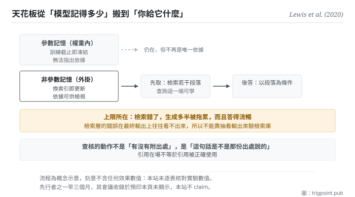

Canonical: https://trigpoint.pub/zh-Hant/collections/software-systems-architecture/retrieval-augmented-generation-lewis-2020  
Captured: 2026-11-02T21:28:01.380910+08:00

> 公開理論閱讀鏡像。驗證層及 Lab 案例請到原站閱讀。

一組問答裡，答案不在任何取回段落時，仍有一成多答對。

# 檢索增強生成

Retrieval-Augmented Generation (RAG) · Lewis et al. (2020)

摘要已核 ✓  
機器學習 · 外部證據  
先讀：單一真相來源

## 三句講透

把模型的記憶拆成兩層：壓在權重裡的，與生成當下才去取的。  
知識因此可以更新、取回的依據可以檢視，幻覺的面收窄。  
但品質的天花板也跟著搬家：從模型記得多少，變成你的檢索庫有多好。

<strong>圖 1</strong> · 把記憶分成兩層：壓在權重裡的那一層無法更新也無法指出依據，掛在外面的那一層可以換、可以檢視。  
權重裡那一層仍在，但不再是作答的唯一依據。  
生成時先取後答。  
下方標出上限所在：品質的天花板從模型記得多少，變成檢索庫有多好與檢索器準不準。

## 一、發生什麼事

在論文報告的一組開放領域問答中，就算取回的段落都沒有答案，模型還是答對了一成多。純參數的生成模型把知識封在權重裡，這帶來三個結構性弱點：知識<strong>過期</strong>（訓練截止就凍結）、<strong>不可溯源</strong>（無法指出答案的依據）、以及<strong>在分佈外仍然高信度地生成</strong>。

這篇 2020 年的論文的做法是把記憶分兩層：參數記憶（權重）之外，再掛一層<strong>非參數記憶</strong>，一個生成當下才去檢索的外部文本庫[\[1\]](#reference-note-1)。流程是先取後答：把問題轉成檢索，取回若干段落，再讓生成以那些段落為條件作答。原始設計裡檢索器與生成器一起訓練：文件那一端的編碼與索引固定不動，問題那一端的編碼與生成器一起微調。所以檢索這一步有一部分是可學的，不只是外掛。

三個弱點因此各有處置：知識更新變成換索引而不必重訓；取回的段落可以拿出來檢視（論文把「標示出處」列為純參數模型的未解問題，並以此作為接上外部記憶的理由；原模型並不輸出引用）；生成的分佈被外部證據收窄。

但上限也要講清楚[\[4\]](#reference-note-4)：<strong>檢索層自己弱的話，生成多半會被拖累。</strong> 不是必然照錯：論文報告過，在一組開放領域問答上，答案不在任何取回段落時仍有一成多答對，權重裡那一層會補位。所以品質的天花板從「模型記得多少」搬到「檢索庫有多好、檢索器準不準」。這不是消滅了知識問題，是把它外部化：而外部化的好處是它變得<strong>可以被治理</strong>（你能檢查、能更新、能指定範圍），不是它消失了。

歸屬有兩處要說。這篇把自己的做法命名為檢索增強生成，一般以它為這個術語的出處；<strong>先行者之一</strong>是 2020 年 2 月另一篇把檢索增強放在預訓練階段的論文，早它三個月[\[3\]](#reference-note-3)；這篇自己的引言把它與一篇 2019 年的檢索式問答模型並列，稱兩者為近期提出、結合遮罩語言模型與可微檢索器的模型[\[1\]](#reference-note-1)。另外，這篇的會議收錄本站標為<strong>次級</strong>：那個資訊來自預印本頁面的自述附註，不是會議官方紀錄[\[2\]](#reference-note-2)；而 2 月那篇的會議收錄在其預印本頁<strong>沒有顯示，所以本站不 claim</strong>[\[3\]](#reference-note-3)。這兩個決定看起來吹毛求疵，但它們正是本站的做法：能查到什麼就說什麼。

<strong>署名要給對：</strong>該架構與其命名歸 Lewis 等十二位作者（2020，該預印本第一版 5 月 22 日；一般以此為術語出處）[\[1\]](#reference-note-1)；<strong>先行者之一是 2020 年 2 月那篇把檢索增強放在預訓練階段的論文</strong>（早三個月）[\[3\]](#reference-note-3)；同篇引言另並列一篇 2019 年的檢索式問答模型[\[1\]](#reference-note-1)。會議收錄之標示為次級，且 2 月那篇之會議收錄本站不 claim[\[2\]](#reference-note-2)[\[3\]](#reference-note-3)。三段要分開署名。

## 二、為什麼這對你重要

你大概已經在用這個模式，而且用的是它最弱的形態。

把檔案丟給模型、讓它讀完再回答，那就是檢索增強的手工版。它有效，而它的效力完全取決於你丟了什麼進去。這頁要你把注意力從「怎麼問」移到<strong>「取什麼給它」</strong>，因為後者才是天花板。

三件事直接可用。

<strong>第一，先建可信的那一層，再談問法。</strong> 大部分人花力氣調整問法，而問法能改善的是表達，不是依據。如果你要它回答的東西依賴一批特定的事實，那批事實得先存在、被整理過、而且你知道它們對。

<strong>第二，引用在場不等於引用被正確使用。</strong> 這是本頁最實用的一句。模型可以附上一份真實存在的來源，同時說出那份來源沒有說的話。查核的動作不是「有沒有附出處」，是<strong>「這句話是不是那份出處說的」</strong>。這一點與本書架最後一頁直接相接。

<strong>第三，這個做法對不需要外部知識的任務增益有限</strong>[\[4\]](#reference-note-4)。純推理、風格改寫、結構重排這類任務，掛檢索未必有幫助，還可能引入無關內容。判斷方法很簡單：這個任務答錯的時候，是因為它不知道某件事，還是因為它想錯了。前者掛檢索有用，後者沒用。

## 常見誤讀

所屬頁核驗：摘要已核 ✓ · 本頁版次 v2 · 內容最後修訂 2026-10-25

- 常見轉述「接了檢索就不會產生幻覺」：檢索錯了，生成多半會被拖累，而且答得流暢。這個做法把知識問題外部化，不消滅它。品質的瓶頸有相當部分移到檢索庫與檢索器。
- 常見轉述「有引用就代表有根據」：引用在場不等於引用被正確使用。答案可以附一份真實的來源，同時說出那份來源沒有說的話。

## 修正記錄

- 本站對這篇的會議收錄標為次級：該資訊來自預印本頁面的自述附註，非會議官方紀錄。先行者之一（2020 年 2 月那篇）的會議收錄在其預印本頁未顯示，本站不 claim。
- 2026-10-12 · 本頁前版有三處超出原論文，已依全文改正。其一，前版說檢索錯了生成就會照著錯答；論文 §4.1 報告答案不在任何取回文件時仍有 11.8% 答對，改為「多半受拖累」。其二，前版說答案可以附出處；原模型並不輸出引用，論文說的是取回的知識可以檢視，故改為取回段落可供檢視。其三，前版說檢索器與生成器一起微調；原設計中文件編碼器與索引固定，只微調查詢端與生成器。另，「對不需外部知識的任務增益有限甚至為負」改為論文附錄的初步觀察，刪去「甚至為負」。

## 參考文獻

<strong>如何閱讀來源註記</strong> 「書目經…核對」指作者、年份、題名與出版項已確認；不代表該來源的主張已被核對。「與摘要一致」指主張與論文摘要相符；不含逐句對照全文。「對照全文核實」指主張已與來源文本本身比對。 定義版本：2026-09-20。

- \[1\] Lewis, P. et al. (2020). Retrieval-Augmented Generation for Knowledge-Intensive NLP Tasks. arXiv:2005.11401.
- \[2\] Lewis, P. et al. (2020). Retrieval-Augmented Generation for Knowledge-Intensive NLP Tasks. arXiv:2005.11401.
- \[3\] Guu, K., Lee, K., Tung, Z., Pasupat, P., & Chang, M.-W. (2020). REALM: Retrieval-Augmented Language Model Pre-Training. arXiv:2002.08909.
- \[4\] 編輯註，無外部來源；全文見正文註 \[4\]。

## 知識圖譜

- [<em>應用於 ▸</em>生成幻覺（Hallucination in NLG）](llm-hallucination-ji-2023.md)

引用格式：Trigpoint，〈檢索增強生成〉，trigpoint.pub/zh-Hant/collections/software-systems-architecture/retrieval-augmented-generation-lewis-2020 · © Strategitect Limited. · 內容最後修訂 2026-10-25

## 來源註記

**[1]** Lewis, P., Perez, E., Piktus, A., Petroni, F., Karpukhin, V., Goyal, N., Küttler, H., Lewis, M., Yih, W., Rocktäschel, T., Riedel, S., & Kiela, D. (2020). Retrieval-Augmented Generation for Knowledge-Intensive NLP Tasks. arXiv:2005.11401. 書目經官方記錄核對。主張已對照全文核實。預印本第一版 2020-05-22，共 12 位作者。摘要把這套做法描述為結合參數化與非參數化記憶的語言生成；摘要把「為決策標示出處」列為純參數模型的未解問題，並以此作為接上外部記憶的理由。原始設計中檢索器與生成器一起訓練，但文件編碼器與索引固定，只微調查詢端與生成器（該篇 §2.4）。

**[2]** 會議收錄之標示：該預印本頁面自述收錄於 2020 年一場機器學習頂會。本站標為次級：這是預印本頁的附註，不是會議官方紀錄。

**[3]** Guu, K., Lee, K., Tung, Z., Pasupat, P., & Chang, M.-W. (2020). REALM: Retrieval-Augmented Language Model Pre-Training. arXiv:2002.08909. 書目經官方記錄核對。要旨與摘要一致。先行者之一：預印本第一版 2020-02-10，把檢索增強放在預訓練階段，早於本頁所談那篇約三個月；本頁所談那篇的引言把它與一篇 2019 年的檢索式問答模型並列，本站因此不把它標為唯一的先行者。其會議收錄在預印本頁沒有顯示，本站刻意不 claim。

**[4]** 邊界：檢索錯時生成多半受拖累，屬推論，不是論文的結論；該篇 §4.1 另報告，在一組開放領域問答上，答案不在任何取回文件時仍有 11.8% 答對，參數記憶可補位。引用在場不等於引用被正確使用，亦屬推論（原模型不輸出引用）。對無需外部知識的任務增益有限，出自該篇附錄 H 的初步觀察，其原因原文屬推測。

---

[English](../../../en/collections/software-systems-architecture/retrieval-augmented-generation-lewis-2020.md) · [简体中文](../../../zh-Hans/collections/software-systems-architecture/retrieval-augmented-generation-lewis-2020.md)

[Index](../../README.md) · [Original page](https://trigpoint.pub/zh-Hant/collections/software-systems-architecture/retrieval-augmented-generation-lewis-2020) · [Citation and versions](../../../READING.md)

[Original SVG](assets/retrieval-augmented-generation-lewis-2020.svg) · Display copy adds a white background only.
