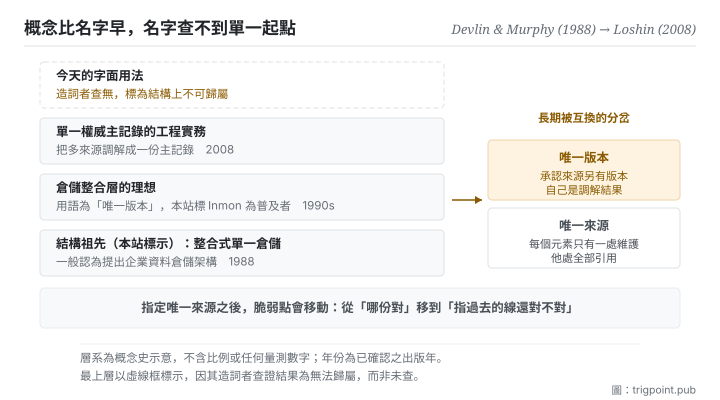

Canonical: https://trigpoint.pub/zh-Hant/collections/software-systems-architecture/single-source-of-truth-concept-history  
Captured: 2026-11-02T21:28:01.653706+08:00

> 公開理論閱讀鏡像。驗證層及 Lab 案例請到原站閱讀。

「唯一版本」承認別處還有版本，「只有一處」不承認。

# 單一真相來源

Single Source of Truth (concept history) · Devlin & Murphy (1988) → Loshin (2008)

書目已核 ✓  
Lab 實測 ✓  
軟體架構 · 資料治理  
先讀：不重複原則

## 三句講透

單一真相來源說的是：每個元素只在一處被維護，其他地方全部引用它。  
它是結構選擇，不是地點選擇。  
而它最容易失效的地方不是那個唯一來源，是指向它的那些引用。

<strong>圖 1</strong> · 四層概念史由下往上：1988 年的整合式倉儲是本站標出的結構祖先，其後是承認他處另有版本的倉儲理想，再上是把多來源調解成單一主記錄的工程實務，最上是今天的字面用法。  
右側標出那個關鍵分岔：承認他處另有版本，與真正只有一處，不是同一件事。

## 一、發生什麼事

談單一真相，有兩件事常被當成一件：保留一份調解出來的權威版本，與真正只在一處維護。這個概念的歷史比它的名字長很多，而名字比概念晚很多。

本站採為可追溯工程祖先的，是 1988 年一篇期刊論文，一般認為它提出了企業資料倉儲的架構[\[1\]](#reference-note-1)：把分散在各處的作業資料整合進單一倉儲，讓「哪一份才是對的」這個問題有答案。那篇論文解的是決策支援的資料一致性。

接下來的一段最容易被講錯。資料倉儲業界在 1990 年代已流傳「唯一版本的真相」這個說法；一般把它與 Inmon 一派的企業資訊工廠論述連在一起，但它不見於 Inmon 與 Kimball 早期資料倉儲著作的索引與目錄[\[2\]](#reference-note-2)。注意那個詞是「版本」。它承認一件事：作業系統那邊還有別的版本，倉儲只是調解出來的那一份。這跟「真正只有一處」在語義上不同，而兩者長期被互換使用。2008 年一本主資料管理的書，是把「調解成單一權威主記錄」寫成工程實務的代表著作之一[\[3\]](#reference-note-3)；至於「唯一版本的真相」作為書名，2006 年已見於另一本客戶資料整合的書[\[4\]](#reference-note-4)。

而今天軟體架構意義下的字面術語，<strong>查無單一造詞者</strong>[\[5\]](#reference-note-5)。它是社群泛化出來的用法，廣泛使用，沒有公認的起點。本站因此把它標為結構上不可歸屬，而不是硬給一個人。

概念本身在這段歷史裡穩定下來的形狀是這樣：指定一處為唯一維護點，其他位置全部引用而非複製，並把資料規範化到一個標準形式，使「哪份才對」不再是一個要問的問題。它的反面不是「有兩份」，而是「有兩份而且都可以被編輯」。

最後一件要說在段一的事：這條原則有一個明文的反對者。2022 年那本資料網格在第 2 章用一整節主張「不要期待單一真相來源」[\[6\]](#reference-note-6)，理由與規模有關。本書架把那一頁放在最後，讓它回頭跟這一頁對打。

<strong>署名要給對：</strong>結構祖先，本站歸 Devlin 與 Murphy（1988，期刊論文）[\[1\]](#reference-note-1)；「唯一版本的真相」在 1990 年代的資料倉儲業界已有流傳，一般與 Inmon 一派連在一起，但此詞不見於他與 Kimball 早期資料倉儲著作的索引與目錄[\[2\]](#reference-note-2)，本站因此把他標為普及者，不標為造詞者；該用語用作書名，例見 Dyché 與 Levy（2006）[\[4\]](#reference-note-4)；把調解成單一主記錄寫成工程實務的代表著作，舉 Loshin（2008）[\[3\]](#reference-note-3)。今天字面術語的造詞者<strong>無法歸屬</strong>，本站標為結構上不可得[\[5\]](#reference-note-5)。四段要分開署名：把整條線壓成「某某在某年提出單一真相來源」，會一次弄錯詞、人與年份。

## 二、為什麼這對你重要

你手上大概有一份「哪個是最新版」的問題，只是它不叫這個名字。

一份判準的最新版在哪裡？如果答案是「在我腦裡，另外三處是舊的抄本」，那你已經在維護四份。原則的做法是把那三處改成連結，不是把它們刪掉。差別在於：刪掉會讓人再抄一次，連結會讓人跳過去。

但本頁真正要你帶走的不是這件事，是它的<strong>失效形狀</strong>。指定唯一來源之後，系統的脆弱點會<strong>移動</strong>：從「哪份是對的」移到「指過去的那條線還對不對」。而後者的失效是安靜的，因為那條線看起來一直在。

這件事在使用模型的時候放大得很快。你把一份規格指定為準，然後在十個地方寫「依規格辦」。半年後規格改了名、搬了位置、或者其中一段被拆到另一份文件裡。那十處引用不會報錯，它們只會指向一個不再說同一件事的地方。而模型讀到那些引用時，會很配合地照著它找到的東西做。

所以這頁給的實務只有兩問。第一，這個元素的唯一維護點在哪，講得出來嗎。第二，<strong>指過去的那些線，上次驗是什麼時候。</strong> 第二問比第一問難答，也比第一問重要。

## 常見誤讀

所屬頁核驗：書目已核 ✓ · 內容最後修訂 2026-10-25

- 常見轉述「單一真相來源是 1992 年那本資料倉儲經典提出的」：沒有證據顯示該書用過這個字面術語；一篇業界文章指出，連較接近的「唯一版本的真相」都不見於該書的索引與目錄。「唯一版本的真相」語義也不同（承認他處另有版本）。今天的字面術語查無單一造詞者；「唯一版本的真相」則在 2006 年已有一本客戶資料整合的書以它為書名。要用哪個詞、歸給誰，兩件都要分開講。
- 常見轉述「做到單一真相就是把資料集中到一個資料庫」：原則講的是每個元素指定一處維護、他處引用，這是結構決定，不是拓樸決定。分散而同步的系統同樣可以滿足它。

## 參考文獻

<strong>如何閱讀來源註記</strong> 「書目經…核對」指作者、年份、題名與出版項已確認；不代表該來源的主張已被核對。「對照全文核實」指主張已與來源文本本身比對。 定義版本：2026-09-20。

- \[1\] Devlin, B. A. & Murphy, P. T. (1988). An architecture for a business and information system. IBM Systems Journal, 27(1), 60–80.
- \[2\] Smith, S. J. (2018, June 5). Single Version of the Truth - Not Optional. Eckerson Group.
- \[3\] Loshin, D. (2008). Master Data Management. Morgan Kaufmann / OMG Press. ISBN 978-0-12-374225-4.
- \[4\] Dyché, J. & Levy, E. (2006). Customer Data Integration: Reaching a Single Version of the Truth. Wiley. ISBN 978-0-471-91697-0.
- \[5\] 編輯註，無外部來源；全文見正文註 \[5\]。
- \[6\] Dehghani, Z. (2022). Data Mesh: Delivering Data-Driven Value at Scale. O'Reilly. Chapter 2.

## 知識圖譜

- [<em>對照 ▸</em>微服務（Microservices）](microservices-lewis-fowler-2014.md)
- [<em>對照 ▸</em>CAP 定理（CAP Theorem）](cap-theorem-brewer-2000.md)
- [<em>對照 ▸</em>資料網格（Data Mesh）](data-mesh-dehghani-2022.md)

引用格式：Trigpoint，〈單一真相來源〉，trigpoint.pub/zh-Hant/collections/software-systems-architecture/single-source-of-truth-concept-history · © Strategitect Limited. · 內容最後修訂 2026-10-25

## 來源註記

**[1]** Devlin, B. A. & Murphy, P. T. (1988). An architecture for a business and information system. IBM Systems Journal, 27(1), 60–80. DOI 10.1147/sj.271.0060. 書目經官方記錄核對。一般認為這篇論文提出了企業資料倉儲的架構：把分散的作業資料整合進單一倉儲。本站採為此概念可追溯的工程祖先。

**[2]** Smith, S. J. (2018, June 5). Single Version of the Truth - Not Optional. Eckerson Group. 主張已對照全文核實。作者自述約 1995 年在商業智慧業界接觸到「唯一版本的真相」這個說法，並指出它不見於 Kimball 與 Inmon 早期資料倉儲著作的索引與目錄。一般把這個詞與 Inmon 一派的企業資訊工廠論述連在一起；本站把 Inmon 標為普及者，不標為造詞者。這是本站的標示，本文沒有談誰造詞、誰普及。

**[3]** Loshin, D. (2008). Master Data Management. Morgan Kaufmann / OMG Press. ISBN 978-0-12-374225-4. 書目經官方記錄核對。把多來源調解成單一權威主記錄寫成工程實務的代表著作之一。

**[4]** Dyché, J. & Levy, E. (2006). Customer Data Integration: Reaching a Single Version of the Truth. Wiley. 書目經官方記錄核對。該用語作為書名出現於此，非 Loshin。

**[5]** 字面術語（今天軟體架構意義下的用法）本站查無單一造詞者，標為無法歸屬：廣泛使用，沒有公認的起點。

**[6]** Dehghani, Z. (2022). Data Mesh: Delivering Data-Driven Value at Scale. O'Reilly. 書目經官方記錄核對。第 2 章〈領域所有權原則〉有一節題為「擁抱最相關的領域資料：不要期待單一真相來源」。見本站資料網格頁。

---

[English](../../../en/collections/software-systems-architecture/single-source-of-truth-concept-history.md) · [简体中文](../../../zh-Hans/collections/software-systems-architecture/single-source-of-truth-concept-history.md)

[Index](../../README.md) · [Original page](https://trigpoint.pub/zh-Hant/collections/software-systems-architecture/single-source-of-truth-concept-history) · [Citation and versions](../../../READING.md)

[Original SVG](assets/single-source-of-truth-concept-history.svg) · Display copy adds a white background only.
