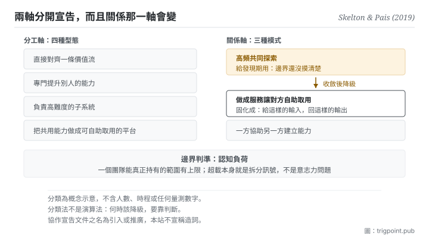

Canonical: https://trigpoint.pub/zh-Hant/collections/software-systems-architecture/team-topologies-skelton-pais-2019  
Captured: 2026-11-02T21:28:02.044585+08:00

> 公開理論閱讀鏡像。驗證層及 Lab 案例請到原站閱讀。

兩個團隊要高頻共探，還是一方做成服務讓另一方自助？

# 團隊拓撲

Team Topologies · Skelton & Pais (2019)

書目已核 ✓  
軟體架構 · 接口與認知負荷  
先讀：康威定律

## 三句講透

團隊之間的關係要像介面一樣被明確宣告，而不是靠默契。  
邊界的判準是認知負荷：一個團隊能真正持有的範圍有上限。  
而關係本身預期會變：發現期需要高頻共探，收斂之後應該降級。

<strong>圖 1</strong> · 左邊是分工軸的四種型態，右邊是關係軸的三種模式。  
書的主張是兩軸要分開宣告，而且關係那一軸預期會隨時間演化：發現期用高頻共探，收斂之後降級為服務式消費。  
底部是邊界判準：一個團隊能真正持有的範圍有上限，超載本身就是拆分訊號。

## 一、發生什麼事

兩個團隊該密切共探，還是一方把成果做成服務讓另一方自取，答案會隨階段改變。這本書的起點就是上一頁：既然系統結構會鏡像組織溝通結構，那麼<strong>刻意設計團隊邊界</strong>就是一種架構手段[\[1\]](#reference-note-1)。

它給的第一件事是分工軸的四種型態：直接對齊價值流的、專門去提升別人能力的、負責高難度子系統的、以及把共用能力做成平台供人自助取用的[\[1\]](#reference-note-1)。這四種不是位階，是<strong>職能形態</strong>。

第二件事是關係軸的三種模式：高頻共同探索、把成果做成服務讓對方自助取用、以及一方協助另一方建立能力[\[1\]](#reference-note-1)。這一軸是本書真正的貢獻。

第三件事是它要求把關係<strong>寫下來</strong>：每個團隊發布一份「怎麼跟我協作」的顯式文件[\[1\]](#reference-note-1)。這件事的名字歸屬要小心：本站只說此書把那個詞作為核心做法提出並推廣，不宣稱是兩位作者所造[\[2\]](#reference-note-2)。

第四件事是邊界判準：<strong>認知負荷</strong>。一個團隊能真正持有的範圍有上限，超載本身就是拆分訊號[\[1\]](#reference-note-1)。兩位作者在出版社網站的文章中，把這個概念的界定歸於 Sweller 1988 年的認知負荷研究[\[4\]](#reference-note-4)（書內如何引用，本站未核）。

而最容易被跳過、也最有用的一件是：<strong>互動模式預期會演化</strong>[\[3\]](#reference-note-3)。共探是給發現期用的，一旦邊界摸清楚了，這段關係應該降級為服務式消費。關係的升降級，就是組織版的架構重構。

<strong>署名要給對：</strong>四種型態、三種互動模式與整套組織設計語彙歸 Skelton 與 Pais（2019；第二版 2025）[\[1\]](#reference-note-1)；協作宣告文件之名，本站標為此書<strong>引入或推廣，不宣稱造詞</strong>[\[2\]](#reference-note-2)；團隊關係會改變為作者明文[\[3\]](#reference-note-3)；認知負荷之理論根，兩位作者歸於 Sweller 1988 年的研究[\[4\]](#reference-note-4)。組織與結構同構之前提歸上一頁的康威定律，不歸本書。四段要分開署名。

## 二、為什麼這對你重要

把「團隊」換成「你的每一條線」，這頁就落地了：不管那條線後面是別人、是你自己的另一個角色，還是一個模型。

第一個可搬的是那份宣告文件。你跟一條線協作時，對方（或未來的你）需要知道的其實就那幾件：這條線負責什麼、不負責什麼、要它做事該怎麼給、什麼情況要先問你。把這幾件寫下來，你就有了一份介面文件。<strong>大部分協作摩擦不是能力問題，是這份文件不存在，於是每次都要重新談。</strong>

第二個可搬的更反直覺，也是本頁的標題那句：<strong>協作不是越緊密越好。</strong> 三種模式各有其時：一件事剛開始、邊界還沒摸清楚，你需要高頻來回；但一旦摸清楚了，繼續高頻來回就是浪費：那時該做的是把它固化成「給定這樣的輸入，回這樣的輸出」，然後你不再參與過程。

這一點在跟模型協作時特別明顯。你在探索一個新任務時，會來回二十輪；那二十輪的價值是<strong>找出邊界</strong>。而多數人的問題是：找到邊界之後，還在繼續來回二十輪，因為沒有把它固化。這頁的說法是，那不是勤奮，是關係沒有降級。

第三個是認知負荷那條線。當你發現自己持有的範圍已經到「每次切換都要重新載入一遍」的程度，那不是意志力問題，是範圍超過上限了。上限是判準，不是缺點。

## 常見誤讀

所屬頁核驗：書目已核 ✓ · 內容最後修訂 2026-10-25

- 常見轉述「Team API 是那兩位作者造的詞」：本站只能說此書把它提出並推廣，不宣稱造詞，也不否認。
- 常見轉述「這是一套實證定律」：這是業界出版的組織設計分類法，非同儕審查理論。當語彙用可以，當定律用不行。
- 常見轉述「四種型態就是四種團隊，照套即可」：分類法不是演算法。何時該把一段關係從共探降級為服務式消費，仍是判斷題。

## 參考文獻

<strong>如何閱讀來源註記</strong> 「書目經…核對」指作者、年份、題名與出版項已確認；不代表該來源的主張已被核對。「對照全文核實」指主張已與來源文本本身比對。 定義版本：2026-09-20。

- \[1\] Skelton, M. & Pais, M. (2019). Team Topologies: Organizing Business and Technology Teams for Fast Flow. IT Revolution Press.
- \[2\] 編輯註，無外部來源；全文見正文註 \[2\]。
- \[3\] Skelton, M. & Pais, M. (2019). Team Topologies: Organizing Business and Technology Teams for Fast Flow. IT Revolution Press.
- \[4\] Skelton, M. & Pais, M. (2021). Team Cognitive Load. IT Revolution. Published 19 January 2021.
- \[5\] Skelton, M. & Pais, M. (2025). Team Topologies (2nd ed.): Organizing Business and Technology for Fast Flow of Value. IT Revolution Press.

## 知識圖譜

- [<em>前置 ▸</em>康威定律（Conway's Law）](conways-law-conway-1968.md)
- [<em>應用於 ▸</em>微服務（Microservices）](microservices-lewis-fowler-2014.md)

引用格式：Trigpoint，〈團隊拓撲〉，trigpoint.pub/zh-Hant/collections/software-systems-architecture/team-topologies-skelton-pais-2019 · © Strategitect Limited. · 內容最後修訂 2026-10-25

## 來源註記

**[1]** Skelton, M. & Pais, M. (2019-09-17). Team Topologies: Organizing Business and Technology Teams for Fast Flow. IT Revolution Press. 書目經官方記錄核對。初版 2019 年 9 月 17 日出版；第二版 2025 年 9 月 23 日出版，副題改為 Organizing Business and Technology for Fast Flow of Value（見參考文獻 [5]）。四種團隊型態與三種互動模式的名稱，已對照兩位作者的網站核對；書的內文本站未核。

**[2]** Team API 之歸屬：本站只說此書把它作為核心做法提出並推廣；不宣稱兩位作者造詞，也不否認。

**[3]** 兩位作者的網站明文寫道，團隊之間的關係會隨新目標設定與新發現而改變。本站據此把關係軸講成可升降級，而非固定編組。

**[4]** Skelton, M. & Pais, M. (2021-01-19). Team Cognitive Load. IT Revolution. 書目經出版社記錄核對。主張已對照全文核實。兩位作者在出版社網站的文章中，把認知負荷的界定歸於心理學家 Sweller 1988 年的研究，並據此談團隊層級的認知負荷。書內如何引用該理論，本站未核。

---

[English](../../../en/collections/software-systems-architecture/team-topologies-skelton-pais-2019.md) · [简体中文](../../../zh-Hans/collections/software-systems-architecture/team-topologies-skelton-pais-2019.md)

[Index](../../README.md) · [Original page](https://trigpoint.pub/zh-Hant/collections/software-systems-architecture/team-topologies-skelton-pais-2019) · [Citation and versions](../../../READING.md)

[Original SVG](assets/team-topologies-skelton-pais-2019.svg) · Display copy adds a white background only.
